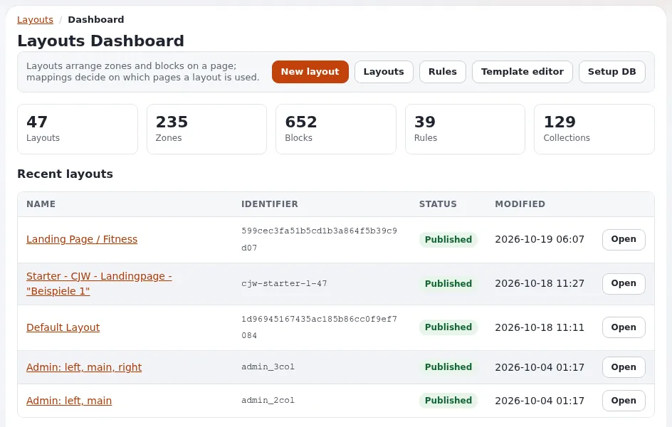
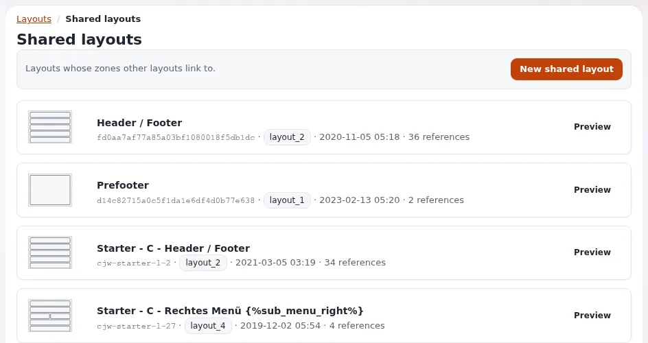
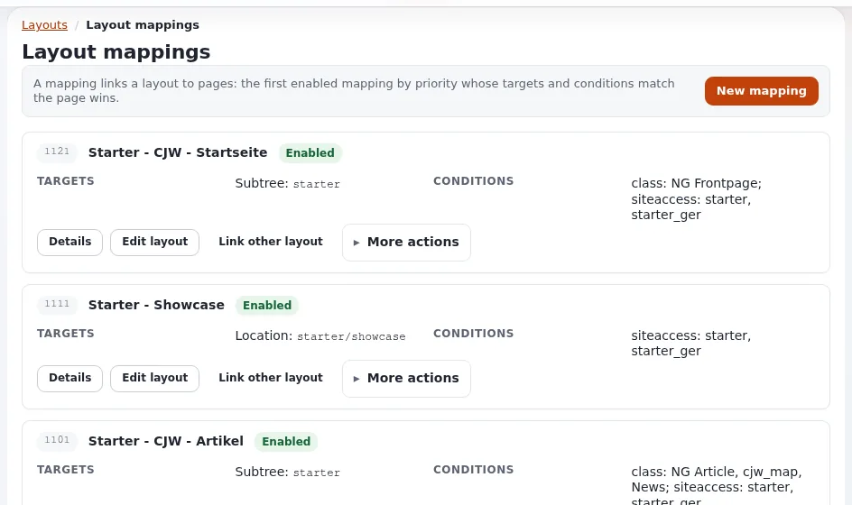

# Demo script: Exponential Layouts

This page is for creators who show the page builder of Exponential. Exponential Layouts brings "the Netgen Layouts
concept to the Exponential kernel" (`README.md`, quoted in
[Brand and naming rules](../business/brand-and-naming-rules.md#other-companies-and-products)); credit Netgen when you
show it. The script runs about eight minutes and works on a copy of a layout, so nothing on your demo site changes
unless you publish. Every click comes from [The layouts editor](../layouts-editor.md) and
[In action: the layouts editor](../admin-tour.md#in-action-the-layouts-editor).

Sign in with an account whose role may work with layouts: the **Layouts** tab is shown only to such roles. The
current editor belongs to the 6.0.15 development line; say which version you show.

## Contents

1. [The words you will use](#the-words-you-will-use)
2. [Part 1: the dashboard and a new layout (1 minute 30)](#part-1-the-dashboard-and-a-new-layout-1-minute-30)
3. [Part 2: blocks (3 minutes)](#part-2-blocks-3-minutes)
4. [Part 3: shared layouts and linked zones (1 minute 30)](#part-3-shared-layouts-and-linked-zones-1-minute-30)
5. [Part 4: publish or discard, and mappings (2 minutes)](#part-4-publish-or-discard-and-mappings-2-minutes)
6. [What not to claim](#what-not-to-claim)

## The words you will use

| Word | Meaning, as the help defines it |
|---|---|
| Layout | The plan of a page |
| Zone | An area of the layout, such as *header*, *main* or *footer*; the layout type decides which zones exist |
| Block | One part inside a zone: a title, rich text, an image, a list, a gallery ... |
| Mapping (rule) | Decides on which pages a layout is used |
| Shared layout | Holds blocks many pages use, such as a header and footer; other layouts link to it |

Source: [Layouts, zones and blocks](../layouts-editor.md#layouts-zones-and-blocks).

## Part 1: the dashboard and a new layout (1 minute 30)

1. Open the **Layouts** tab. Say: "The **Layouts Dashboard** shows the numbers of layouts, zones, blocks and mappings,
   and the recently changed layouts."
2. Press **New layout**, choose a **Layout type** (for example *2 columns*), give it a **Name**, press
   **Create layout**. Say: "The editor opens with the empty zones of that type."
3. Point at the four areas: the name and buttons at the top, **Add a block** on the left, the zones in the middle, the
   properties on the right (*Select a block to access its properties.*).



## Part 2: blocks (3 minutes)

1. Press **Add a block** (the plus button). Show the groups: **Basic**, **Components**, **Listing**, **Gallery**,
   **Containers**, **Placeholders**.
2. Drag a **Title** block into a zone. Click it: it is outlined in blue and its settings appear in two tabs.
3. In **Content**, type a title. Say: "Changes show in the block at once."
4. Open **Design**. Say: "How the block looks: for example the view type and style."
5. Open the menu with three dots on the block, choose **Duplicate block**.
6. Drag the copy by its header bar into another zone. Then **Delete block** on it.

## Part 3: shared layouts and linked zones (1 minute 30)

Switch to an existing layout that has a linked zone (**Layouts**, **Open**).

1. Point at a zone with a red dashed border and hatched blocks. Say: "This zone is linked to a zone of a shared
   layout. The header and footer live once, and many layouts link to them instead of copying them."
2. Say: "Linked blocks cannot be changed here; you change them by opening the shared layout itself."
3. Press **Link zone with shared layout zone** at the bottom left. Show step 1 (**Link zone** on each zone) and say what
   step 2 asks for: the shared layout and its zone. Press **Back**.



## Part 4: publish or discard, and mappings (2 minutes)

1. Open the menu with three dots at the top and show **Publish and continue editing** and **Save draft and close**.
2. Press **Discard** and confirm in the **Discard changes** dialog. Say: "I worked on a draft; the published layout
   is exactly as it was."
3. Back on the dashboard, open **Rules**. Point at one mapping's **Targets** and **Conditions**. Say: "The first
   enabled mapping by priority whose targets and conditions match a page wins."
   ([Which pages use a layout](../layouts-editor.md#which-pages-use-a-layout))

If you publish on camera and the editor asks whether to clear caches, choose **Clear caches** so the change shows.



## What not to claim

| Do not say | Say instead |
|---|---|
| "Every Exponential product has this editor." | "Exponential Platform DXP does not ship a layouts editor." ([Knowing the product family](../advocates/knowing-the-product-family.md#common-mix-ups)) |
| "It's Netgen Layouts." | "It brings the Netgen Layouts concept to the Exponential kernel." |
| "Netgen made this for Exponential." | Credit the concept only; the sources do not say Netgen built the port |
| "Anyone can change any page." | "Roles decide who sees the Layouts tab; mappings decide whole parts of the site." |

```text
DESCRIPTION BLOCK
Shows Exponential Layouts in Exponential <version>, on my own test installation.
Exponential Layouts brings the Netgen Layouts concept to the Exponential kernel.
The layouts editor: <link to "The layouts editor">
Walk-through with screenshots: <link to "A tour of the administration, In action: the layouts editor">
```

## Related pages

- [The layouts editor](../layouts-editor.md)
- [Talking points: Exponential Layouts](../advocates/talking-points-exponential-layouts.md)
- [Demo script: editor tour](demo-script-editor-tour.md)
- [Free documentation](../free-documentation.md): this page is free to copy, translate and improve under the GNU FDL 1.3.
