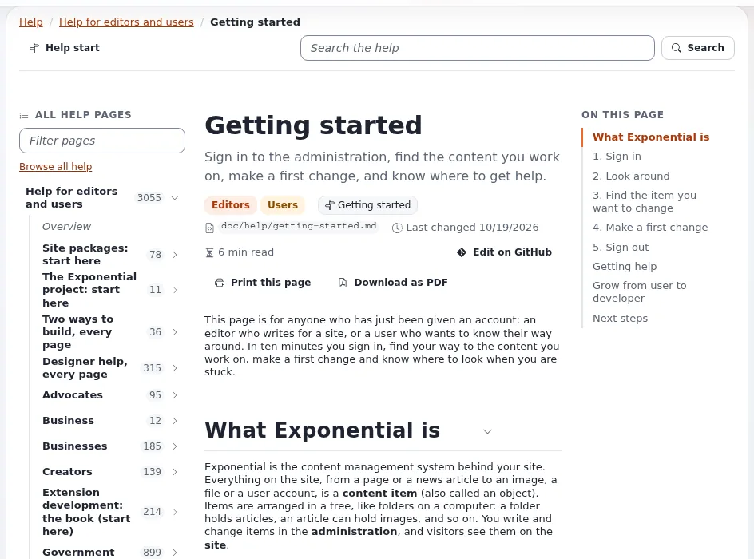

# Story: the help system

This page is for journalists and creators who write about documentation and usability. The help you are reading is
itself a feature of the 6.0.15 line: the project put its own repository documentation inside the administration.

## Contents

1. [The story in one paragraph](#the-story-in-one-paragraph)
2. [What is new, and when](#what-is-new-and-when)
3. [Facts you can print](#facts-you-can-print)
4. [What not to claim](#what-not-to-claim)
5. [Angles and headline ideas](#angles-and-headline-ideas)
6. [Who to ask](#who-to-ask)

## The story in one paragraph

Most software keeps its documentation on a separate website that drifts away from the version you run. Exponential's
help system shows the documentation that ships with the installed version: every git-tracked Markdown file under
`doc/`, rendered with headings, tables, callouts and highlighted code, searchable, filtered by audience (editors,
administrators, developers, site users and many more, now including the press), and opened in context by a **Help**
button on every administration page ([Help system](../../features/6.0/help-system.md)). The pages are free
documentation under the GNU FDL ([Story: free documentation](story-free-documentation.md)).

## What is new, and when

| What | When | Source |
|---|---|---|
| The help system in the administration | October 2026, in the 6.0.15 line (in development) | [October 2026](../../history/2026/2026-10.md), [6.0.15 changelog](../../../changelogs/6.0/6.0.15.md) |
| Help pages written as content in the database, phase 1 | 6.0.15 line | [Help as content](../../features/6.0/help-content.md) |

## Facts you can print

| Fact | Source |
|---|---|
| A help dashboard with search, help per audience, categories, featured pages, recent changes and how to report an error | [Help system, In short](../../features/6.0/help-system.md#in-short) |
| Help pages show every git-tracked Markdown and text file under `doc/`, with a table of contents and a link to the file on GitHub | same |
| Search by title, headings and text, with filters for audience, category and type; `/` focuses the search field | same |
| A **Help** button in the header opens the page for the current module and view, or the dashboard | same |
| **Report an error** prefills an issue with diagnostics, "never passwords, keys, database hosts or personal data" | same |
| Pages can be printed and exported as PDF | [Help system, Print and PDF](../../features/6.0/help-system.md#print-and-pdf) |
| Extensions can contribute their own help | [Help from extensions](../../features/6.0/help-system.md#help-from-extensions) |

## What not to claim

| Do not say | Say instead |
|---|---|
| "AI-generated documentation" | The help shows the project's written documentation |
| "Available in all languages" | The help shows the documentation's language; check [Help system, Languages and accessibility](../../features/6.0/help-system.md#languages-and-accessibility) |
| "Released" | Part of the 6.0.15 line, in development |

## Angles and headline ideas

- "Documentation that ships with the version you run."
- "A CMS whose help is free to copy, translate and improve."
- "Help for the press, inside the product": this section is itself an example.

## Who to ask

7x, which leads development ([Press contacts](press-contacts.md)). To see the help yourself, install a demo
([Setting up a demo installation](setting-up-a-demo-installation.md)).

## Related pages

- [Story: free documentation](story-free-documentation.md)
- [Feature stories: index](feature-stories-index.md)
- [Help system](../../features/6.0/help-system.md)
- [Free documentation](../free-documentation.md): this page is free to copy, translate and improve under the GNU FDL 1.3.
