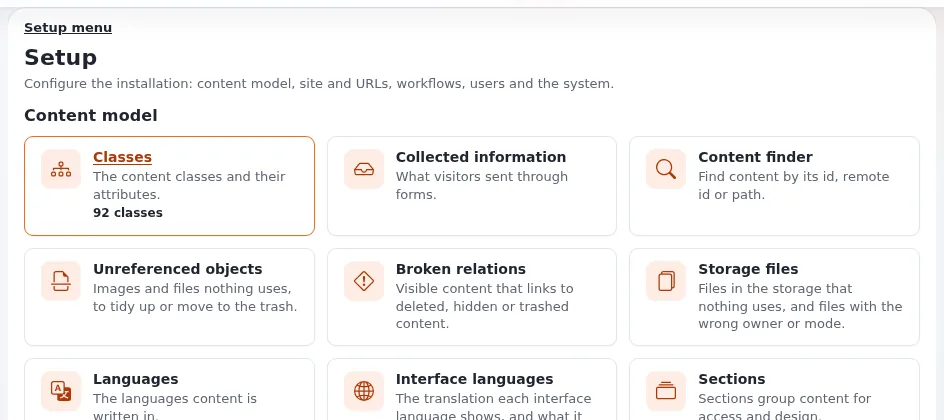

# Style and spelling for coverage

This page is for writers and sub-editors who want their copy to match how the project writes, or who need to decide
how to treat technical terms. Your house style wins where it differs; this page tells you what the project does and
why, so you can choose.

## Contents

1. [Spelling](#spelling)
2. [Names of products and features](#names-of-products-and-features)
3. [Interface terms](#interface-terms)
4. [Code, commands and files](#code-commands-and-files)
5. [Numbers, versions and dates](#numbers-versions-and-dates)
6. [Terms to explain for general readers](#terms-to-explain-for-general-readers)

## Spelling

The project writes **American English** in its interface and documentation: license (with an s), color, behavior,
organization, customize ([Brand and naming rules](../business/brand-and-naming-rules.md#language-and-spelling)).
Quote the project's text as written even if your house style is British; spell your own text as your house style
says.

## Names of products and features

| Write | Notes |
|---|---|
| Exponential | Capital E, no article |
| Exponential Velocity, Velocity | Product name, capitalized |
| Exponential Intelligence | Product name; not "Exponential AI" |
| Exponential Layouts, the layouts editor | Product name; the editor is a common noun |
| the help system, the help | Common nouns |
| admin4, admin3 | Lowercase design names as the project writes them |
| AdminUI | As written |
| the Content Security Policy, the audit trail | Feature names as common terms |

## Interface terms

Use the words the reader sees on screen. The project's own help style prefers interface terms such as "object",
"content class", "draft" and "trash" ([Brand and naming rules](../business/brand-and-naming-rules.md#language-and-spelling)).
Write names of menus and buttons as they appear, in bold if your style allows: **Setup**, **Send for publishing**,
**Edit on GitHub**.

## Code, commands and files

- Code identifiers, file names, package names and commands in code style if your medium has it: `eZContentObject`,
  `SECURITY.md`, `expai`, `./console exp:install`.
- Never translate or "correct" code names ([Why it is called Exponential](why-it-is-called-exponential.md)).
- Package names are lowercase as in `composer.json`.

## Numbers, versions and dates

| Item | Style |
|---|---|
| Versions | 6.0.14, without "v"; the "v" belongs to Git tags ([Version numbers in print](version-numbers-in-print.md)) |
| Counts | With the date they were counted ([Exponential by the numbers](exponential-by-the-numbers.md)) |
| Dates | As precise as the source: "1 January 2024", "December 2023", "2022" ([Verifying dates](verifying-dates.md)) |
| Speed figures | With their conditions: "0.36 ms per cached page" |

## Terms to explain for general readers

| Term | Plain explanation |
|---|---|
| Content management system (CMS) | Software for editing and publishing a website's content without programming |
| Content model, content class | The types of content a site has (article, event, product) and their fields |
| Open source, GPL | Anyone may use, study, change and share the code |
| Fork | A copy of a code base that someone continues separately |
| Siteaccess | One way into an installation: a site, a language or the administration |
| Multisite | Several websites run from one installation |
| Draft | A version not yet published |
| Web server | The program that answers a browser's requests |
| Right to left | Scripts such as Arabic and Hebrew, written from right to left |

More terms: [Glossary for journalists](glossary-for-journalists.md).

## Related pages

- [Brand and naming for media](brand-and-naming-for-media.md)
- [Naming quick reference for news editors](naming-quick-reference-for-editors.md)
- [Making your coverage accessible](making-your-coverage-accessible.md)
- [Free documentation](../free-documentation.md): this page is free to copy, translate and improve under the GNU FDL 1.3.
