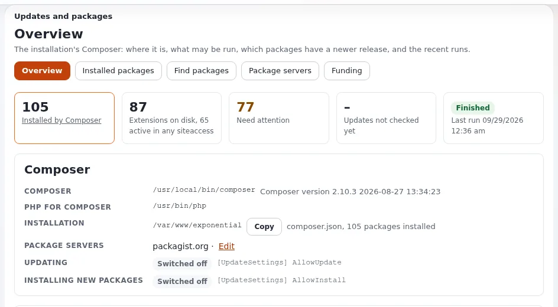

# The roadmap: what is planned and how to shape it

The project keeps its plans in two public places, both on Share Exponential and both linked from
[exponential.earth/roadmap](https://exponential.earth/roadmap):

| Roadmap | What it is | Address |
|---|---|---|
| **Official roadmap** | The plans of 7x and the project, product by product and resource by resource | <https://share.exponential.earth/roadmap> |
| **Community roadmap** | Feature requests from users, discussed in public; you sign in to add one, and submissions are moderated | <https://share.exponential.earth/community-roadmap> |

The community roadmap also holds feature requests from much older times of the code base, which the website keeps for
reference. It has an RSS feed, so you can follow new requests in a feed reader.

## What the official roadmap lists

The official roadmap, read in October 2026, covers the period **2025/Q4 to 2026/Q2**. In short, in this help's words:

### The products

| Product | Plans named on the roadmap |
|---|---|
| **Exponential 6.0.x** | Stabilization and fixes for PHP 8 warnings; more templates in the default installation's design to match its content classes; Smarty template language support in the kernel "under heavy consideration"; consolidating the free documentation of the past; video guides; a partner portal; PHP 8.6 support, estimated for 2026/Q3 |
| **Exponential Platform Nexus** | More Symfony bundles; testing and refining the default installation; getting-started documentation for developers; video guides; PHP 8.4 and 8.5 support |
| **Exponential Platform Legacy** and **Exponential Platform** | A default demo design bundle; testing the default installation; getting-started documentation; video guides; PHP 8.4 and 8.5 support |
| **Exponential Basic** | More advanced shop features (for example encryption of stored information); testing the default installation; documentation; video guides; PHP 8.4 and 8.5 support |

### The community websites

- **Documentation** ([doc.exponential.earth](https://doc.exponential.earth/)): a redesigned documentation portal, more
  coverage of the Platform products, and the wish to move today's static documentation pages into a CMS with
  comments. The roadmap invites people who share that goal to take part.
- **Exponential Projects** ([projects.exponential.earth](https://projects.exponential.earth/)): a possible redesign,
  more documentation, package management web services integrated with the Exponential 6 kernel through a
  Composer-based solution, and support for GitLab repositories.
- **eZpedia** ([ezpedia.exponential.earth](https://ezpedia.exponential.earth/)): more content for both Exponential 6
  and the Platform, and a shared sign-in with Share and Projects.
- **Share Exponential** ([share.exponential.earth](https://share.exponential.earth/)): a redesign, "share a site"
  announcements, and more ways to take part.

### Two calls for volunteers

The roadmap asks the community for help with two things that anyone with some experience can do:

1. **Composer packages for extensions.** Not every extension repository has a `composer.json` and a Packagist entry
   yet. Adding them makes those extensions installable with one command.
   [Contribute extensions back](../contribute-extensions-back.md#4-write-composerjson) shows what the file needs.
2. **Site packages.** The setup wizard installs site packages such as 7x Simple. The project wants to open the
   wizard's list of site packages to the community, so that users can publish their own. The roadmap asks
   interested people to write to the community address it gives (community at exponential dot earth);
   [Contribute your site package](../site-packages/contribute-your-site-package.md) shows the pull request route.

It also invites companies to [become partners](https://exponential.earth/partner/apply) and to
[sponsor 7x's development work](https://github.com/sponsors/se7enxweb) ([Give and donate](give-and-donate.md)).

## What has already been delivered

The roadmap names Exponential 6.0.10 as the current stable release. The repository has moved on since: 6.0.11 was
tagged on 30 December 2025, 6.0.12 on 10 February 2026, 6.0.13 on 18 April 2026 and 6.0.14 on 7 June 2026
(`git tag`), and 6.0.15 is in development. So read the roadmap's version numbers as a snapshot of when it was
written. Several of its items are visible in the repository today:

| Roadmap item | What the repository shows |
|---|---|
| PHP 8.4 and 8.5 support | Exponential 6.0.15 runs on PHP 8.0 to 8.5 ([Requirements](../../install/02-requirements.md)) |
| PHP 8.6 | `composer.json` already allows PHP up to 8.8 and the README names 8.6 as a goal; the roadmap's estimate was 2026/Q3 |
| Documentation consolidated | The documentation now lives in `doc/` of the repository and this help shows it in the administration ([Help system](../../features/6.0/help-system.md)), under the GNU FDL |
| Composer-based package management in the administration | **Setup > Updates and packages**, from the `ezupdate` extension, finds, checks and installs Composer packages from package servers ([Update with Git: Updates and packages](../update-with-git.md#3-update-the-extensions-with-updates-and-packages)) |

For everything that changed release by release, read the [6.0.15 changelog](../../changelogs/6.0/6.0.15.md) and
[the history](../../history/README.md). The changelog is the authoritative record; the roadmap is a statement of
intent.

## How to shape the roadmap

- **Ask for a feature**: sign in on Share Exponential and add it to the
  [community roadmap](https://share.exponential.earth/community-roadmap). Explain the problem it solves, not only the
  solution, and give enough detail for others to discuss it.
- **Report a missing piece in the software**: open an issue in
  [se7enxweb/exponential](https://github.com/se7enxweb/exponential/issues); for the project and its websites, in
  [exponential-community](https://github.com/se7enxweb/exponential-community/issues). The website's roadmap page also
  names GitHub as the place to request features.
- **Discuss it first**: the [forums](https://share.exponential.earth/forums), Telegram, Discord and Slack
  ([Community channels](community-channels.md)).
- **Build it**: a pull request moves a feature faster than any request
  ([Contribute to the project](contribute-to-the-project.md)).
- **Fund it**: sponsorship pays for the work on the roadmap ([Give and donate](give-and-donate.md)). Partners have
  their own way to take part ([Partners: roadmap participation](../partners/roadmap-participation.md)).

## Related pages

- [The Exponential project: start here](README.md)
- [Build with Exponential](build-with-exponential.md)
- [Who is the Exponential Foundation?](../who-is-the-exponential-foundation.md)
- [Free documentation](../free-documentation.md): this page is free to copy, translate and improve under the GNU FDL 1.3.
