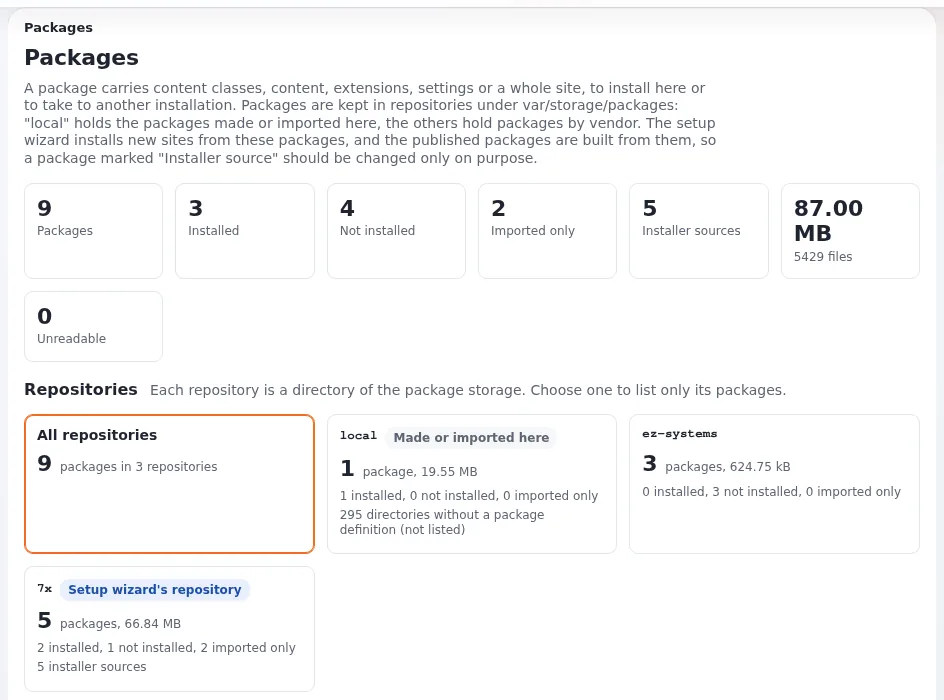

# Installing and uninstalling

This page is for administrators who install a package that is already in the local repository (imported, fetched or
created), or take one off again. Installing runs the package's install items on this site; uninstalling runs its
uninstall items. Both change the site.



## Contents

1. [Site packages are not installed here](#site-packages-are-not-installed-here)
2. [Open the install page](#open-the-install-page)
3. [What the install meets here](#what-the-install-meets-here)
4. [Three ways to install](#three-ways-to-install)
5. [Conflicts and steps](#conflicts-and-steps)
6. [Large packages](#large-packages)
7. [Uninstalling](#uninstalling)

## Site packages are not installed here

A site package is `install_type="import"`: its work (settings, siteaccesses, roles, the post-install) is done by its
installer script inside the `CreateSites` step of the setup wizard, the kickstarter or `exp:install`. Its card says
"Imported only", and its page has no Install button. The packages it requires (classes, demo content) can be installed
here like any other package, for example to add demo content to an existing site.

## Open the install page

**Install** on a package's page opens `/package/install/<name>`. You need `package/install` for the package's type
(`eZPackage::canInstall()`); without it the page answers "access denied" and the package's page says "You are not
allowed to install packages (package/install), so the Install button is not shown."

The page lists the **Install items**, one line per item as its handler explains it, and, when the package came from an
upload or **Validate**, the validation result. A package that is already installed says so: "Installing it again
repeats every item below; content it creates is created again."

## What the install meets here

Before you press anything, **What the install meets here** looks up every content object of the package by its remote
ID: "%total content objects, by remote ID: %create new, %update existing (updated, or a new draft), %conflict
conflicts, %error without their class." Each object's row says where its main location goes: "At the top", "A node
here", "A node of the package", or a missing parent.

Read it for every package with content. A conflict means the remote ID belongs to an object of another class, which
is left alone. "the class is neither installed nor in the package" means the object cannot be created until its class
exists.

## Three ways to install

| Button | Does | Use it when |
|---|---|---|
| **Install package** | installs every item in turn, in this request | small packages, classes, settings |
| **Install as drafts** ("Install the content objects as drafts") | writes only the content objects, as drafts; nothing is published; an existing object gets a new draft or is left alone, as you choose; "These items change the site at once and were left out" for classes, settings and files | you want to review content before it goes live |
| **Install in the background** | the same install as a content job (`packageinstall`) as you; "The package page and the job page show its progress; nothing waits for this page." | many objects; the page suggests it above `[ContentJobSettings] SynchronousLimit` |

**Skip installation** returns to the package's page without installing. Install as drafts is described on
[The JSON package format](../../../bc/6.0/package-json-format.md#install-as-drafts).

## Conflicts and steps

"Each item is installed in turn; a step may ask how to handle a conflict." The content class handler, for example,
finds an existing class by its remote ID and asks what to do (`ERROR_EXISTS` in
`kernel/classes/packagehandlers/ezcontentclass/ezcontentclasspackagehandler.php`). Your answer can be remembered for
the rest of the run for items of the same type and error.

## Large packages

The install runs in batches so a large package does not hit the web server's time limit
(`package.ini [InstallerSettings]`):

```ini
[InstallerSettings]
InstallBatchMaxItems=12
InstallBatchTimeBudgetSeconds=6
```

A batch ends after that many items or that many seconds, and the page continues with the next one. See
[A package installer that survives big packages](../../../features/6.0/package-installer-batching.md). For very
large packages the command line is often better: `php ezpm.php install <name>`
([ezpm](../../../features/6.0/ezpm-package-manager-cli.md#install-a-package)).

## Uninstalling

**Uninstall** on a package's page opens `/package/uninstall/<name>` (policy `package/install` as well). It lists the
**Uninstall items** and warns: "Uninstalling removes what the items below created on this site, content included. It
cannot be undone." **Uninstall package** runs them in reverse order and marks the package as not installed; **Skip
uninstallation** goes back. A package with nothing to uninstall says "This package has nothing to uninstall."

> **Warning**
> Take a backup of the database and `var/` before you install or uninstall a package with content. Neither page has
> an undo, and uninstalling removes content editors may have changed since.

## Related pages

- [Packages in the administration](README.md)
- [Packages, section 7](../../../guides/packages.md#7-installing-and-uninstalling)
- [Import versus install](../basics/import-versus-install.md)
- [Install items and handlers](../basics/install-items-and-handlers.md)
- [Look inside a package, compare it with your site](../../../features/6.0/package-compare-and-import.md)
- [Site packages: start here](../README.md)
- [Free documentation](../../free-documentation.md): this page is free to copy, translate and improve under the GNU FDL 1.3.
