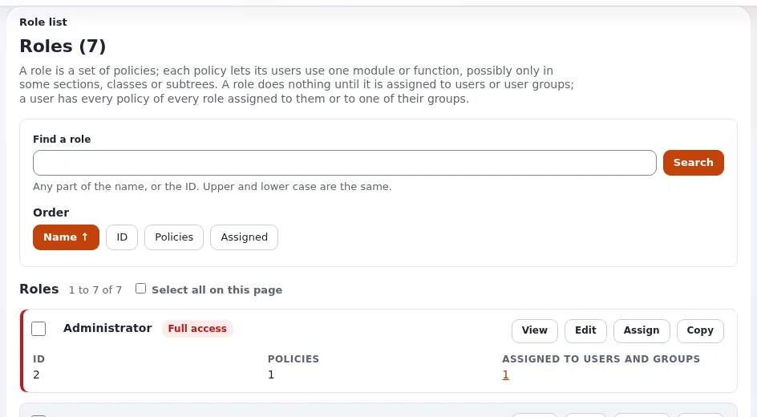

# Permissions for packages

This page is for administrators who decide who may look at, import, install, create and remove packages. Installing
a package changes content and settings, so these policies belong to trusted roles only. The Administrator role with
all functions has every one of them.

## Contents

1. [The package module](#the-package-module)
2. [The limitations](#the-limitations)
3. [Exporting extensions](#exporting-extensions)
4. [The update module (ezupdate)](#the-update-module-ezupdate)
5. [Role examples](#role-examples)
6. [Switches that lock the pages anyway](#switches-that-lock-the-pages-anyway)

## The package module

From `kernel/package/module.php`:

| Function | Opens | Limited by |
|---|---|---|
| `package/list` | the package list (`package/list`) | Type |
| `package/read` | a package's page (`package/view`), its files (`package/viewfile`), **Compare** (`package/compare`) | Type |
| `package/export` | **Download** (`package/export`) | Type |
| `package/import` | **Import new package** (`package/upload`) | Type |
| `package/install` | **Install**, **Reinstall** (`package/install`) and **Uninstall** (`package/uninstall`); the import actions of Compare | Type |
| `package/remove` | **Remove selected**, **Remove** | Type |
| `package/create` | **Create new package** (`package/create`) | Type, CreatorType, Role |
| `package/edit` | defined, but no view of the module asks for it | Type |
| `package/export_extension` | exporting an extension as a package (see below) | none |

Every form of these pages carries the form token; a post without it is refused with 403
([Packages, section 10](../../../guides/packages.md#10-permissions)).

## The limitations

| Limitation | Values | Effect |
|---|---|---|
| Type | `package.ini [PackageSettings] TypeList[]`: Content object (`contentobject`), Content class (`contentclass`), Site style (`sitestyle`), Site (`site`) | the policy applies only to packages of these types (`eZPackage::canUsePackagePolicyFunction()`); a policy without it applies to every type |
| CreatorType | the creators of `package.ini [CreationSettings]`: `ezcontentobject`, `ezcontentclass`, `ezextension`, `ezstyle` | which wizards **Create new package** offers |
| Role | `package.ini [MaintainerSettings] RoleList[]`: lead, developer, designer, contributor, tester | which maintainer roles the wizard lets you give; with none, the Maintainer step is left out |

The checks are per package: `package/install` limited to `contentclass` lets a role install a classes package but not
a content package, and the install page asks the policy for the package's own type, not for any type.

> **Note**
> A Type limitation only offers the types of `TypeList[]`. Packages of other types (the index of 6.0.15 also lists
> `extension` packages) are reached only by a policy without a Type limitation.

## Exporting extensions

`package/export_extension` is asked when an extension is exported in the administration and
`package.ini [ExtensionExportSettings] RequirePolicy=enabled` (the default). Independent of roles, the extension must
also be listed in `AllowedExtensions[]` (empty by default: none), and an extension holding secret values or key
material is always refused. The command line runs as no user and is not asked for the policy
([Exporting an extension as a package](../../designers/extensions/extension-export-package.md)).

## The update module (ezupdate)

From `extension/ezupdate/modules/update/module.php`:

| Function | Opens |
|---|---|
| `update/ezupdate` | the ezupdate pages: overview, installed packages, Packagist search, a server's packages (`update/packages`), runs, funding; checks and dry runs |
| `update/manage` | changes: updating and installing with Composer, **Fetch** of `.ezpkg` packages, and the **Package servers** page (`update/servers`) with adding and removing servers |

"Every page needs `update/ezupdate`; every change needs `update/manage` ... Checked on every request, in the view, not
only by hiding buttons." (`extension/ezupdate/doc/SECURITY.md`)

## Role examples

| Role | Policies |
|---|---|
| Reader of packages (auditors, support) | `package/list`, `package/read` |
| Content packager | the above, `package/export`, `package/create` limited to CreatorType `ezcontentobject` and `ezcontentclass` |
| Package installer on a staging site | the above, `package/import`, `package/install` |
| Package server maintainer | `update/ezupdate`, `update/manage` |
| Cleaner | `package/list`, `package/read`, `package/remove` |

Give `package/install` and `update/manage` sparingly: both change the site, and an uninstall cannot be undone.

## Switches that lock the pages anyway

| Switch | Locks |
|---|---|
| `site.ini [ConfigurationSettings] ManagedByDeployment=enabled` | in a web request: `package/upload`, `package/install`, `package/uninstall`, `package/create`, `package/export`, the remove actions, and every settings file write (so adding an ezupdate server as well); the list, a package's page and Compare stay open (`kernel/classes/expmanagedconfiguration.php`) |
| `ezupdate.ini [UpdateSettings] AllowUpdate`, `AllowInstall` (both `disabled` by default) | Composer updates and installs from the admin; fetching `.ezpkg` packages is not affected |

## Related pages

- [Packages in the administration](README.md)
- [Packages, section 10](../../../guides/packages.md#10-permissions)
- [ezupdate: updates and packages in the admin](../../../features/6.0/extensions/ezupdate.md)
- [The package wizard](the-package-wizard.md)
- [Package types](../basics/package-types.md)
- [Site packages: start here](../README.md)
- [Free documentation](../../free-documentation.md): this page is free to copy, translate and improve under the GNU FDL 1.3.
