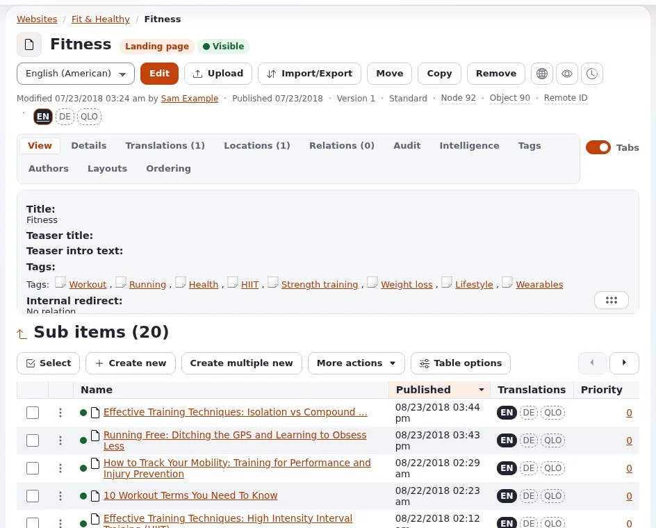

# Lesson 2.2: An item's tabs and its sub items

Below the buttons, an item's page has tabs with more about the item, and a folder shows the items below it in the
**Sub items** list. Editors use both every day: the tabs to check facts about an item, the list to find and act on
the items in a folder. This lesson covers reading them; acting on many items at once comes in lesson 3.4.

## At a glance

| | |
|---|---|
| Course | [Editors 101](../README.md) |
| Module | [Module 2: The content tree and navigation](README.md) |
| Duration | 45 minutes (20 presenting, 25 exercise) |
| Level | Beginner |
| Audience | New editors and authors |
| Prerequisites | [Lesson 2.1](the-tree-and-an-items-page.md) |

## Learning objectives

After this lesson, learners can:

- open the tabs **View**, **Details**, **Translations**, **Locations** and **Relations** and say what each shows;
- switch between tabs and one long page with the **Tabs** switch;
- sort the **Sub items** list by a column and page through it;
- choose the columns and the number of rows with **Table options**;
- explain that the tabs shown depend on the installation and the role.

## Trainer's notes

### How to present it

Source: [An item's page](../../../admin-tour.md#an-items-page) and
[Many items at once](../../../editing-content.md#many-items-at-once).

1. **The tabs** (8 minutes). Open a folder that has sub items and walk through the tabs:
   - **View**: the item's content, field by field;
   - **Details**: facts about the item, such as its creator, section and dates;
   - **Translations (n)**: the languages the item exists in (Editors 201 covers translating);
   - **Locations (n)**: the places in the tree where the item appears;
   - **Relations (n)**: the items this item links to, and the ones that link to it.
   The number in brackets is a count. Installations with extensions show more tabs (for example **Tags**,
   **Intelligence**, **Layouts**, **Ordering** in the administration); an editor in the Editor interface sees fewer.
   Say plainly that the set differs and that learners should not worry about tabs this course does not cover.
2. **The Tabs switch** (2 minutes). It turns the tabs into one long page and back; some editors prefer to scroll.
3. **Sub items** (6 minutes). The list under the tabs shows the items below the item, with its count in the heading
   (for example *Sub items (12)*). Click a column heading to sort by it. Point out the checkboxes, **Create new**,
   **Select** and **More actions**, and say that lesson 3.1 and lesson 3.4 use them.
4. **Table options** (4 minutes). Open **Table options**: choose, order and save the columns, set 10, 25, 50 or 100
   rows a page, and export the visible columns as a CSV file.

### Common questions

**Why is my Sub items list in a different order from the site's menu?** The site may sort by priority or by another
field. When the list is sorted by priority, the grip at the start of each row changes the order by dragging; that
changes the site's order too, so it is not part of the beginners' exercise.

**What is the CSV file for?** A quick list of a folder's items for a report or a check, opened in a spreadsheet.

**Why do I not see the Relations tab?** Some designs or roles show fewer tabs. Ask your administrator if you need
it.

### Pitfalls

- **Dragging rows by accident.** In a list sorted by priority a drag changes the order on the site. Ask learners to
  keep the mouse off the grip, or sort the list by name first.
- **Saved columns surprise.** **Table options** saves the columns for the learner. If someone's list looks
  different later, it is their saved choice.
- **Empty folders.** Make sure the training site has at least one folder with ten or more items, or paging cannot
  be shown.

## Hands-on exercise

Use the training installation and your Editor training account. Nothing in this exercise changes content.

1. Open **Media** and then the folder **Images** (or the folder with the most items the trainer names).
2. Read the heading of the list: write down the number in *Sub items (n)*.
3. Click the heading of the name column to sort the list by name; click it again to reverse the order.
4. Open **Table options**. Set the list to 10 rows a page and confirm. Use the pager to go to the second page.
5. In **Table options**, add one more column (for example the date it was modified) and save.
6. Open an image from the list. Click the tab **Details** and write down the section the image belongs to.
7. Click **Locations** and write down how many places the image has in the tree.
8. Click **Relations** and note whether any item uses this image.
9. Use the **Tabs** switch to show the page as one long page, then switch back.
10. Go back to the folder with the path and set **Table options** back to the number of rows you had before.

## Expected result

- The learner sorted and paged the list and changed its columns.
- Their notes have the folder's sub item count, the image's section (on most installations *Media*), its number of
  locations (usually 1) and whether anything relates to it.
- The **Tabs** switch showed all tabs as one page.
- The trainer checks by asking a learner to open the **Details** tab on the projector and read the section.

## Quiz

1. Which tab shows the languages an item exists in?
   A. **Details** B. **Translations** C. **Locations** D. **View**
2. What does the number in **Locations (2)** tell you?
3. Name two things **Table options** lets you do.
4. True or false: every installation shows exactly the same tabs on an item's page.
5. A learner dragged a row in a list sorted by priority. What may have changed?

Answers

1. **B.** **Translations**.
2. The item appears in two places in the tree.
3. Any two of: choose and order the columns, set 10, 25, 50 or 100 rows a page, export the visible columns as CSV
   ([Creating and editing content](../../../editing-content.md#many-items-at-once)).
4. **False.** Extensions add tabs, and roles and interfaces show fewer.
5. The order of the items, which is also the order on the site.

## Further reading

- [A tour of the administration](../../../admin-tour.md#an-items-page): the parts of an item's page.
- [Creating and editing content](../../../editing-content.md#many-items-at-once): the Sub items list and its actions.
- [Sub items table options](../../../../features/6.0/subitems-table-options.md): every option of the table.

## Related pages

- [Module 2: The content tree and navigation](README.md)
- [Editors 101: course overview](../README.md)
- [Trainers: start here](../../trainers-start-here.md)
- [Free documentation](../../../free-documentation.md): this page is free to copy, translate and improve under the GNU FDL 1.3.
