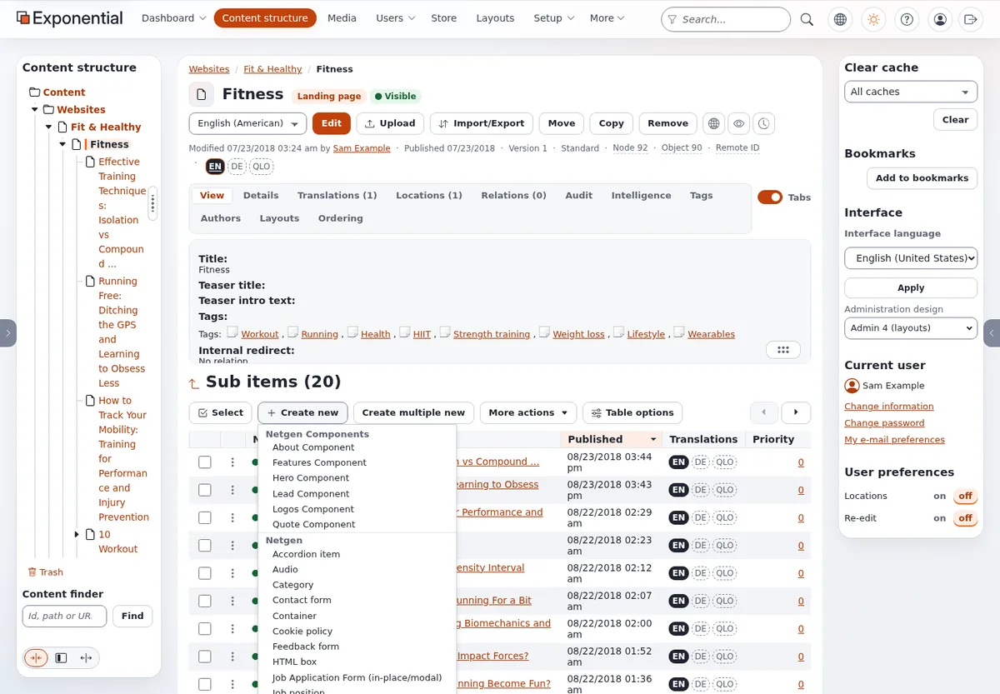

# Lesson 3.1: Creating your first folder

A folder is the simplest content item and the one every editor creates first: it is where their articles will go.
In this lesson learners create a personal folder for the rest of the course, meet the edit form for the first time
and publish.

> **Note**
> Every learner creates their own folder, named after themselves. All later exercises of this course happen inside
> it, so learners never change each other's work.

## At a glance

| | |
|---|---|
| Course | [Editors 101](../README.md) |
| Module | [Module 3: Creating and editing content](README.md) |
| Duration | 45 minutes (15 presenting, 30 exercise) |
| Level | Beginner |
| Audience | New editors and authors |
| Prerequisites | [Module 2](../module-02-the-content-tree/README.md); a training account that may create folders in the training area |

## Learning objectives

After this lesson, learners can:

- create a new item below a chosen place with **Create new** in the **Sub items** list or **Create here** in the
  item menu;
- name the three buttons at the top of the edit form and what each does;
- fill in the fields of a folder, including the required **Name**;
- publish the folder with **Send for publishing** and find it in the tree.

## Trainer's notes

### Preparing

Create one folder named **Training** (or similar) on the training site and give the learners' role permission to
create folders and articles below it. Test the permission with one learner account before the class.

### How to present it

Source: [Creating and editing content](../../../editing-content.md#create-a-new-item) and
[In action: editing a folder](../../../admin-tour.md#in-action-editing-a-folder).

1. **Where the item goes** (2 minutes). Open the **Training** folder. A new item is created below the item you are
   looking at; choosing the place first saves moving it later.
2. **Create new** (3 minutes). Under **Sub items**, press **Create new**. A list of the content types you may create
   here opens, in groups. Choose **Folder**. Mention the other way: the item menu in the tree has **Create here**,
   with the same list.
3. **The edit form** (6 minutes). Point at:
   - the buttons at the top: **Send for publishing**, **Store draft and exit**, **Discard draft**;
   - the title line with the type and the language you edit, for example *English (American)*;
   - the **field bar**, one button per field; a red `*` marks a required field;
   - one **card** per field, with its kind in the corner (*Text*, *Rich text* ...).
4. **The folder's fields** (2 minutes): **Name** (required), **Short name** (used in menus and the tree when it is
   filled in), **Summary** and **Description** (rich text), **Display sub items** (whether the site lists the items
   in the folder below its text). Other installations may add fields such as **Tags** or **Publish date**.
5. **Publish** (2 minutes). Press **Send for publishing**. The folder's page opens; the folder is now in the tree.

### Common questions

**What if I leave the form with Discard draft?** For a new item, nothing is created at all.

**Which types can I create?** The list shows only the types your role may create in this place. A folder that
accepts only some types (a gallery accepting only images, for example) shows fewer.

**Why did my item get the short name in the tree?** When **Short name** is filled in, it is used as the item's name
in lists and the tree. That is the folder's naming rule on a standard installation.

### Pitfalls

- **Creating in the wrong place.** Learners press **Create new** on the dashboard or the top of the tree. Ask them
  to read the path at the top of the page before they press it.
- **Enter publishes.** Pressing Enter in a one-line field is the same as pressing **Send for publishing**. Warn the
  class before they type the name.
- **Missing permission.** If **Create new** is missing or grayed out, the role may not create here. Fix the role on
  the training installation; do not hand out the administrator account.

## Hands-on exercise

Use the training installation and your Editor training account.

1. Open **Content structure** and then the folder **Training** that the trainer named.
2. Check the path at the top of the page: it must end with **Training**.
3. Under **Sub items**, press **Create new** and choose **Folder**.
4. In **Name**, type your first name followed by `- course folder` (for example `Alex - course folder`). Do not press
   Enter.
5. In **Short name**, type your first name only.
6. In **Summary**, type one sentence about what this folder is for.
7. Tick **Display sub items** (if your form has it), so the site lists the articles you add later.
8. Look at the field bar at the top and click the button of **Description**: the form jumps to that field. Leave it
   empty.
9. Press **Send for publishing**.
10. On the folder's page, read the name in the title and the version line. Find your folder in the tree below
    **Training**.
11. Press **View on site** and see your folder as visitors see it.

## Expected result

- A folder named after the learner (shown with the short name, for example *Alex*) exists below **Training**, with
  *Version 1*.
- The tree shows the folder below **Training**.
- **View on site** shows the folder's summary on the public site.
- The trainer checks by opening **Training** on the projector: one folder per learner.

## Quiz

1. Where is a new item created when you press **Create new** under **Sub items**?
2. What does a red `*` next to a field mean?
3. Which button publishes the draft?
   A. **Store draft and exit** B. **Discard draft** C. **Send for publishing** D. **Preview**
4. You fill in **Name** and press Enter. What happens?
5. A learner pressed **Discard draft** on a new folder. Where is the folder now?

Answers

1. Below the item whose page you are on ([Creating and editing content](../../../editing-content.md#create-a-new-item)).
2. The field is required: the draft cannot be published while it is empty.
3. **C.** **Send for publishing**.
4. The form is sent as with **Send for publishing**
   ([Creating and editing content](../../../editing-content.md#the-edit-form)).
5. Nowhere: a new item left with **Discard draft** is not created at all.

## Further reading

- [Creating and editing content](../../../editing-content.md): every way to create an item.
- [A tour of the administration](../../../admin-tour.md#in-action-editing-a-folder): a folder edited step by step,
  with pictures.
- [The content model and editing content](../../../../guides/content-model-and-editing.md): how types and fields
  are defined.

## Related pages

- [Module 3: Creating and editing content](README.md)
- [Editors 101: course overview](../README.md)
- [Trainers: start here](../../trainers-start-here.md)
- [Free documentation](../../../free-documentation.md): this page is free to copy, translate and improve under the GNU FDL 1.3.
