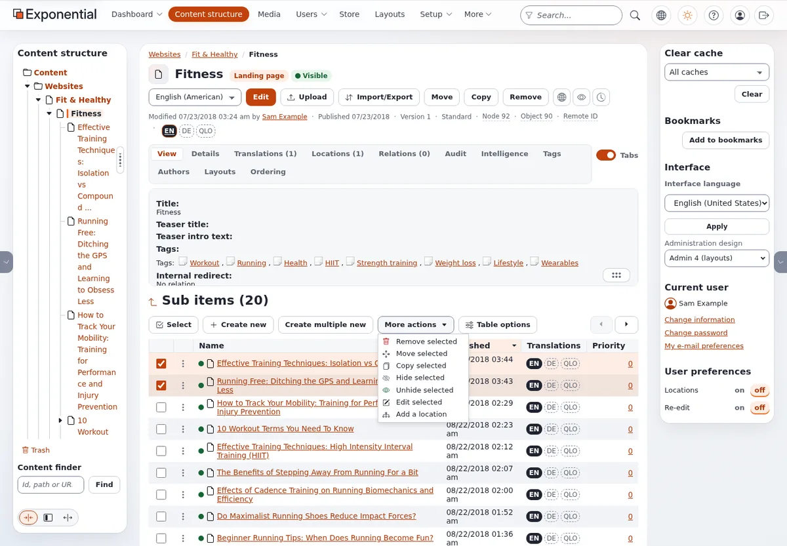

# Lesson 3.4: Many items at once

Editors often need several similar items: three news items for the week, a set of team members, a batch of
corrections. Exponential lets them create several new items in one form and edit several existing items in one form.
This lesson teaches both, inside the learner's own course folder.

## At a glance

| | |
|---|---|
| Course | [Editors 101](../README.md) |
| Module | [Module 3: Creating and editing content](README.md) |
| Duration | 45 minutes (15 presenting, 30 exercise) |
| Level | Beginner |
| Audience | New editors and authors |
| Prerequisites | [Lesson 3.3](the-edit-form-in-depth.md); each learner has a course folder with one article |

## Learning objectives

After this lesson, learners can:

- create several new items below one place with **Create multiple new**;
- tick items in the **Sub items** list with the checkboxes or **Select**;
- edit the selected items in one form with **More actions** > **Edit selected**;
- choose between **Save drafts**, **Publish all** and **Discard** in that form and read its report.

## Trainer's notes

### How to present it

Sources: [Many items at once](../../../editing-content.md#many-items-at-once) and
[Edit many items in one form](../../../../guides/content-model-and-editing.md#6-edit-many-items-in-one-form-multi-node-edit).

1. **Create multiple new** (5 minutes). Next to **Create new** in the **Sub items** list. It opens one form in which
   you fill in several new items below the same place at once (up to 50 at a time). Show it with two articles.
2. **Selecting** (2 minutes). Tick items with the checkboxes, or use **Select** to select all, none or the opposite.
   Without a selection, **More actions** reminds you: *Use the checkboxes to select one or more items.*
3. **Edit selected** (6 minutes). **More actions** > **Edit selected** opens one form with all the selected items:
   one section per content type and a collapsible panel per item, with **Expand all** and **Collapse all** above it.
   At the end:
   - **Save drafts** keeps the work without publishing;
   - **Publish all** publishes each item;
   - **Discard** throws the drafts away.
   A report lists which items were published, are waiting for approval, or were refused.
4. **Other actions in the menu** (2 minutes). Name them without using them: **Remove selected**, **Move selected**,
   **Copy selected**, **Hide selected**, **Unhide selected**, **Add a location**. Module 6 and Editors 201 cover
   them.

### Common questions

**Can I edit search results together?** Yes. Tick results on the search page and press **Edit selected**
(lesson 7.1).

**What if one item cannot be published?** The report after **Publish all** says which ones were refused and why;
the others are published.

**Is there a limit?** **Create multiple new** makes up to 50 items at a time.

### Pitfalls

- **Selecting more than intended.** **Select** > all ticks every item on the page, including other learners' items
  if the learner is in the wrong folder. Check the path first.
- **Publish all by reflex.** Encourage **Save drafts** for a first try, then check the drafts and publish them.
- **The menu's destructive entries.** **Remove selected** is next to **Edit selected**; read before you click.

## Hands-on exercise

Use the training installation and your course folder.

1. Open your course folder.
2. In the **Sub items** list, press **Create multiple new**.
3. Choose **Article** and create two articles in the same form: `News one` and `News two`, each with a one-sentence
   **Intro**.
4. Publish them, and check that both appear in the **Sub items** list of your folder.
5. Tick the checkboxes of `News one` and `News two`.
6. Open **More actions** and choose **Edit selected**.
7. Press **Expand all**. Add the word `(updated)` to the end of both titles.
8. Press **Save drafts**. Open **My drafts** on the dashboard and find both drafts.
9. Go back to your folder, tick the two articles again and choose **More actions** > **Edit selected**.
10. Check that the form continues with your changes (if it asks, continue your own drafts), then press
    **Publish all**.
11. Read the report, then check the titles in the **Sub items** list.

## Expected result

- Two new articles, *News one (updated)* and *News two (updated)*, are published in the learner's folder.
- **My drafts** listed both drafts after step 8 and is empty for them after step 10.
- The report after **Publish all** listed both items as published.
- The trainer checks by opening one learner's folder on the projector.

## Quiz

1. Where do you find **Create multiple new**?
2. How many items can **Create multiple new** make at a time?
   A. 5 B. 10 C. 50 D. No limit
3. What is the difference between **Save drafts** and **Publish all** in the multi-item form?
4. You press **More actions** and see *Use the checkboxes to select one or more items.* What is wrong?
5. Name two other entries of **More actions** besides **Edit selected**.

Answers

1. Next to **Create new** in the **Sub items** list.
2. **C.** Up to 50 ([The content model and editing content](../../../../guides/content-model-and-editing.md#6-edit-many-items-in-one-form-multi-node-edit)).
3. **Save drafts** keeps the work without publishing; **Publish all** publishes each item.
4. Nothing is ticked: select items first.
5. Any two of **Remove selected**, **Move selected**, **Copy selected**, **Hide selected**, **Unhide selected**,
   **Add a location** ([Creating and editing content](../../../editing-content.md#many-items-at-once)).

## Further reading

- [Creating and editing content](../../../editing-content.md#many-items-at-once): every multi-item action.
- [The content model and editing content](../../../../guides/content-model-and-editing.md): the multi-node edit
  form in detail.
- [Searching](../../../searching.md): editing search results together.

## Related pages

- [Module 3: Creating and editing content](README.md)
- [Editors 101: course overview](../README.md)
- [Trainers: start here](../../trainers-start-here.md)
- [Free documentation](../../../free-documentation.md): this page is free to copy, translate and improve under the GNU FDL 1.3.
