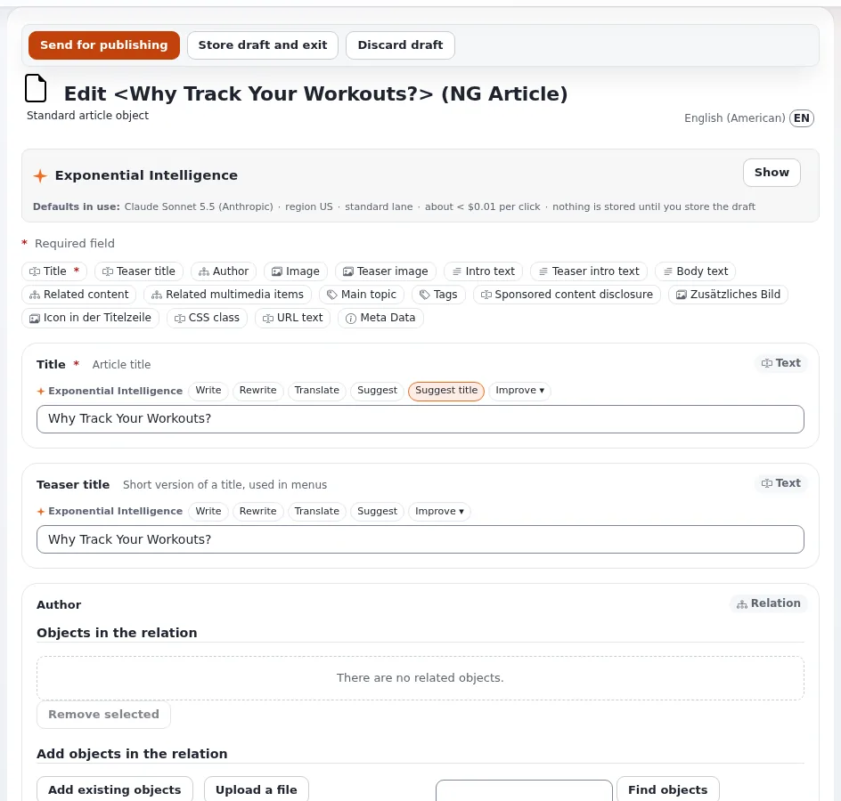

# Lesson 3.3: The edit form in depth

Learners have now used the edit form twice. This lesson slows down and looks at every part of it, so that the form
holds no surprises: the field bar, the left column with the current draft and **Preview**, automatic saving, error
messages, and the extras some sites add.

## At a glance

| | |
|---|---|
| Course | [Editors 101](../README.md) |
| Module | [Module 3: Creating and editing content](README.md) |
| Duration | 45 minutes (20 presenting, 25 exercise) |
| Level | Beginner |
| Audience | New editors and authors |
| Prerequisites | [Lesson 3.2](creating-your-first-article.md): each learner has a published article |

## Learning objectives

After this lesson, learners can:

- jump between fields with the field bar and recognize a required field;
- read the left column of the form: the item's numbers, the current draft, **Manage versions**, **Preview** and the
  section;
- explain that the draft is saved automatically every few minutes and where to find it again;
- read an error message at the top of the form and at the field, and fix it;
- say what **Publish without notification** and the **Exponential Intelligence** box do when a site offers them.

## Trainer's notes

### How to present it

Source: [The edit form](../../../editing-content.md#the-edit-form) and
[In action: editing a folder](../../../admin-tour.md#in-action-editing-a-folder).

1. **Top to bottom** (5 minutes). Open your article with **Edit** and point at: the buttons **Send for
   publishing**, **Store draft and exit** and **Discard draft**; the title line *Edit <name> (Article)* with the
   language; the field bar; the field cards with their kind in the corner (*Text*, *Rich text*, *Relation* ...).
2. **The left column** (5 minutes): the item's numbers and dates, **Current draft** with its version number,
   **Manage versions**, **Preview** (see the draft as the site will show it), the existing translations, and the
   **section** the item belongs to.
3. **Automatic saving** (3 minutes). The form saves the draft by itself every few minutes. A closed tab or a lost
   connection costs little: the draft waits under **My drafts**. Still, teach the habit of **Store draft and exit**
   when leaving for a break.
4. **Errors** (4 minutes). A field that is wrong at publishing sends the form back with a message at the top and at
   the field. Show it with an empty required field. Mention that the rich text editor may report links it had to
   repair (lesson 4.2).
5. **Extras some sites have** (3 minutes):
   - **Publish without notification** publishes without e-mailing the people who follow that part of the site.
   - The **Exponential Intelligence** box and buttons such as **Write**, **Rewrite**, **Translate**, **Suggest** and
     **Improve** on text fields, when the writing assistant is switched on. Its suggestions change nothing until the
     editor accepts them and stores the draft. Exponential Intelligence has a course of its own.

### Common questions

**How often is the draft saved automatically?** Every few minutes; the exact interval is a setting of the site.
Teach learners not to rely on it at the end of their work.

**What does Preview show that the edit form does not?** The draft with the site's design, at the width of a phone, a
tablet, a desktop or a large desktop. Lesson 6.2 covers it.

**Can I change the section in the form?** The left column shows it; changing sections belongs to Editors 201 and
needs the permission.

**Why does my form have fields my colleague's does not?** Different types have different fields, and some fields
appear only in some languages or to some roles. Check the title line for the type.

### Pitfalls

- **Losing work by closing the tab during the first minutes.** Automatic saving runs every few minutes, not after
  every key. Make **Store draft and exit** a habit.
- **The writing assistant.** On a site where it is switched on, learners click its buttons out of curiosity. Its
  suggestions change nothing until accepted; ask learners to leave it for its own course.
- **Publishing without notification by habit.** Followers of the site then miss the change. Use it only when a
  change is too small to announce.

## Hands-on exercise

Use the training installation and the article from lesson 3.2.

1. Open your article and press **Edit**.
2. Read the title line and write down the type and the language you are editing.
3. Click each button of the field bar once and watch the form jump to the field.
4. Find the field kind in the corner of the **Intro** card and of the **Title** card; write both down.
5. In the left column, find **Current draft** and write down its version number.
6. Empty the **Title** field and press **Send for publishing**. Read the message at the top and at the field.
7. Type a new title, `My first article, third version`.
8. Press **Store draft and exit**. Open **My drafts** on the dashboard: your draft is listed.
9. Open the draft from **My drafts** with **Edit** and press **Preview** in the left column. Look at the draft with the
   site's design, then go back to the form with **Back to edit**.
10. Press **Send for publishing**. Check that the article's page shows *Version 3*.
11. If your form shows **Publish without notification** or the **Exponential Intelligence** box, find them and
    write down where they are. Do not use them.

## Expected result

- The learner's notes have *Article*, the language (for example *English (American)*), the kinds *Text* and
  *Rich text*, and the draft's version number.
- Step 6 showed an error message for the empty title.
- The draft appeared in **My drafts** after **Store draft and exit** and was published as *Version 3*.
- The trainer checks by asking two learners to point at **Current draft** and **Preview** on their screens.

## Quiz

1. Where in the form do you see which version you are working on?
2. True or false: the draft is saved with every key you press.
3. What does **Publish without notification** do?
   A. Publishes without a version B. Publishes without e-mailing followers C. Stores the draft D. Hides the item
4. The form came back after **Send for publishing** with a message at the top. What do you do?
5. What happens to your text when you click a suggestion button of the writing assistant but do not accept the
   suggestion?

Answers

1. In the left column, under **Current draft**.
2. **False.** It is saved automatically every few minutes ([Creating and editing content](../../../editing-content.md#the-edit-form)).
3. **B.** It publishes without e-mailing the people who follow that part of the site.
4. Read the message at the top and at the field, fix the field and press **Send for publishing** again.
5. Nothing changes: suggestions change nothing until you accept them and store the draft.

## Further reading

- [Creating and editing content](../../../editing-content.md#the-edit-form): every part of the form.
- [Publish without notification](../../../../features/6.0/publish-without-notification.md): when the button
  appears.
- [My drafts and my pending items](../../../../guides/drafts-and-pending.md): finding a stored draft.

## Related pages

- [Module 3: Creating and editing content](README.md)
- [Editors 101: course overview](../README.md)
- [Trainers: start here](../../trainers-start-here.md)
- [Free documentation](../../../free-documentation.md): this page is free to copy, translate and improve under the GNU FDL 1.3.
