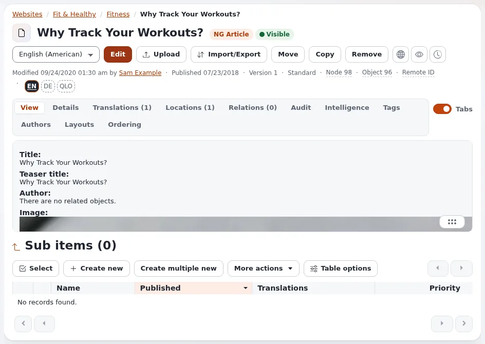

# Lesson 9.2: Capstone, a page from start to finish

The last lesson of Editors 101 is a single exercise that uses everything learners have practiced, without
step-by-step help. Learners produce a complete article in the Editor (or the administration), and the trainer checks
it against a list. It is the trainer's own check of the course, not an official examination.

## At a glance

| | |
|---|---|
| Course | [Editors 101](../README.md) |
| Module | [Module 9: The editor siteaccess](README.md) |
| Duration | 60 minutes (5 presenting, 45 exercise, 10 review) |
| Level | Beginner |
| Audience | New editors and authors who completed modules 1 to 8 |
| Prerequisites | [Lesson 9.1](working-in-the-editor.md); one new sample image per learner |

## Learning objectives

After this lesson, learners can:

- plan and produce a complete article without step-by-step instructions;
- combine rich text, links, an embedded image and a main image in one article;
- check a draft in the preview before publishing;
- correct a published article and restore an earlier version when asked.

## Trainer's notes

### How to present it

1. **The brief** (5 minutes). Hand out or project the task list below. Learners work alone, in the Editor if the
   training installation has one, otherwise in the administration. They may use the help pages and their notes.
2. **During the exercise** (45 minutes). Walk around. Answer questions with a question ("Which lesson covered
   that?"). Note common problems for the review.
3. **The review** (10 minutes). Open two or three learners' articles on the projector and go through the checklist
   in **Expected result** together. Then list the three most common problems you saw and where in the course they
   are covered.

### Common questions

**May I look at the lessons?** Yes. Finding the answer in the help is a skill this course teaches.

**What if I run out of time?** Store the draft and publish what you have; the review covers the rest.

**Is this a certification?** No. It is the trainer's own check, not an official certification; the partner program's certifications
are separate ([Certifications](../../../partners/certifications.md)).

### Pitfalls

- **Learners waiting for instructions.** Some learners freeze without numbered steps. Point them to the task list
  and to the module they need.
- **Overlong tasks.** If many learners are behind after 30 minutes, drop task 9 and do it together in the review.
- **Personal content.** Remind learners to write about a neutral topic (their city's park, a recipe, a hobby) and to
  use sample images without people.

## Hands-on exercise

Use the training installation (the Editor if it has one) and your course folder. Do the tasks in any order you like.

1. Create an article in your course folder titled `Capstone: <your topic>`.
2. Write an **Intro** of two sentences and a **Body** with at least one heading, one bulleted list and one paragraph
   with a bold word.
3. Upload a new sample image with a clear title and a descriptive alternative text, and make it the article's main
   **Image**.
4. Embed one of your images from lesson 5.2 in the **Body**, aligned right.
5. Link one phrase in the **Body** to *My first article* with the link dialog, and one phrase to an external
   `https://` address the trainer gives.
6. Look at the draft in **Preview** at the **iPhone** and **Desktop** widths, then publish.
7. Bookmark the article and follow it with **Add to my notifications**.
8. Edit the article again: change the title to `Capstone: <your topic>, final` and publish.
9. On the versions page, compare the first and the latest version with **Show differences**, then restore the first
   title with **Make a new draft** and publish it.
10. Find your article with the quick search, limited to **Current location** in your course folder.

## Expected result

The trainer checks each article against this list:

| Check | Where to look |
|---|---|
| Article in the learner's course folder, published | The folder's **Sub items** |
| Intro and body with a heading, a list and a bold word | **View on site** |
| Main image with a descriptive alternative text | The image item's **View** tab |
| Embedded image aligned right | **View on site** |
| One internal and one external link that work | **View on site**, click both |
| At least four versions; the published title is the first one | **Manage versions** |
| Bookmarked and followed | The learner's **My bookmarks** and **My notification settings** |

A learner who meets five of the seven checks has the skills of Editors 101; the trainer suggests the lessons behind
any missing check for review.

## Quiz

1. You need to restore an earlier title of a published article. Which page do you use and which button?
2. In which order do you do these: preview, publish, store draft? Explain.
3. Where do you check that the main image has an alternative text?
4. Name two things the preview shows that the edit form does not.
5. Which help page would you open first if a link was reported as broken when you stored the text?

Answers

1. The versions page (**Manage versions**), **Make a new draft** from the version with the earlier title, then publish
   ([Publishing, versions and the trash](../../../publishing-and-versions.md#go-back-to-an-earlier-version)).
2. Store the draft while working, preview it, then publish; previewing before publishing catches layout problems.
3. On the image item: its **View** tab or its edit form's **Alternative image text**.
4. The site's design, and the widths of a phone, a tablet and a desktop.
5. [The online editor on TinyMCE 8](../../../../features/6.0/online-editor-tinymce8.md#link-checks-when-the-text-is-saved),
   section "Link checks when the text is saved".

## Further reading

- [Getting started](../../../getting-started.md): the short version of this whole course, for learners to keep.
- [Creating and editing content](../../../editing-content.md) and
  [Publishing, versions and the trash](../../../publishing-and-versions.md): the two pages editors use most.
- [When something goes wrong](../../../when-something-goes-wrong.md): what to do after the course, when stuck.

## Related pages

- [Module 9: The editor siteaccess](README.md)
- [Editors 101: course overview](../README.md)
- [Trainers: start here](../../trainers-start-here.md)
- [Free documentation](../../../free-documentation.md): this page is free to copy, translate and improve under the GNU FDL 1.3.
