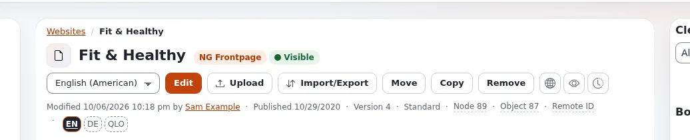

# Lesson 1.2: Translating an item

Translating in Exponential means adding a language to an existing item, not copying it. This lesson shows the two
ways to start a translation, how a translation is published on its own, and how to change an existing one.

## At a glance

| | |
|---|---|
| Course | [Editors 201](../README.md) |
| Module | [Module 1: Translations and languages](README.md) |
| Duration | 45 minutes (15 presenting, 30 exercise) |
| Level | Intermediate |
| Audience | Editors and translators |
| Prerequisites | [Lesson 1.1](content-languages-and-translations.md); a role that may edit and create in the second language |

## Learning objectives

After this lesson, learners can:

- start a translation from a dashed language badge or with **New translation** in the language list;
- choose **Translate based on** an existing translation, or **None** for empty fields;
- publish a translation and explain that the other languages do not change;
- edit an existing translation by choosing its language before **Edit**;
- say why a translator may be allowed one language only.

## Trainer's notes

### How to present it

Sources: [Translate an item](../../../languages.md#translate-an-item) and
[Translating content in the editor](../../../../guides/content-languages.md#7-translating-content-in-the-editor).

1. **Starting** (4 minutes). Two ways: click the dashed badge of the language (for example **DE**, *Translate into
   German*), or choose **New translation** in the language list next to **Edit** and press **Edit**.
2. **The choice page** (4 minutes). If the page asks, choose the language under **New translation** and, under
   **Translate based on**, the translation to start from: its text is copied into the form, so you overwrite it
   sentence by sentence. **None** gives empty fields. Then **OK**.
3. **The form** (3 minutes). The title line names the language being edited. Translate, then **Send for
   publishing**. Fields that cannot be translated (for example a checkbox such as **Enable comments**) are shared by
   all languages and may be shown read-only.
4. **Independence** (2 minutes). Each translation is published on its own: publishing the German text does not
   change the English one. Each has its own versions.
5. **Permissions** (2 minutes). The role editor can limit editing and creating by language, so a translator may be
   allowed German and nothing else.

### Common questions

**Should I start from the English text or from nothing?** From the existing translation, in most cases: the
structure (headings, lists, embedded images and links) comes with it, and you translate the words.

**Do links and embedded images come along?** With **Translate based on**, yes, because the rich text is copied.
Check that the linked items exist in the new language too.

**Can two people translate the same item into two languages at the same time?** Yes. Each works on a draft of their
own language.

### Pitfalls

- **Editing the wrong language.** Learners press **Edit** without choosing the language and change the English
  text. Read the title line of the form before typing.
- **Translating images.** An embedded image is an item of its own; its name and alternative text need their own
  translation (on the image item).
- **Missing permission.** If **New translation** is missing, the role has no right to create in that language.

## Hands-on exercise

Use the training installation and your course folder from Editors 101 (or a folder the trainer names).

1. Create an article in your folder in the main language, titled `Opening hours`, with a two-sentence **Intro** and a
   **Body** with a heading and a list. Publish it.
2. On the article's page, point at the dashed badge of the second language (for example **DE**) and click it.
3. If the page asks: choose the second language under **New translation**, choose your main language under
   **Translate based on**, and press **OK**.
4. Read the title line of the form: it names the second language.
5. Translate the **Title** and the **Intro** (a rough translation is fine). Leave the heading and the list in place
   and translate their words.
6. Press **Send for publishing**.
7. Read the badges again: both are filled now. Open the **Translations** tab and check the list.
8. Choose the main language in the list next to **Edit**, press **Edit**, change one word and publish. Check that the
   second language's text is unchanged (choose it in the language list).
9. Start a translation of another of your articles with **New translation**, choose **None** under **Translate
   based on**, and see the empty fields. Press **Discard draft**.

## Expected result

- *Opening hours* exists in two languages; both badges are filled and the **Translations** tab lists both.
- The second translation kept the heading and list structure of the first.
- After step 8 only the main language changed.
- Step 9 showed empty fields and was discarded; that article still has one language.
- The trainer checks by opening the article in both languages on the projector.

## Quiz

1. Name two ways to start a translation.
2. What does **Translate based on** do?
3. You publish the German translation of an article. What happens to the English text?
   A. It is replaced B. It is unchanged C. It is archived D. It is hidden
4. How do you edit the existing German translation?
5. A translator should only work on French. How can an administrator make sure?

Answers

1. Click the dashed badge of the language, or choose **New translation** in the language list and press **Edit**
   ([Languages](../../../languages.md#translate-an-item)).
2. It copies the fields of the chosen translation into the new one as a starting point.
3. **B.** Each translation is published on its own.
4. Choose German in the language list next to **Edit**, then press **Edit**.
5. Limit the translator's edit and create policies by **Language** in the role
   ([Content languages](../../../../guides/content-languages.md#7-translating-content-in-the-editor)).

## Further reading

- [Languages](../../../languages.md#translate-an-item): the steps in short.
- [Content languages](../../../../guides/content-languages.md#7-translating-content-in-the-editor): permissions and the
  translation window.
- [Roles and policies](../../../../guides/roles-and-policies.md): language limitations, for administrators.

## Related pages

- [Module 1: Translations and languages](README.md)
- [Editors 201: course overview](../README.md)
- [Trainers: start here](../../trainers-start-here.md)
- [Free documentation](../../../free-documentation.md): this page is free to copy, translate and improve under the GNU FDL 1.3.
