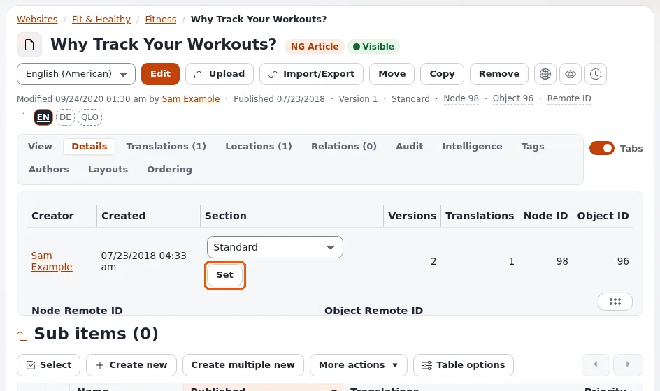

# Lesson 3.3: Sections as the editor sees them

Sections are labels that group content for permissions, the administration and designs. Editors rarely create
them, but they meet them every day: a page put into the wrong section can disappear for visitors. This lesson gives
editors exactly what they need: reading, setting and predicting an item's section.

## At a glance

| | |
|---|---|
| Course | [Editors 201](../README.md) |
| Module | [Module 3: Organizing content](README.md) |
| Duration | 45 minutes (20 presenting, 25 exercise) |
| Level | Intermediate |
| Audience | Experienced editors |
| Prerequisites | [Lesson 3.1](moving-and-copying.md) |

## Learning objectives

After this lesson, learners can:

- explain what a section is and name the sections of a new installation;
- read an item's section in the **Details** tab and set another one with **Set** when their role allows;
- predict the section of a new item, a moved subtree and a copy;
- explain why content put into a new section can be hidden from visitors.

## Trainer's notes

### How to present it

Source: [Sections](../../../../guides/sections.md#in-short).

1. **What a section is** (4 minutes). A named group of content. Every item belongs to exactly one section. Sections
   are used for permissions (a role can be limited to sections), for the administration (which top tab is active)
   and for designs (templates can differ per section).
2. **The sections of a new installation** (3 minutes): **Standard** (the content tree), **Users**, **Media**,
   **Setup** and **Design**. Sites add their own (for example a members area).
3. **Visitors** (3 minutes). The Anonymous role of a new installation may read the **Standard** section only. That
   is why content in **Media** or **Users**, or in a new section, is hidden from visitors who are not signed in,
   unless a policy allows it.
4. **Reading and setting** (4 minutes). The **Details** tab shows **Section** with a list of the sections your role
   lets you assign, and **Set**. Setting a section changes the item **and every item below it** whose main location
   is there. The same choice is in the edit form of a draft.
5. **Predicting** (4 minutes):
   - a new item takes the section of its parent;
   - moving a subtree gives the new parent's section to the items that still had the old parent's section;
   - a copy takes the section of the place it is copied to;
   - adding a second location changes nothing: an item has one section.

### Common questions

**I moved an article into the members' area and visitors still see it.** It kept its own section if it had one
different from the old parent's; set it on the **Details** tab, or ask an administrator.

**Why can I not see the section list on the Details tab?** Your role may not assign sections.

**Who creates sections?** Administrators, under **Setup** > **Sections**.

### Pitfalls

- **Setting a section on a big folder.** It changes everything below it; on large subtrees it may run as a
  background job (lesson 3.4).
- **Hiding by section.** Learners use a section to hide content. Teach **Hide** for that; sections are for
  permissions and design.
- **Training site sections.** A training installation may have extra sections from packages; tell learners which to
  use.

## Hands-on exercise

Use the training installation and your course folder. Ask the trainer which section you may set (for example a
section *Training* the trainer created).

1. Open your course folder's **Details** tab. Write down its **Section**.
2. Open an image of the media library. Write down its section.
3. Open the public site without signing in (a private browser window) and open your course folder's address: it is
   visible. Open the image's address the same way and note what you see.
4. Create an article `Section test` in your course folder. Before publishing, find the section in the form; then
   publish and read its **Details** tab. Predict first, then check.
5. Move `Section test` into a folder with another section, if the trainer prepared one, and read its section again.
6. On the **Details** tab of `Section test`, choose the section the trainer named and press **Set** (if your role
   allows).
7. Open `Section test` in the private window and note whether visitors can see it now.
8. Set the original section back.

## Expected result

- The course folder is in **Standard** (usually) and the image in **Media**.
- `Section test` started in its parent's section, as predicted.
- After step 6, visitors could or could not see the article depending on the section's permissions; the trainer
  explains the result.
- The trainer checks by asking each learner for their prediction in step 4 and the result.

## Quiz

1. How many sections can one item belong to?
2. Name three sections of a new installation.
3. You create an article in a folder of the section *Members*. Which section does the article get?
4. Why are items in a new section often hidden from visitors?
   A. Sections are always hidden B. The Anonymous role reads only Standard by default C. A section hides its items
   D. Nobody can see new sections
5. You set a section on a folder with twenty articles. What happens to the articles?

Answers

1. Exactly one ([Sections](../../../../guides/sections.md#in-short)).
2. Any three of **Standard**, **Users**, **Media**, **Setup**, **Design**.
3. *Members*: a new item takes its parent's section.
4. **B.**
5. They get the section too (those whose main location is below the folder)
   ([Sections](../../../../guides/sections.md#84-one-object-the-details-tab-and-the-edit-form)).

## Further reading

- [Sections](../../../../guides/sections.md): the full guide, including roles and designs.
- [Roles and policies](../../../../guides/roles-and-policies.md): how sections limit permissions.

## Related pages

- [Module 3: Organizing content](README.md)
- [Editors 201: course overview](../README.md)
- [Trainers: start here](../../trainers-start-here.md)
- [Free documentation](../../../free-documentation.md): this page is free to copy, translate and improve under the GNU FDL 1.3.
