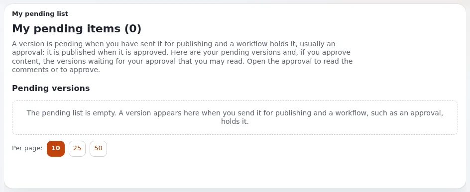

# Lesson 5.1: When publishing needs approval

On many sites, an editor's **Send for publishing** does not publish at once: a colleague has to approve first. This
lesson explains what happens to the version in between, and where the author sees it.

## At a glance

| | |
|---|---|
| Course | [Editors 201](../README.md) |
| Module | [Module 5: Approvals and collaboration](README.md) |
| Duration | 30 minutes (15 presenting, 15 exercise) |
| Level | Intermediate |
| Audience | Editors on sites with approval before publishing |
| Prerequisites | Editors 101, lesson 6.1 (version states) |

## Learning objectives

After this lesson, learners can:

- explain what an approval workflow is and when it applies;
- recognize a pending version and find it on **My pending items**;
- read a pending card: the state of the approval, who sent it, what holds it;
- explain why an approved version may need a few minutes before it is published.

## Trainer's notes

### How to present it

Sources: [Workflows](../../../../guides/workflows.md#in-short) and
[My pending items](../../../../guides/drafts-and-pending.md#2-my-pending-items).

1. **The idea** (4 minutes). A **workflow** is a list of steps; an *Approve* step makes publishing wait until an
   approver decides. A **trigger** connects it to publishing ("before publishing content"). An administrator sets it
   up, and can limit it to some sections, languages, new items or updates, and to some user groups.
2. **What the author sees** (4 minutes). After **Send for publishing** the version is **pending**: sent, but held.
   The site keeps showing the previous published version (or nothing, for a new item). **My pending items** lists
   it: the state of its approval, class, location, translation and version, who sent it and when, what holds it, and
   links such as **Open the approval** when you take part in it.
3. **Who decides** (3 minutes). Approvers are users or groups named in the workflow. An approver's own content does
   not need approval.
4. **The few minutes** (2 minutes). After the decision, the workflow cronjob carries on and publishes the approved
   version; on most sites it runs every few minutes. Until then the version stays pending.

### Common questions

**My item has been pending for days.** Ask the approver. If no approval holds it any more, the pending card says so;
then an administrator looks at **Setup** > **Workflow processes**.

**Can I change a pending version?** Not that version. If it is denied, it becomes a draft again and you edit it; if
you need to change it before a decision, ask the approver to deny it.

**Does every change need approval?** Only what the workflow covers: certain sections, languages, user groups, new
items or updates.

### Pitfalls

- **No workflow on the training site.** Run `exp:collaborationsampledata` (see the module overview) or set up the
  guide's example before the class.
- **Approvers in the same group as authors.** An approver's own content passes without approval; give authors a
  separate account.
- **Impatience.** Explain the cronjob delay before learners think it is broken.

## Hands-on exercise

Use the training installation, with an approval workflow that covers the learners' group (the trainer set it up).

1. Create an article `Needs approval` in your course folder and press **Send for publishing**.
2. Read the message or page that follows.
3. Open your course folder: is the article in **Sub items**? Open the site in a private window: is it visible?
4. Open **My pending items** from the dashboard. Find `Needs approval`.
5. Read its card and write down: the state of its approval, who sent it, when, and what holds it.
6. If the card offers **Open the approval** or **Approval and comments**, open it and read the page.
7. Open **Manage versions** of the article (if it is listed in your folder) and find the version's status.

## Expected result

- The article did not appear on the site; its version is pending.
- **My pending items** lists it with an approval waiting, sent by the learner.
- The approval page (if opened) says that the content awaits approval before it can be published.
- The trainer checks by opening one learner's **My pending items** on the projector.

## Quiz

1. What holds a version back from publishing on a site with approval?
2. Where does the author see a version that waits for approval?
   A. **My drafts** B. **My pending items** C. **Trash** D. **Bookmarks**
3. Why might an approved version need a few minutes before it is on the site?
4. True or false: an approver's own content always needs approval by someone else.
5. What do you do with a version that has been pending for a week?

Answers

1. A workflow with an approval step, started by the trigger "before publishing content"
   ([Workflows](../../../../guides/workflows.md#in-short)).
2. **B.**
3. The workflow cronjob carries on after the decision; it runs every few minutes on most sites.
4. **False.** When the publishing user is an approver, the approval step lets the version through.
5. Ask the approver; if nothing holds it any more, ask an administrator to look at the workflow processes.

## Further reading

- [Workflows](../../../../guides/workflows.md): approvals, triggers and processes.
- [My drafts and my pending items](../../../../guides/drafts-and-pending.md#2-my-pending-items): the pending page.
- [Publishing, versions and the trash](../../../publishing-and-versions.md#my-pending-items): pending items in short.

## Related pages

- [Module 5: Approvals and collaboration](README.md)
- [Editors 201: course overview](../README.md)
- [Trainers: start here](../../trainers-start-here.md)
- [Free documentation](../../../free-documentation.md): this page is free to copy, translate and improve under the GNU FDL 1.3.
