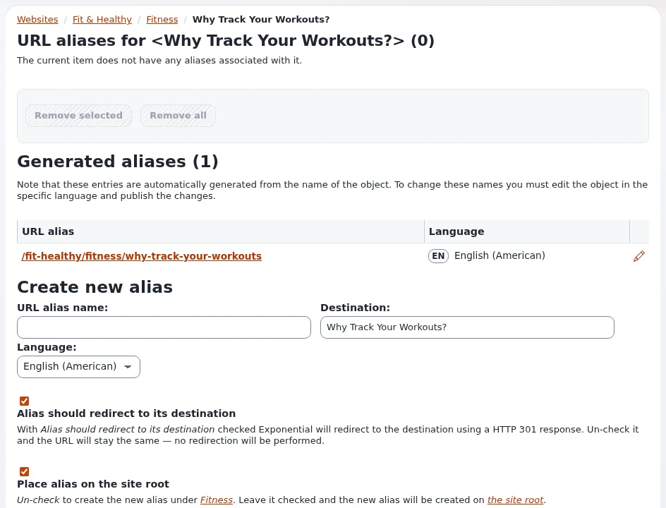

# Lesson 6.1: The address of an item and its URL aliases

Every page on the site has an address, made from the names of the items on its path. Sometimes editors need a short,
memorable extra address for a campaign or a printed flyer. This lesson explains generated addresses and shows how to
add an alias to an item.

## At a glance

| | |
|---|---|
| Course | [Editors 201](../README.md) |
| Module | [Module 6: Addresses, feeds and PDF](README.md) |
| Duration | 45 minutes (15 presenting, 30 exercise) |
| Level | Intermediate |
| Audience | Editors who publish campaigns or print addresses |
| Prerequisites | [Module 3](../module-03-organizing-content/README.md) (moving content) |

## Learning objectives

After this lesson, learners can:

- explain how an item's address is generated from its name and its place in the tree;
- open **Manage URL aliases** for an item and read its **Generated aliases**;
- create an extra alias with **Create new alias**, with or without a redirect, and on the site root;
- remove an alias they created, and say what happens to old addresses when an item is renamed or moved.

## Trainer's notes

### How to present it

Sources: [Links, URL aliases, wildcards and search statistics](../../../../guides/urls-and-aliases.md#3-global-url-aliases)
(the aliases of content are on each node's own page, described below).

1. **Generated addresses** (3 minutes). An item's address is built from the names on its path, for example
   `/news/opening-hours`. Renaming or moving the item changes the generated address; on most sites the old address
   keeps leading to the item, but check your own site before promising it.
2. **The page** (4 minutes). Item menu > **Advanced** > **Manage URL aliases** opens *URL aliases for <name> (n)*:
   **Generated aliases (n)** with **URL alias** and **Language**, the extra aliases you made, and **Create new alias**.
3. **Creating** (5 minutes). **URL alias name:** the extra address; **Destination:** the item (shown); **Language:**
   the language the alias works in; **Alias should redirect to its destination** (visitors are sent on to the real
   address) and **Place alias on the site root** (the alias is `/flyer` instead of below the item's parent); then
   **Create**. **Remove selected** and **Remove all** remove extra aliases.
4. **Global aliases** (3 minutes). Addresses for module pages (for example `login`) are made by administrators under
   **Setup** > **URL translator**, not here.

### Common questions

**Should an alias redirect?** Usually yes: visitors then see and bookmark the item's real address, and search engines
see one address.

**Can two items share an alias?** No. An address can lead to one place only; the page says when an address is taken.

**My alias does not work in the other language.** It works in the language chosen under **Language:**.

### Pitfalls

- **Removing generated aliases.** The page removes the extra aliases; do not try to "clean up" generated ones.
- **Aliases on the site root.** They compete with the top-level folders' addresses. Agree on names in the team.
- **Printed addresses.** Test an alias in a private window before it goes to print.

## Hands-on exercise

Use the training installation and your article *Opening hours* (moved to `Archive` in lesson 3.1).

1. Open *Opening hours* with **View on site** and write down its address.
2. In the tree, open the article's item menu and choose **Advanced** > **Manage URL aliases**.
3. Read the page title and the **Generated aliases** table. Compare it with the address of step 1.
4. Under **Create new alias**, type `hours-<your first name>` in **URL alias name:**, keep the language, tick **Alias
   should redirect to its destination** and **Place alias on the site root**, and press **Create**.
5. In a private window, open the site's address followed by `/hours-<your first name>`. You arrive at the article's
   real address.
6. Rename the article to `Opening hours and holidays` and publish. Open **Manage URL aliases** again and read the
   generated aliases.
7. Open the address of step 1 in the private window and note what happens.
8. Back on **Manage URL aliases**, tick your extra alias and press **Remove selected**.

## Expected result

- The generated alias matched the address in step 1.
- The extra alias redirected to the article in step 5.
- After the rename, the generated alias changed; step 7 shows whether the old address still leads to the article on
  this site.
- The extra alias is gone after step 8.
- The trainer checks by trying one learner's alias on the projector before step 8.

## Quiz

1. From what is an item's address generated?
2. Where do you add an extra address to an item?
   A. **Setup** > **URL translator** B. Item menu > **Advanced** > **Manage URL aliases** C. The **Details** tab
   D. The edit form
3. What does **Alias should redirect to its destination** do?
4. What does **Place alias on the site root** change?
5. Who makes addresses for module pages such as the login page, and where?

Answers

1. The names of the items on its path in the tree.
2. **B.**
3. Visitors who open the alias are sent on to the item's real address.
4. The alias is directly below the site's address instead of below the item's parent.
5. Administrators, under **Setup** > **URL translator**
   ([Links, URL aliases, wildcards and search statistics](../../../../guides/urls-and-aliases.md#3-global-url-aliases)).

## Further reading

- [Links, URL aliases, wildcards and search statistics](../../../../guides/urls-and-aliases.md): global aliases,
  wildcards and the link list.
- [URL wildcards](../../../creators/website-creators/url-wildcards.md): patterns of addresses, for site builders.

## Related pages

- [Module 6: Addresses, feeds and PDF](README.md)
- [Editors 201: course overview](../README.md)
- [Trainers: start here](../../trainers-start-here.md)
- [Free documentation](../../../free-documentation.md): this page is free to copy, translate and improve under the GNU FDL 1.3.
