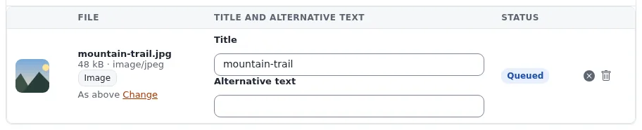

# Lesson 8.2: Accessible content

The administration and the site's design can be built for accessibility, but whether a page works for someone who
uses a screen reader also depends on the editor: alternative texts, heading order and link texts are written by
people, not by the software. This lesson gives editors the habits and a checklist.

## At a glance

| | |
|---|---|
| Course | [Editors 201](../README.md) |
| Module | [Module 8: Quality and accessibility](README.md) |
| Duration | 60 minutes (20 presenting, 40 exercise) |
| Level | Intermediate |
| Audience | All editors |
| Prerequisites | Editors 101, modules 4 and 5 |

## Learning objectives

After this lesson, learners can:

- write an alternative text that says what an image shows and why it is there, and recognize a decorative image;
- structure a text with headings in order, without skipping levels;
- write link texts that make sense on their own;
- give a table a caption and keep it for tabular data;
- review an article against a short accessibility checklist.

## Trainer's notes

### How to present it

Sources: [Accessibility standards](../../../../standards/accessibility.md) and
[Images, media and uploads](../../../media-and-uploads.md#good-practice).

1. **Why editors matter** (3 minutes). The project's accessibility statement says it plainly: alternative text,
   heading order and link text in published content depend on editors; the image fields offer an alternative text
   field, but nothing forces editors to fill it unless the site requires it.
2. **Alternative text** (5 minutes). Say what the image shows and why it is there, in a sentence. For a decorative
   image (a pattern, a divider) an empty alternative text is right, so screen readers skip it. Where the site uses
   Exponential Intelligence, its image fields offer **Write alt text** and **Decorative (empty alt text)**; the editor
   reviews the suggestion and chooses.
3. **Headings** (4 minutes). Use the paragraph style list; one main heading per page (usually the title), then
   headings in order, never a level skipped for looks. Screen reader users jump from heading to heading.
4. **Links** (3 minutes). "Read the opening hours", not "click here". A list of links read out of context must make
   sense.
5. **Tables and language** (3 minutes). Tables for tabular data only, with a caption and a header row. Short sentences,
   explained abbreviations.
6. **The checklist** (2 minutes). Hand it out (below, in the exercise).

### Common questions

**How long should an alternative text be?** As long as needed to say what matters, usually one sentence. The caption
need not be repeated.

**What about images of text?** Avoid them; if they must be used, the alternative text contains the text.

**Does the site check accessibility for us?** The administration warns about some things (for example a required
alternative text); most of the checklist is the editor's judgment.

### Pitfalls

- **"Image of ..."** Screen readers already say it is an image. Start with what it shows.
- **Bold lines as headings.** Show the status bar path in the editor: *paragraph » strong* is not a heading.
- **Color as the only signal.** "The items in red are mandatory" does not reach everyone; say it in words.

## Hands-on exercise

Use the training installation and your article *Our team, two places*.

1. Open the article on the site and read it with the following checklist. Note each problem.

   | Check | Yes / No |
   |---|---|
   | Every informative image has an alternative text that says what it shows | |
   | Decorative images have an empty alternative text | |
   | Headings are real headings (paragraph style), in order, no level skipped | |
   | Every link text makes sense on its own | |
   | Tables have a caption and a header row and hold tabular data only | |
   | Sentences are short; abbreviations are explained | |

2. Open the article with **Edit**. Fix the headings with the paragraph style list.
3. Rewrite every link text that does not make sense alone.
4. Open each embedded and related image item and improve its **Alternative image text**; publish each.
5. If your article has a table, add a caption.
6. Publish the article.
7. Swap with a neighbor: review their article with the checklist and tell them one improvement.
8. If your site uses Exponential Intelligence, open an image with **Edit** and look at **Write alt text** and
   **Decorative (empty alt text)**; do not send anything unless the trainer says so.

## Expected result

- The learner's checklist has a "Yes" in every row after the fixes.
- The neighbor's review found at most minor points.
- The trainer checks by reading two alternative texts and two link texts aloud and asking the class whether they work
  without seeing the page.

## Quiz

1. Write an alternative text for a photo of a team of five at a whiteboard planning a website.
2. When is an empty alternative text right?
3. True or false: it is fine to skip from a level 2 heading to a level 4 heading for a smaller font.
4. Rewrite the link text "click here" for a link to the opening hours.
5. Which three things in published content does the project's accessibility statement say depend on editors?

Answers

1. For example: "Five colleagues at a whiteboard sketching the pages of the new website."
2. For a decorative image that carries no information.
3. **False.** Headings go in order; the design, not the heading level, sets the size.
4. For example: "See our opening hours".
5. Alternative text, heading order and link text
   ([Accessibility standards](../../../../standards/accessibility.md)).

## Further reading

- [Accessibility standards](../../../../standards/accessibility.md): what the project complies with and the known gaps.
- [Images, media and uploads](../../../media-and-uploads.md#good-practice): alternative text and titles.
- [Advocating for accessibility](../../../advocates/advocating-for-accessibility.md): talking about accessible
  publishing.

## Related pages

- [Module 8: Quality and accessibility](README.md)
- [Editors 201: course overview](../README.md)
- [Trainers: start here](../../trainers-start-here.md)
- [Free documentation](../../../free-documentation.md): this page is free to copy, translate and improve under the GNU FDL 1.3.
