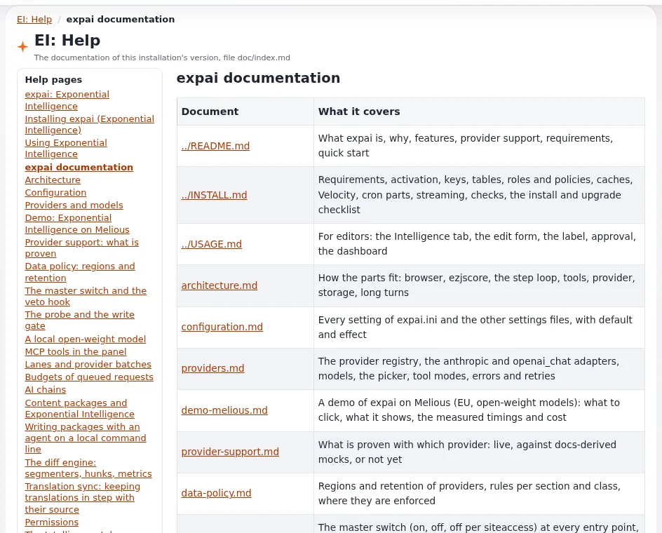

# Lesson 7.3: EI: Summary, the help pages and the audit trail

Sooner or later someone asks: "What does the AI feature send where, and who may use it?" The **EI: Summary** page
answers it on one printable page. This lesson shows it, the help pages that come with the extension, and what the
audit trail keeps.

## At a glance

| | |
|---|---|
| Course | [Exponential Intelligence](../README.md) |
| Module | [Module 7: Administration](README.md) |
| Duration | 30 minutes (10 presenting, 20 exercise) |
| Level | Advanced |
| Audience | Administrators, data protection officers |
| Prerequisites | [Lesson 7.2](switching-on-settings-and-limits.md); the policy `expai/summary` |

## Learning objectives

After this lesson, learners can:

- open **EI: Summary** and name its sections;
- print it or save it as PDF for a data protection officer;
- give a data protection officer a role with `expai/summary` only;
- find a topic in **EI: Help**;
- say what the audit trail records about the assistant and what it never records.

## Trainer's notes

### How to present it

Sources: the EI: Summary and audit trail pages under **EI: Help** (`extension/expai/doc/summary.md`,
`extension/expai/doc/audit-trail.md`) and [expai: For administrators](../../../../features/6.0/extensions/expai.md#for-administrators).

1. **EI: Summary** (4 minutes). Setup > **EI: Summary** (or **Details** on the dashboard). Read-only; every fact read at
   the moment the page opens. Sections: **Master switch and surfaces**, **Providers** (host, region, retention, terms
   date, where the key comes from but never the key, who may use it, this month's use), **Lanes and their retention**,
   **Data policy**, **Limits, budget and usage this month**, **Tools that reach outside the site**, **What this site
   keeps**, **Roles with Exponential Intelligence policies**. **Print or save as PDF** opens the browser's print dialog.
2. **A role for the DPO** (2 minutes). `expai/summary` needs no other expai policy and no content access.
3. **EI: Help** (2 minutes). The extension's documentation, rendered from the installed files, so it matches the
   installed version; every expai page has a "?" link to its page.
4. **Audit** (2 minutes). Every request, draft and draft state change is an event of the channel `ai` of the audit
   trail. Prompts, answers and keys are never recorded there.

### Common questions

**Is the page a legal document?** It lists the facts the site's settings and logs hold. Your organization's record of
processing activities is a separate document; the page can reference it (`[SummarySettings] Note`).

**Can the DPO see content?** Not with `expai/summary` alone.

**Where is the full documentation outside the administration?** In the extension's `doc/` folder and its repository.

### Pitfalls

- **Printing an outdated page.** It reflects the moment it was opened; print it again after changes.
- **Empty "terms checked" dates.** The page shows them; fix them before sending it.
- **Sending the PDF around freely.** It names roles and settings; treat it as internal.

## Hands-on exercise

Use the training installation with an administrator account.

1. Open Setup > **EI: Summary**. Read each section heading.
2. For each provider, check the region, retention and terms date. Note any "not checked".
3. Find where the key comes from (the settings file and its placement). Confirm that no key is on the page.
4. Read **Roles with Exponential Intelligence policies**: does it match the roles you designed in lesson 1.3?
5. Press **Print or save as PDF** and save a PDF to your computer.
6. Open **EI: Help** and find the pages on the data policy and on prompt injection (the security page).
7. If your role may open the audit console, find the assistant's events (channel `ai`) and check that no prompt text
   appears.

## Expected result

- The learner has a PDF of the page and a list of open points (for example terms dates to set).
- The learner found the data policy and security pages in **EI: Help**.
- The trainer checks by asking a learner which section answers "what does the AI feature send where?".

## Quiz

1. Name four sections of **EI: Summary**.
2. Does **EI: Summary** show API keys?
3. Which policy alone is enough for a data protection officer to read the page?
   A. `expai/write` B. `expai/summary` C. `expai/log` D. `expai/settings`
4. Why do the help pages always match the installed version?
5. What does the audit trail never record about the assistant?

Answers

1. Any four of: Master switch and surfaces; Providers; Lanes and their retention; Data policy; Limits, budget and usage
   this month; Tools that reach outside the site; What this site keeps; Roles with Exponential Intelligence policies.
2. No; it names where a key comes from, never the key.
3. **B.**
4. They are rendered from the installed files.
5. Prompts, answers and keys.

## Further reading

- [expai: For administrators](../../../../features/6.0/extensions/expai.md#for-administrators)
- [Security and audit](../../../../guides/security-and-audit.md): the audit trail.
- The EI: Summary and audit trail pages under **EI: Help**.

## Related pages

- [Module 7: Administration](README.md)
- [Exponential Intelligence: course overview](../README.md)
- [Trainers: start here](../../trainers-start-here.md)
- [Free documentation](../../../free-documentation.md): this page is free to copy, translate and improve under the GNU FDL 1.3.
