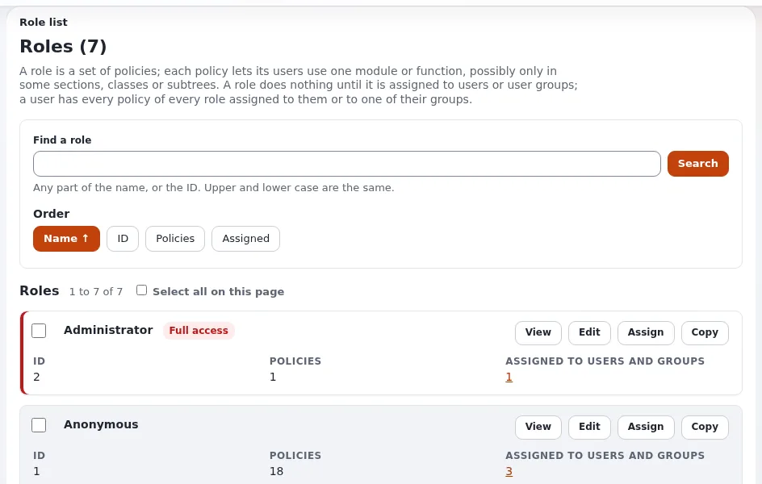

# Lesson 1.3: Who may do what with layouts

A layout can change the look of hundreds of pages with one click on **Publish layout**. Before the class builds
anything, the trainer explains who may read, edit and publish layouts, and the team agrees on rules. This lesson is
short and mostly talk; it saves trouble later.

## At a glance

| | |
|---|---|
| Course | [Exponential Layouts](../README.md) |
| Module | [Module 1: Introducing Exponential Layouts](README.md) |
| Duration | 30 minutes (15 presenting, 15 exercise) |
| Level | Beginner |
| Audience | Editors, site builders, and the administrators who give them access |
| Prerequisites | [Lesson 1.2](finding-your-way.md) |

## Learning objectives

After this lesson, learners can:

- name the three layouts modules and their **read** and **edit** policies;
- explain what an account with read only can and cannot do;
- propose a role for a page builder and one for an editor who only fills existing layouts;
- agree on three team rules for drafts and publishing.

## Trainer's notes

### How to present it

Sources: [Exponential Layouts: Permissions](../../../../bc/6.0/LAYOUTS.md#permissions) and
[explayouts_ui: Settings](../../../../features/6.0/extensions/explayouts_ui.md#settings).

1. **Three modules** (4 minutes). The layouts suite has three modules, each with policies in the role editor:
   - `explayouts` (the core): **read** and **edit**;
   - `explayouts_ui` (the Layouts tab and its screens): **read**, **edit**, and **transfer_export** and
     **transfer_import** for moving layouts between installations;
   - `explayouts_ui_api` (the visual editor and its JSON API): **read** and **edit**.
2. **Read and edit** (3 minutes). Read opens the dashboard, the lists and previews. Edit is needed to create layouts,
   change blocks, publish and change mappings. If the editor loads but every list is empty, check the policies
   before suspecting the data.
3. **Typical roles** (4 minutes):

   | Person | Needs |
   |---|---|
   | Editor who only looks | read on the three modules |
   | Page builder | read and edit on the three modules |
   | Administrator | everything, including transfer export and import |

4. **Team rules** (4 minutes). Drafts belong to the layout, not to a person: two people editing the same layout at
   the same time overwrite each other. Agree who edits which layout, who publishes, and to announce changes to
   shared layouts (they affect many pages).

### Common questions

**Can an editor be limited to some layouts?** The handover checklist of the site builders' guide recommends giving
editors only the layouts they own; how fine-grained a limitation can be depends on the installation's policies. Check
in the role editor of your installation.

**Why does the visual editor say "You don't have permission to edit this layout."?** The account has read but not edit
on the layouts modules.

**Who may change mappings?** Edit on `explayouts_ui` is needed for the mapping screens.

### Pitfalls

- **Giving administrator to page builders.** It is simpler, and dangerous. Give the layouts policies instead.
- **Two builders, one layout.** The second one's work silently replaces the first's. The team rule prevents it.
- **Forgetting the Editor siteaccess.** Editors who work only there cannot reach layouts at all.

## Hands-on exercise

Use the training installation. The trainer signs in as an administrator on the projector; learners work on paper.

1. The trainer opens **Users** > **Roles and policies** and the role used for this course. The class reads which
   layouts policies it has.
2. Learners write down, for each of the three modules, whether the role has **read**, **edit** or both.
3. Learners sign in with their own training account and open the **Layouts** tab. Check that **New layout** is
   offered.
4. In pairs, design on paper a role "Page builder" and a role "Layout viewer" with the policies from the table above.
5. As a class, agree on three team rules for this course, for example: "Each learner edits only their own layouts";
   "Shared layouts are changed only by the trainer"; "Publish only after a preview".
6. The trainer writes the rules on the board for the rest of the course.

## Expected result

- Every learner can open the **Layouts** tab and sees **New layout**.
- Each pair has two role designs that match the table.
- Three team rules are on the board.
- The trainer checks the role designs of two pairs.

## Quiz

1. Name the three layouts modules.
2. Which policy is needed to change blocks and publish layouts?
   A. read B. edit C. transfer_export D. dashboard
3. Which policies move layouts between installations?
4. What happens when two people edit the same layout at the same time?
5. A user sees the visual editor but every list is empty. What do you check first?

Answers

1. `explayouts`, `explayouts_ui`, `explayouts_ui_api`.
2. **B.**
3. **transfer_export** and **transfer_import** of `explayouts_ui`.
4. They overwrite each other: drafts belong to the layout, not to a person
   ([Landing pages with the layouts editor](../../../creators/website-creators/landing-pages-with-layouts.md#drafts-and-publishing)).
5. The account's layouts policies ([Exponential Layouts](../../../../bc/6.0/LAYOUTS.md#permissions)).

## Further reading

- [Exponential Layouts: Permissions](../../../../bc/6.0/LAYOUTS.md#permissions)
- [Roles and policies](../../../../guides/roles-and-policies.md): the role editor.
- [Landing pages with the layouts editor](../../../creators/website-creators/landing-pages-with-layouts.md#handing-over-to-editors):
  the handover checklist.

## Related pages

- [Module 1: Introducing Exponential Layouts](README.md)
- [Exponential Layouts: course overview](../README.md)
- [Trainers: start here](../../trainers-start-here.md)
- [Free documentation](../../../free-documentation.md): this page is free to copy, translate and improve under the GNU FDL 1.3.
