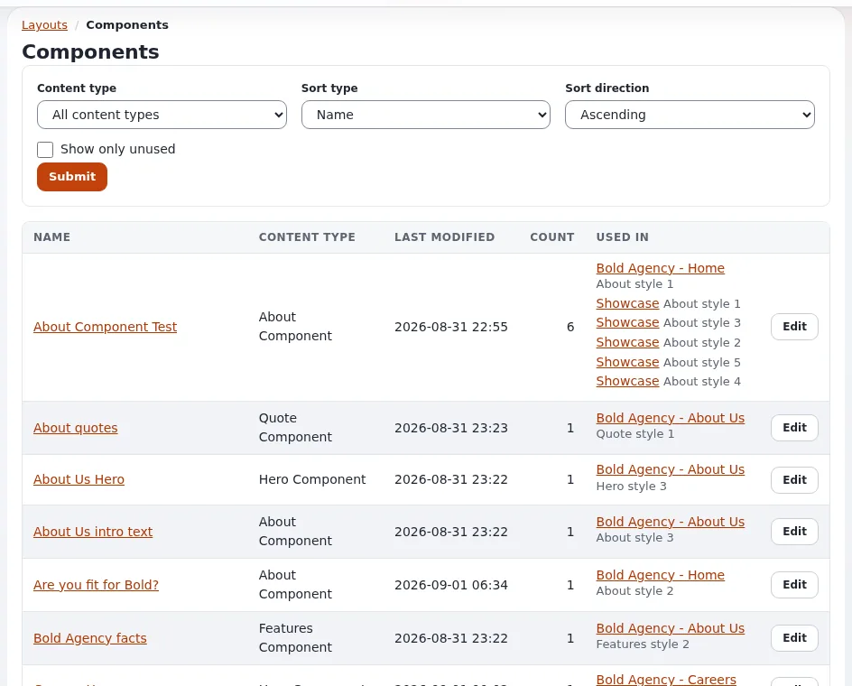

# Lesson 1.1: The five ideas of Exponential Layouts

Exponential Layouts is the page builder of Exponential: editors arrange pages from blocks in the browser, without a
developer. Everything in it rests on five ideas. Learners who have them clear find the editor easy; learners who do
not keep asking why their page did not change. This first lesson is the picture, without a computer.

> **Note**
> Use a training installation for every exercise of this course. A layout change can alter many pages of a live site
> at once.

## At a glance

| | |
|---|---|
| Course | [Exponential Layouts](../README.md) |
| Module | [Module 1: Introducing Exponential Layouts](README.md) |
| Duration | 30 minutes (20 presenting, 10 exercise) |
| Level | Beginner |
| Audience | Editors and site builders who will build pages with layouts |
| Prerequisites | Editors 101 (or experience as an editor) |

## Learning objectives

After this lesson, learners can:

- explain **layout**, **zone**, **block**, **collection** and **rule** (mapping) in their own words;
- say which of the five decides what appears on a page, and which decides on which pages;
- tell apart the content (items in the tree) from the arrangement (the layout);
- sketch a page as zones with blocks.

## Trainer's notes

### How to present it

Sources: [The layouts editor](../../../layouts-editor.md#layouts-zones-and-blocks) and
[Landing pages with the layouts editor](../../../creators/website-creators/landing-pages-with-layouts.md#the-five-ideas).

1. **Layout** (3 minutes). A named plan of a page, based on a **layout type** that fixes its zones; the type cannot be
   changed later. Example: *Landing Page / Home*.
2. **Zone** (3 minutes). A named area of a layout: *main*, *sidebar*, *header*, *footer*. A zone holds blocks, or is
   **linked** to a zone of a shared layout (module 5).
3. **Block** (4 minutes). One piece in a zone: a title, a text, an image, a button, a list of articles, a hero banner.
   A block has a type, a view type (its shape) and settings.
4. **Collection** (3 minutes). The content a listing block shows: **manual** (picked by hand) or **dynamic** (a query,
   such as "the newest six articles in News").
5. **Rule** (3 minutes). Also called a **mapping**: it decides which pages get which layout, by targets (a page, a part
   of the tree) and conditions (a content type, a siteaccess), highest priority first. A layout does nothing until a
   rule points at it.
6. **The sentence to remember** (2 minutes). Write it on the board: *A rule decides that this request gets that
   layout; the layout's zones hold blocks; a block may own a collection that supplies its content.*
7. **Content stays content** (2 minutes). Articles, images and folders still live in the content tree and are edited
   as in Editors 101. A layout arranges them; a **Full view** block shows the page's own content inside a layout.

### Common questions

**Do I need layouts for every page?** No. Pages without a matching rule are shown by the site's templates as before.
Layouts suit front pages, landing and campaign pages that change often.

**Is a layout the same as a template?** No. Templates are files a developer writes; a layout is data an editor
arranges in the browser.

**What happened to the old way of building landing pages?** Some sites still use the older page builder of earlier
versions; Exponential Layouts is the current one. Site builders decide which a site uses.

### Pitfalls

- **Jumping into the editor.** Learners who skip this picture create layouts that never show (no rule). Insist on the
  five ideas first.
- **"Mapping" and "rule".** The screens use both words. Say once that they mean the same.
- **Overselling.** Layouts arrange content; they do not replace the content tree or the templates of a site.

## Hands-on exercise

Use paper and the public site of the training installation.

1. Open the training site's front page.
2. On paper, draw the page as boxes: which areas do you see (header, a big banner, columns, a footer)?
3. Label each box as a zone: give it a short name such as `header`, `main` or `footer`.
4. In each zone, list the pieces you see, one under the other: these are blocks. Write a type for each (title, text,
   image, list ...).
5. Mark the blocks that show a list of articles: write "collection" next to them and guess whether the list is picked
   by hand or updated automatically.
6. Write one sentence that would be the rule for this page, for example "the front page of the site gets this layout".
7. Compare your drawing with your neighbor's.

## Expected result

- Each learner has a sketch with three to five zones, blocks inside them, at least one collection and one rule
  sentence.
- The trainer shows the real layout of the front page in the editor on the projector (module 2) and compares it with
  two sketches.

## Quiz

1. What does a layout type fix?
   A. The colors B. The zones C. The rules D. The content
2. What decides on which pages a layout is used?
3. What is the difference between a manual and a dynamic collection?
4. True or false: an article's text is stored in the layout.
5. Complete the sentence: a rule decides that this request gets that ..., the layout's ... hold blocks.

Answers

1. **B.** The type fixes the zones and cannot be changed later
   ([Landing pages with the layouts editor](../../../creators/website-creators/landing-pages-with-layouts.md#the-five-ideas)).
2. A rule (mapping), by its targets, conditions and priority.
3. Manual: items picked by hand. Dynamic: a query that finds the items when the page is shown.
4. **False.** The text stays in the content item; the layout arranges it.
5. Layout; zones.

## Further reading

- [The layouts editor](../../../layouts-editor.md): the editor for editors.
- [Landing pages with the layouts editor](../../../creators/website-creators/landing-pages-with-layouts.md): the
  builder's view.
- [Exponential Layouts](../../../../bc/6.0/LAYOUTS.md): the complete reference, for the trainer.

## Related pages

- [Module 1: Introducing Exponential Layouts](README.md)
- [Exponential Layouts: course overview](../README.md)
- [Trainers: start here](../../trainers-start-here.md)
- [Free documentation](../../../free-documentation.md): this page is free to copy, translate and improve under the GNU FDL 1.3.
