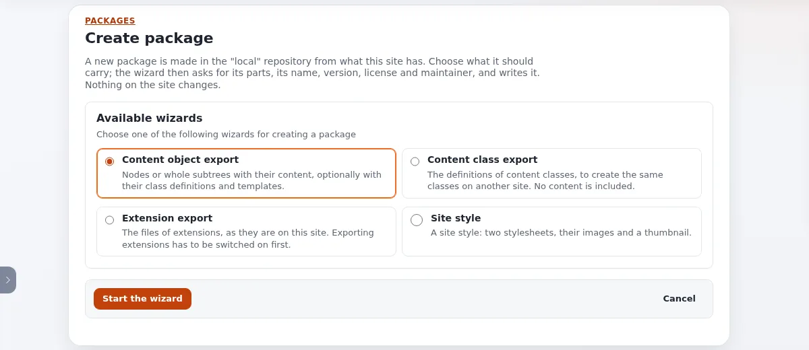

# Lesson 5.4: Creating a package with the wizard

The administration has four wizards that make a package from what the site has: content, content classes,
extensions and a site style. Every package names a license from a strict list and a Semantic Versioning version. This
lesson walks through the content class wizard, step by step, and ends with a package in the `local` repository that
can be downloaded and installed elsewhere.

## At a glance

| | |
|---|---|
| Course | [Multisite and site packages](../README.md) |
| Module | [Module 5: Site packages](README.md) |
| Duration | 50 minutes (15 presenting, 35 exercise) |
| Level | Intermediate |
| Audience | Administrators and developers |
| Prerequisites | [Lesson 5.2](the-packages-pages.md); a role with `package/create` (the Administrator role) |

## Learning objectives

After this lesson, learners can:

- choose the right wizard for a task among the four;
- move through the wizard's steps with **Continue**, **Back** and **Cancel**, and correct an error at its field;
- choose a license from the list and write a valid Semantic Versioning version;
- review a package before **Create package** writes it;
- add a license to the list in `package.ini`.

## Trainer's notes

### How to present it

Sources: [The package wizard](../../../../features/6.0/package-wizard.md) and
[Package licenses and Semantic Versioning](../../../../features/6.0/package-licenses-and-versions.md). The labels are
those of the admin4 design.

1. **The four wizards** (4 minutes). **Setup** > **Packages** > **Create new package** opens **Create package**, which
   lists **Content object export** (nodes or whole subtrees with their content), **Content class export** (the
   definitions of content classes, no content), **Extension export** (the files of extensions; exporting has to be
   switched on first in `package.ini [ExtensionExportSettings]`) and **Site style** (two stylesheets, their images and
   a thumbnail). Choose one and press **Start the wizard**.
2. **The steps** (4 minutes). Each step shows the list of steps, "Step n of m" and its name. **Continue** checks the
   step; errors are listed at the top with links to their fields and shown under each field. **Back** keeps valid
   input; **Cancel** writes nothing. The last step shows the **Review**; **Create package** writes the package into
   `local` and opens its page.
3. **Licenses** (4 minutes). The **License** drop-down is grouped (software, documentation, Creative Commons, public
   domain, proprietary). The default is `GPL-2.0-or-later`, the license of Exponential itself. The server accepts only
   a configured SPDX identifier or an alias such as `GPL`. Add a license in `settings/override/package.ini.append.php`
   under `[LicenseSettings] LicenseList[]` with a `[License_<identifier>]` block.
4. **Versions** (3 minutes). New packages start at `1.0.0`. The wizards accept `MAJOR.MINOR.PATCH` with an optional
   `-prerelease` and `+build`, at most 24 characters.

### Common questions

**Which license for course material?** Documentation: `GFDL-1.3-or-later` is offered under documentation licenses.
Code: `GPL-2.0-or-later` unless there is a reason for another.

**Is `1.0` accepted?** Not for a new package: it must be `1.0.0`. Existing packages with `1.0` are read as `1.0.0`
and never rewritten.

**Why is the Maintainer step missing?** It is left out when your role may give no maintainer role.

**Can I choose the format?** Yes: Classic XML or JSON, on the Package information step.

### Pitfalls

- **Extension export disabled.** Every extension is listed but cannot be chosen, with the reason; switching it on is a
  settings change, not part of this lesson.
- **Real names and addresses.** The maintainer and changelog fields go into `package.xml` and travel with the package.
  In class, use a role name and an address at `example.invalid`.
- **Pressing Enter.** Enter in a field is **Continue**, never **Back**.

## Hands-on exercise

Use your training installation and an administrator account.

1. Open **Setup** > **Packages** and press **Create new package**.
2. Read the four wizards, choose **Content class export** and press **Start the wizard**.
3. On the content classes step, filter the list by `folder`, tick **Folder**, clear the filter and tick **Article**
   too. Note "2 of n selected". Press **Continue**.
4. On **Package information**, leave the name empty and press **Continue**. Read the error summary and follow its
   link to the field.
5. Enter the name `course_classes`, a summary, the version `1.0` and press **Continue**. Read the version error.
6. Correct the version to `1.0.0`. Open **License** and find `GPL-2.0-or-later` and `GFDL-1.3-or-later`. Keep the
   default. Choose the format Classic XML. Press **Continue**.
7. On the maintainer step (if shown), enter `Course trainer` and `trainer@example.invalid`. Press **Continue**.
8. On the changelog step, write "Course package of lesson 5.4" and read the **Review**.
9. Press **Back** once, then **Continue** again: your input is kept.
10. Press **Create package**. The package's page opens.
11. On the page, press **Validate**, then **Download**.

## Expected result

- Step 4 and step 5 stay on their step with an error summary and the error under the field.
- After step 10 the page of `course_classes` opens in the `local` repository, version `1.0.0`, license
  GNU General Public License v2.0 or later, carrying two content classes.
- Step 11: validation passes and the browser saves `course_classes-1.0.0...ezpkg`.
- The trainer checks the **Review** of step 8 on one screen.

## Quiz

1. Which wizard exports the definitions of classes without content?
   A. Content object export B. Content class export C. Extension export D. Site style
2. Which version does the wizard accept: `1.0`, `1.0.0` or `1.0.0.1`?
3. What is the default license, and why?
4. Where do you add a license that is not in the list?
5. What does **Cancel** write?

Answers

1. **B.**
2. `1.0.0`: strict Semantic Versioning 2.0.0, `MAJOR.MINOR.PATCH`
   ([Package licenses and Semantic Versioning](../../../../features/6.0/package-licenses-and-versions.md#versions-semantic-versioning)).
3. `GPL-2.0-or-later`, the license of Exponential itself and what "GPL" always meant.
4. In `settings/override/package.ini.append.php`: `[LicenseSettings] LicenseList[]=<identifier>` and a
   `[License_<identifier>]` block with `Name`, `URL` and `Group`; then clear the INI cache.
5. Nothing; it returns to the package list.

## Further reading

- [The package wizard](../../../../features/6.0/package-wizard.md).
- [Package licenses and Semantic Versioning](../../../../features/6.0/package-licenses-and-versions.md).
- [Package creator wizard step by step](../../../designers/extensions/package-creator-wizard-step-by-step.md) and
  [Package licenses in the wizard](../../../designers/extensions/package-licenses-in-the-wizard.md).
- [Extension list and downloads](../../../../features/6.0/extension-list-and-downloads.md): switching extension
  export on.

## Related pages

- [Module 5: Site packages](README.md)
- [Multisite and site packages: course overview](../README.md)
- [Trainers: start here](../../trainers-start-here.md)
- [Free documentation](../../../free-documentation.md): this page is free to copy, translate and improve under the GNU FDL 1.3.
