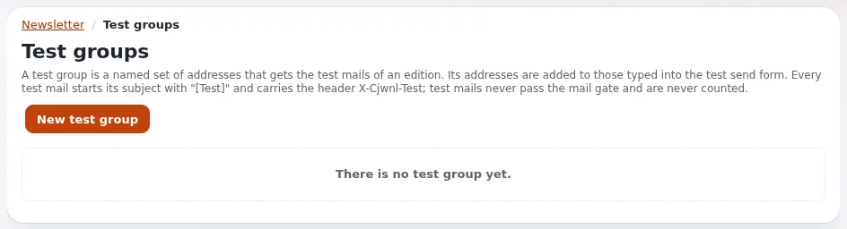

# Lesson 4.1: Previews and test sends

Nobody should send an edition they have not seen as a mail. The preview shows the rendered edition on screen; a
test send produces the real mail for a few test addresses. In this lesson learners do both and read the test mail as
a file, exactly as a mail program would receive it.

> **Note**
> Test sends go through `TransportMethodPreview`, which ships as `sendmail`: on an installation that was not prepared,
> a test send leaves the machine. Before this exercise, the trainer checks in the settings viewer that
> `TransportMethodPreview=file` (lesson 1.2). Test addresses are always at `example.invalid`.

## At a glance

| | |
|---|---|
| Course | [Newsletters with CJW Newsletter](../README.md) |
| Module | [Module 4: Sending](README.md) |
| Duration | 45 minutes (15 presenting, 30 exercise) |
| Level | Beginner |
| Audience | Editors who send newsletters |
| Prerequisites | [Module 2](../module-02-systems-lists-and-editions/README.md): an edition with articles; [Module 3](../module-03-subscribers/README.md): test subscribers |

## Learning objectives

After this lesson, learners can:

- check an edition in the **HTML / Text** and **Text** preview tabs;
- use **Preview as a subscriber** to see the edition with one subscriber's language and interests;
- send a test with **Send Test Newsletter** to one or more addresses at `example.invalid`;
- find the test mail file and recognize it as a test (subject prefix, header).

## Trainer's notes

### How to present it

Sources: [From rehearsal to real mail](../../../creators/website-creators/sending-newsletters.md#from-rehearsal-to-real-mail),
[10.5](../../../../install/10-after-installing.md#105-notifications-and-newsletters) and the deliverability and
rendering guides of the extension (linked from the [feature page](../../../../features/6.0/extensions/cjw_newsletter.md#the-features-of-420)).

1. **Check the transport first** (3 minutes). Open **INI Settings** on the projector and show
   `TransportMethodPreview=file`. Say aloud why: the shipped value sends.
2. **Preview** (3 minutes). The tabs **HTML / Text** and **Text** on the edition's page. **Preview as a subscriber**
   (on the send page) shows the edition as one subscriber gets it: their language, the conditional parts and the
   articles for their interests.
3. **The test form** (4 minutes). On an edition that has not been sent, the test form is prefilled with the list's
   **Newsletter default test receiver email**. Several addresses are separated by `;`. **Send Test Newsletter**
   renders and sends at once; no cron is needed.
4. **How a test is marked** (3 minutes). The subject starts with `[TestSendSettings] SubjectPrefix` (`[Test]`), the
   header `X-Cjwnl-Test: 1` is set, and each address gets its own mail. Test mails are never counted in the
   statistics.
5. **Test groups** (2 minutes). **Test groups** on the dashboard: named sets of test addresses for a list. The test
   form offers the groups of the list.

### Common questions

**Does a test send change the subscribers' statistics?** No; tests are never counted.

**Why does my test show placeholders unfilled?** The test addresses may not be subscribers with data. Use
**Preview as a subscriber** to see a real subscriber's version.

**Can I test in several mail programs?** On a real site, yes, with your own test mailboxes, after the switch in
lesson 5.2. In this course, open the `.eml` file in a mail program on your own machine instead.

### Pitfalls

- **A real test address on the list.** The list's test receiver was set in lesson 2.2; check it is at
  `example.invalid` before pressing the button.
- **Pressing Send Newsletter instead of Send Test Newsletter.** The real send is the next lesson. On the training
  installation it would only write files, but it changes the edition's state. Read the button before pressing.
- **Looking at the wrong file.** The outbox has the confirmation files of module 3 too; sort by time.

## Hands-on exercise

Use the training installation; `TransportMethodPreview=file` is checked (step 1). Replace `<name>` with your first name.

1. Open **Newsletter**, press **INI Settings**, and find `TransportMethodPreview` under `[NewsletterMailSettings]`.
   It must read `file`. If it does not, stop and call the trainer.
2. Open your edition `Tips for week 2` (the one you have not sent).
3. Read the **HTML / Text** and **Text** tabs once more and fix any typing error (edit and publish).
4. Find the test send form on the edition's page. It shows the list's test receiver,
   `test-<name>@example.invalid`.
5. Add a second address after a semicolon: `test-<name>@example.invalid;review-<name>@example.invalid`.
6. Press **Send Test Newsletter** and read the result page.
7. List the newest files in the outbox:

   ```bash
   ls -lt var/log/mail | head -5
   ```

8. Open the file for `review-<name>`. Find the `Subject:` line and the `X-Cjwnl-Test` header.
9. Optional: copy the `.eml` file to your own computer and open it in a mail program to see the HTML part.
10. Open **Send Newsletter** on the edition (do not press the button on that page) and use
    **Preview as a subscriber** for one of your test subscribers.

## Expected result

- Two new `.eml` files in `var/log/mail`, one per test address, each with a subject starting with `[Test]`.
- The edition is still unsent: **Newsletter processing info** is empty.
- The learner has seen the edition as one subscriber gets it.
- The trainer checks by opening one learner's test file on the projector.



## Quiz

1. Which transport method carries a test send, and what is its shipped value?
2. How do you send a test to two addresses at once?
3. Which of these marks a test mail?
   A. the subject starts with `[Test]` B. it is counted in the statistics C. it goes through cron
   D. all recipients are in one mail
4. What does **Preview as a subscriber** show that the preview tabs do not?
5. True or false: a test send needs the cronjob to run.

<details>
<summary>Answers</summary>

1. `TransportMethodPreview`, shipped as `sendmail` ([10.5](../../../../install/10-after-installing.md#105-notifications-and-newsletters)).
2. Type both in the test form, separated by a semicolon.
3. **A.** Tests are not counted, not queued, and each address gets its own mail (deliverability guide, linked from the
   [feature page](../../../../features/6.0/extensions/cjw_newsletter.md#the-features-of-420)).
4. The edition with that subscriber's language, conditional parts and interests (rendering guide).
5. **False.** A test is rendered and sent at once.

</details>

## Further reading

- [Sending newsletters safely](../../../creators/website-creators/sending-newsletters.md#from-rehearsal-to-real-mail):
  testing before real sending.
- [10.5 Notifications and newsletters](../../../../install/10-after-installing.md#105-notifications-and-newsletters):
  the three transport methods.
- [cjw_newsletter: newsletters in the admin](../../../../features/6.0/extensions/cjw_newsletter.md#the-features-of-420):
  the guides on test groups and rendering.

## Related pages

- [Module 4: Sending](README.md)
- [Newsletters with CJW Newsletter: course overview](../README.md)
- [Trainers: start here](../../trainers-start-here.md)
- [Free documentation](../../../free-documentation.md): this page is free to copy, translate and improve under the GNU FDL 1.3.
