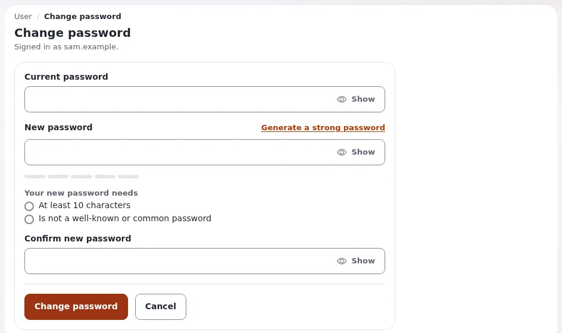

# Lesson 2.3: Passwords, resets and lockouts

"I cannot sign in" is the support call an administrator gets most. This lesson goes through every supported way to
change or reset a password, what happens to the user's sessions afterwards, and how to unlock an account that was
locked after too many failed sign-ins.

## At a glance

| | |
|---|---|
| Course | [Site administration](../README.md) |
| Module | [Module 2: Users and groups](README.md) |
| Duration | 45 minutes (15 presenting, 30 exercise) |
| Level | Intermediate |
| Audience | Site administrators and support staff |
| Prerequisites | [Lesson 2.2](creating-and-managing-user-accounts.md): the users `tess.trainee` and `sam.sample`; a terminal in the installation root |

## Learning objectives

After this lesson, learners can:

- change their own password on `user/password`;
- set a new password for another user from the user's edit form;
- explain how **Forgot your password?** works and when it cannot help;
- reset a password on the command line with `resetuserpassword.php`;
- unlock an account locked by failed sign-ins.

## Trainer's notes

### How to present it

Source: [Change the administrator password](../../../change-the-admin-password.md) and
[Reset a user password from the command line](../../../../features/6.0/reset-user-password.md).

1. **Your own password** (3 minutes). In admin4, the user menu (the button with your name in the header) >
   **Change password**. The page lists the requirements and ticks them off while you type; **Generate a strong
   password** makes one.
2. **Someone else's password** (3 minutes). Open the user, **Edit**, type the new password twice in the
   **User account** field, **Send for publishing**. Better: let the user use **Forgot your password?** so that you
   never know their password.
3. **What follows a change** (3 minutes). With `[PasswordSettings] EndOtherSessions=enabled` (the default) the user's
   other sessions are signed out at their next request; with `ChangeNotificationMail=enabled` the user gets "Your
   password was changed", which never contains the password. The change is in the audit trail.
4. **Forgot your password?** (2 minutes). The link in the mail works once and for one hour
   (`ForgotPasswordKeyLifetime=3600`). It needs a real address and working mail, so it never works on a training site
   with `example.invalid` addresses.
5. **Command line and lockouts** (4 minutes). `bin/php/resetuserpassword.php` (also `exp:resetuserpassword`) works
   when nobody can sign in. Failed sign-ins lock an account only when `[UserSettings] MaxNumberOfFailedLogin` is above
   0; the shipped value is 0 (no lock).

### Common questions

**Why does a password given with `-p` worry you?** It is visible in the process list and the shell history. Prefer
`-g` to generate one, which is printed once.

**Can an administrator see a user's password?** No. Passwords are stored as hashes; nobody can read them back.

**The user says nobody changed their password, but they got the mail.** Treat it as a possible attack: check the
audit trail and change the password again.

### Pitfalls

- **Lockout of the trainer.** If learners set `MaxNumberOfFailedLogin` and then mistype the administrator password,
  they lock themselves out. Keep the exercise on `sam.sample` and keep a second administrator session open.
- **Running the script as root.** As the operating system root user it needs `--allow-root-user`; otherwise use
  `-a` and `-ap` with an administrator's login, which puts that password in the history too.

## Hands-on exercise

On your training installation, signed in as an administrator, with a terminal in the installation root:

1. Open the user menu with your name in the header and choose **Change password**. Read the listed requirements;
   press **Generate a strong password**, look at it, and leave the page without saving.
2. Open `tess.trainee`, press **Edit**, type a new password twice in the **User account** field and press
   **Send for publishing**.
3. In a terminal, generate a new password for `sam.sample`:

   ```bash
   php bin/php/resetuserpassword.php --allow-root-user -u sam.sample -g -l 20
   ```

   (Run it without `--allow-root-user` and with `-a <your login> -ap '<your password>'` if you are not root.)
4. Sign in to the public site as `sam.sample` with the printed password, in a private window. Then sign out.
5. Switch on locking for the lab only, and clear the INI cache:

   ```bash
   php bin/php/console exp:ini set site.ini/UserSettings/MaxNumberOfFailedLogin 3 global
   php bin/php/ezcache.php --clear-tag=ini
   ```

6. In the private window, try to sign in as `sam.sample` with a wrong password four times. Then try the right one.
7. As the administrator, open `sam.sample` and **Configure user account settings**. Read the number of failed
   attempts and press **Reset**.
8. Sign in as `sam.sample` with the right password again.
9. Switch locking off again:

   ```bash
   php bin/php/console exp:ini rem site.ini/UserSettings/MaxNumberOfFailedLogin global
   php bin/php/ezcache.php --clear-tag=ini
   ```

## Expected result

- Step 3 prints one generated password of 20 characters.
- Step 6: after more failed attempts than the setting allows, the right password is refused too; the account is
  locked.
- Step 7 shows the failed attempts; after **Reset** the sign-in of step 8 works.
- After step 9, `exp:ini where site.ini/UserSettings/MaxNumberOfFailedLogin` shows the default 0 in effect.
- The trainer checks the audit records later in the course, or asks a learner to show step 7.



## Quiz

1. How long does a **Forgot your password?** link work on a new installation?
   A. 10 minutes B. one hour C. one day D. until used
2. What happens to a user's other sessions when an administrator changes the password?
3. Why prefer `-g` to `-p` with `resetuserpassword.php`?
4. With the shipped settings, does an account lock after ten wrong passwords? Why?
5. Name two places where an administrator can clear an account's failed sign-ins.

<details>
<summary>Answers</summary>

1. **B.** `ForgotPasswordKeyLifetime=3600` seconds
   ([Forgot your password?](../../../change-the-admin-password.md#forgot-your-password)).
2. They are signed out at their next request (`EndOtherSessions=enabled`).
3. A password on the command line stays in the process list and the shell history.
4. No. `MaxNumberOfFailedLogin` is 0 as shipped, which means no lock.
5. **Reset** on **Configure user account settings**, and **Unlock** on **Check user accounts** (lesson 2.4).

</details>

## Further reading

- [Change the administrator password](../../../change-the-admin-password.md): every way, and what to do when locked
  out.
- [Reset a user password from the command line](../../../../features/6.0/reset-user-password.md): the script's options
  and errors.
- [Changing your password](../../../../features/6.0/modern-password-change.md): the rules and the mail.
- [Sessions](../../../../guides/sessions.md): ending every session after a suspected compromise.

## Related pages

- [Module 2: Users and groups](README.md)
- [Site administration: course overview](../README.md)
- [Trainers: start here](../../trainers-start-here.md)
- [Free documentation](../../../free-documentation.md): this page is free to copy, translate and improve under the GNU FDL 1.3.
