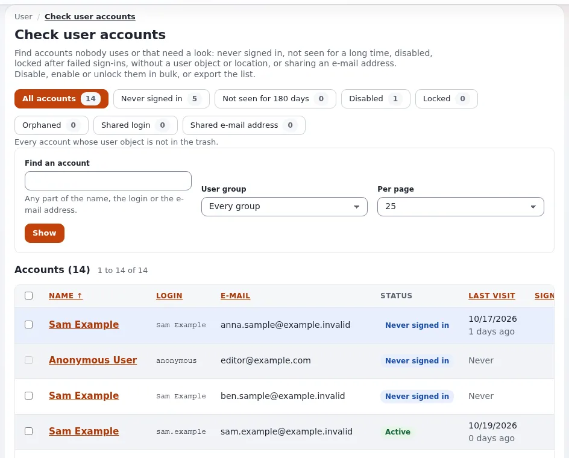
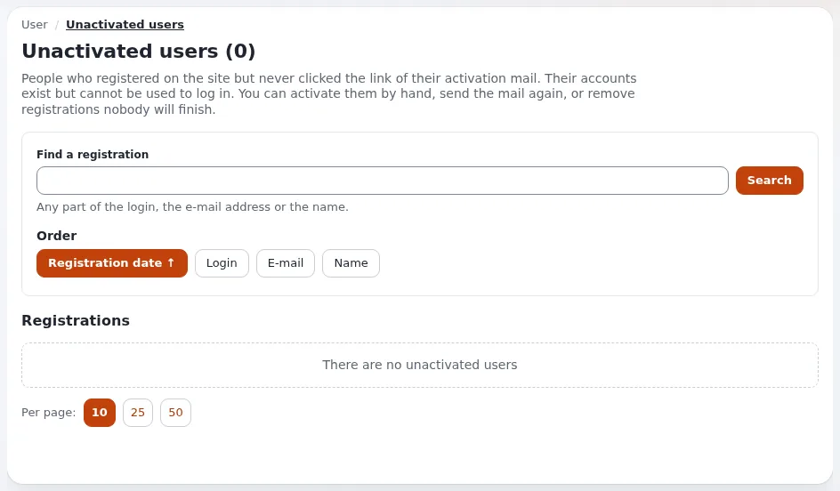

# Lesson 2.4: Unactivated users and checking user accounts

Accounts pile up: registrations nobody finished, staff who left, test accounts from a project long ago. Every unused
account that can still sign in is a risk. This lesson uses two pages under **Users > Access control** to find such
accounts and act on many at once: **Unactivated users** and **Check user accounts**.

## At a glance

| | |
|---|---|
| Course | [Site administration](../README.md) |
| Module | [Module 2: Users and groups](README.md) |
| Duration | 40 minutes (15 presenting, 25 exercise) |
| Level | Intermediate |
| Audience | Site administrators |
| Prerequisites | [Lesson 2.3](passwords-resets-and-lockouts.md): the users `tess.trainee` and `sam.sample` exist |

## Learning objectives

After this lesson, learners can:

- read the list of unactivated users and activate, mail again or remove registrations;
- use the filters of **Check user accounts** to find accounts that need a look;
- disable, enable and unlock several accounts at once, and read what was left out and why;
- export an account list as CSV;
- explain why removing a user is final and what **Deactivate and move** offers instead.

## Trainer's notes

### How to present it

Source: [Roles, policies and unactivated users](../../../../guides/roles-and-policies.md#7-clean-up-unactivated-users)
and [Check user accounts](../../../../features/6.0/user-hygiene.md).

1. **Unactivated users** (4 minutes). **Users > Unactivated users** lists people who registered but never clicked the
   link of their activation mail. Registrations older than 30 days are marked **Old**. Actions:
   **Activate selected users**, **Send the activation mail again**, **Remove selected users**, and
   **Remove all unactivated users**. The anonymous user, the account `admin` and you are never removed.
2. **Check user accounts** (6 minutes). **Users > Check user accounts** has the filters **All accounts**,
   **Never signed in**, **Not seen for 180 days**, **Disabled**, **Locked**, **Orphaned**, **Shared login** and
   **Shared e-mail address**, each with its count; **Find an account**, **User group** and **Per page** narrow the
   list. Each row shows status, last visit, sign-ins, groups and roles.
3. **Bulk actions** (3 minutes). **Disable the ticked accounts**, **Enable the ticked accounts** and **Unlock the ticked accounts**. The confirmation says how
   many accounts will change and which are left out, and why. Nothing on this page removes an account.
4. **Retiring instead of removing** (2 minutes). User objects never go to the trash. With
   `[UserSettings] DeactivateAndMove=enabled` (off by default), **Deactivate and move** disables accounts and moves them
   into a hidden group without roles, remembering where they were.

### Common questions

**Who may use these pages?** **Check user accounts** needs the function `user/hygiene`; e-mail addresses are shown
only with `role/assign`. Unactivated users needs `user/activation`. A clean installation gives them only to the
Administrator role.

**Why is the anonymous user listed as never signed in? Can I disable it?** It cannot sign in by nature. It is left
out of every action, as are the user creator, the account `admin` and you.

**What is an orphaned account?** An account whose user object is missing, was never published or has no location.

**Is the CSV export recorded?** Yes, as `data.export.csv` with the number of rows and the filter, never the values.

### Pitfalls

- **Remove all unactivated users with a search active.** The button then removes only the matching ones; without a
  search it removes every unactivated user on every page. Read the number in the confirmation aloud.
- **CSV files with addresses.** An export can hold personal data. On a live site, store it like any personal data and
  delete it when done. On the lab every address is at `example.invalid`.
- **Disabled is not removed.** A disabled account still counts in licenses, lists and exports. Decide with the
  organization when to remove accounts for good.

## Hands-on exercise

On your training installation, signed in as an administrator:

1. If the public site offers registration, register one account in a private window with an address at
   `example.invalid` and do not activate it. (Mail on the lab is written to files and never sent.)
2. Open **Users > Unactivated users**. Note the count in the heading and the registration you made, if any.
3. Tick your registration and choose **Activate selected users**. Read the confirmation, then confirm.
4. Open **Users > Check user accounts**. Write down the count of each filter.
5. Choose **Never signed in**. Which of your accounts are listed?
6. Tick `tess.trainee` and `sam.sample` and the anonymous user, if it can be ticked, and press **Disable the ticked accounts**. Read the
   confirmation: how many will change, how many are left out?
7. Confirm. Choose the filter **Disabled** and check the result.
8. Tick both accounts again and press **Enable the ticked accounts**, then confirm.
9. Use **Find an account** with `example.invalid` and choose **Per page** 25.
10. Press **Export the list as CSV** (the button shows the number of accounts) and open the file. Check that only addresses at `example.invalid` are in it.

## Expected result

- Step 3 activates the registration; it disappears from **Unactivated users**.
- Step 6: the anonymous user cannot be ticked; the confirmation counts two accounts to change.
- After step 7 both accounts are under **Disabled**; after step 8 they are active again.
- Step 10: a UTF-8 CSV file with the filtered list.
- The trainer checks the counts of step 4 on one screen and the CSV of one learner.

## Quiz

1. Which accounts are never removed by **Remove all unactivated users**?
2. Which filter lists accounts that signed in at least once but not for a long time?
   A. **Never signed in** B. **Not seen for 180 days** C. **Disabled** D. **Orphaned**
3. True or false: **Check user accounts** can remove accounts.
4. Which function does a role need to open **Check user accounts**?
5. What does **Deactivate and move** do, and is it on by default?

Answers

1. Anyone activated meanwhile, the anonymous user, the account `admin` and you
   ([Clean up unactivated users](../../../../guides/roles-and-policies.md#7-clean-up-unactivated-users)).
2. **B.** The number of days is 180 by default.
3. **False.** It disables, enables and unlocks; removal stays with the node's own **Remove**.
4. `user/hygiene` ([Who may use it](../../../../features/6.0/user-hygiene.md#who-may-use-it)).
5. It disables accounts and moves them into a hidden group without roles, remembering where they were; it is off by
   default (`DeactivateAndMove=disabled`).

## Further reading

- [Check user accounts](../../../../features/6.0/user-hygiene.md): every filter, action and setting.
- [Roles, policies and unactivated users](../../../../guides/roles-and-policies.md): the unactivated users page and
  the registration mail.
- [Security and audit](../../../../guides/security-and-audit.md): where the account changes are recorded.

## Related pages

- [Module 2: Users and groups](README.md)
- [Site administration: course overview](../README.md)
- [Trainers: start here](../../trainers-start-here.md)
- [Free documentation](../../../free-documentation.md): this page is free to copy, translate and improve under the GNU FDL 1.3.
