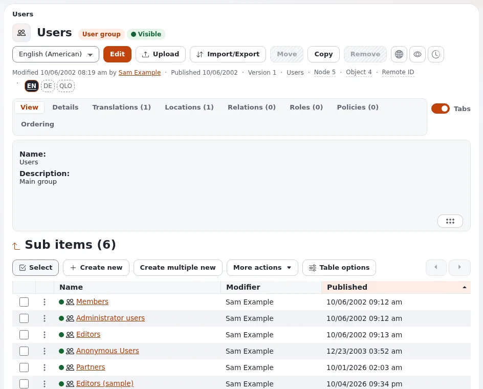

# Lesson 2.1: Users and user groups

In Exponential, users and user groups are content: they live in their own part of the content tree, under **Users**,
and are created, moved and edited like other items. A user's place in that tree decides which groups it belongs to,
and the groups decide most of what it may do. This lesson builds that picture before learners create accounts.

## At a glance

| | |
|---|---|
| Course | [Site administration](../README.md) |
| Module | [Module 2: Users and groups](README.md) |
| Duration | 35 minutes (15 presenting, 20 exercise) |
| Level | Intermediate |
| Audience | Site administrators |
| Prerequisites | [Module 1](../module-01-orientation/README.md); an administrator account on the training installation |

## Learning objectives

After this lesson, learners can:

- open the Users tree and name the user groups of a new installation;
- explain that a user belongs to every group it has a location in;
- read a group's **Roles** and **Policies** tabs;
- explain the special place of the anonymous user and the account `admin`;
- create a user group for a team.

## Trainer's notes

### How to present it

Source: [Roles, policies and unactivated users](../../../../guides/roles-and-policies.md) and
[Your account and signing in](../../../accounts-and-sign-in.md).

1. **The Users tree** (4 minutes). Press **Users** in the top menu. The left column shows **User accounts** with the
   top group **Users** and its groups (on a site installed from the 7x site packages, for example **Members**,
   **Administrator users**, **Editors** and **Anonymous Users**), and under **Access control** the entries
   **Roles and policies**, **Unactivated users** and **Check user accounts**.
2. **A group is an item** (3 minutes). Open **Administrator users**. It has the tabs of any item (**View**,
   **Details**, **Locations**, **Relations**) plus **Roles** and **Policies**: the roles assigned to this group and
   the policies they give.
3. **Membership is location** (4 minutes). A user is a member of the group it is placed in. A user with two locations
   (in **Editors** and in another group) has the roles of both. Moving a user to another group changes its rights at
   once.
4. **Two special accounts** (4 minutes). The anonymous user (in **Anonymous Users**) is who every visitor is before
   signing in: its roles decide what the public may see. The account `admin` is the first administrator; it should
   not be the everyday account of anyone (lesson 2.3).

### Common questions

**Can a user be in no group?** Every user object needs at least one location, and that location is below a group.
A user account without a location is reported as *Orphaned* on **Check user accounts** (lesson 2.4).

**Why is there a Trash entry under Users?** The left column shows the trash, but user objects never go to the trash:
removing a user is final. Lesson 2.4 shows how to retire accounts instead.

**Can a group be inside another group?** Yes. A member of an inner group also gets the roles assigned to the groups
above it.

### Pitfalls

- **Editing the Anonymous Users group's roles.** A wrong change there opens or closes the whole public site. Look,
  do not change, in this lesson.
- **Removing a group with users in it.** The users are removed with it, for good. Never remove a group in class
  without checking its sub items.

## Hands-on exercise

On your training installation, signed in as an administrator:

1. Press **Users** in the top menu. Write down the groups listed under **User accounts**.
2. Open **Administrator users** and its **Roles** tab. Note the role assigned and whether it has a limitation.
3. Open the **Policies** tab of the same group and read the policies it lists.
4. Open **Anonymous Users**, then its **Roles** tab. Note the role.
5. Open the top group **Users**. Under **Sub items**, press **Create new** and choose **User group**.
6. Name the group `Training team` and give it a short description.
7. Press **Send for publishing**.
8. Open the new group's **Roles** tab. It is empty: no role is assigned yet.
9. Open your own account (the user menu with your name in the header leads to it, or find it in
   **Administrator users**) and open its **Locations** tab. Which group is it in?

## Expected result

- Learners name four or more groups and the role of **Administrator users** and **Anonymous Users**.
- A group `Training team` exists directly below **Users**, with no roles.
- Step 9: the learner's account is located in **Administrator users**.
- The trainer checks by opening **Users** on one learner's screen and the new group's **Roles** tab.

## Quiz

1. What decides which groups a user belongs to?
   A. A field on the user B. Its locations in the Users tree C. The role list D. The siteaccess
2. Which account is every visitor before signing in?
3. Name the two tabs a user group has that an ordinary folder does not.
4. A user is in an inner group. Does it get the roles of the groups above it?
5. True or false: a removed user can be restored from the trash.

Answers

1. **B.** Membership is the user's location.
2. The anonymous user, in **Anonymous Users**; its roles decide what the public may see.
3. **Roles** and **Policies**.
4. Yes, the roles of the groups above it apply too.
5. **False.** User objects never go to the trash; removing one is final
   ([Check user accounts](../../../../features/6.0/user-hygiene.md)).

## Further reading

- [Roles, policies and unactivated users](../../../../guides/roles-and-policies.md): roles and how they reach users.
- [Your account and signing in](../../../accounts-and-sign-in.md): what users see of their own account.
- [Check user accounts](../../../../features/6.0/user-hygiene.md): the account checks of lesson 2.4.

## Related pages

- [Module 2: Users and groups](README.md)
- [Site administration: course overview](../README.md)
- [Trainers: start here](../../trainers-start-here.md)
- [Free documentation](../../../free-documentation.md): this page is free to copy, translate and improve under the GNU FDL 1.3.
