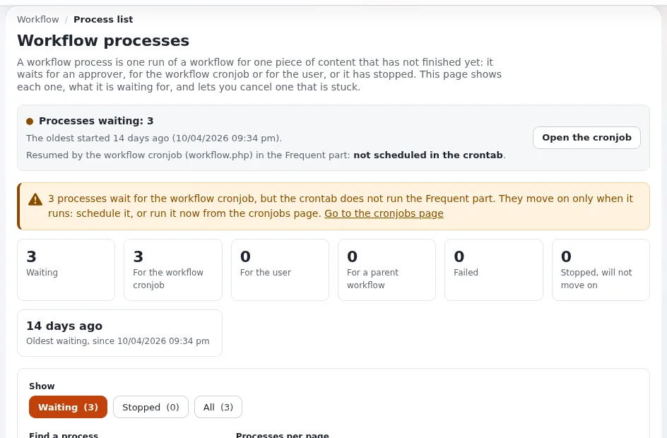
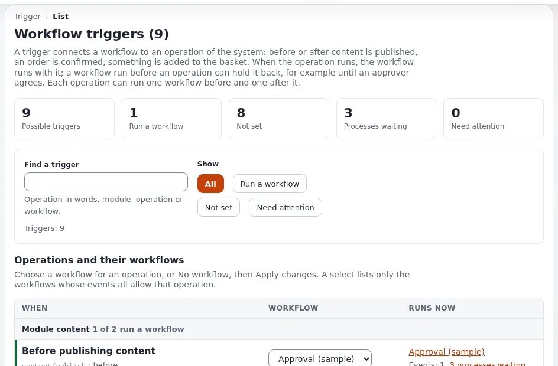

# Lesson 6.3: Workflows and approvals

A workflow holds an operation back until something has happened: most often, an article waits until a chief editor
approves it. Workflows depend on a cronjob, so this lesson follows straight on from lessons 6.1 and 6.2: without the
workflow cronjob, approved content is never published. Learners build an approval, see a waiting process and let the
cronjob finish it.

> **Note**
> A trigger acts on every publish of the installation. Set one up only on your training installation.

## At a glance

| | |
|---|---|
| Course | [Site administration](../README.md) |
| Module | [Module 6: Cronjobs, workflows and notifications](README.md) |
| Duration | 50 minutes (15 presenting, 35 exercise) |
| Level | Intermediate |
| Audience | Site administrators who set up editorial workflows |
| Prerequisites | [Lesson 6.2](the-cronjobs-page.md); an administrator account and one editor test account (address at `example.invalid`) |

## Learning objectives

After this lesson, learners can:

- explain workflow, event, trigger and workflow process in one sentence each;
- create a workflow with an **Approve** event and connect it to **Before publishing content**;
- read a waiting process on **Setup > Workflow processes** and open its approval request;
- explain why the workflow cronjob must run for an approved article to be published;
- cancel a stuck process and say what cancelling does to the content.

## Trainer's notes

### How to present it

Source: [Workflows: approvals, triggers and the processes that wait](../../../../guides/workflows.md), sections 1
to 7.

1. **The four words** (4 minutes). A *workflow* is an ordered list of *events* (approve, wait until date,
   multiplexer and others). A *trigger* connects a workflow to an operation, before or after it. A *workflow process*
   is one run of a workflow for one piece of content that has not finished. Draw the flow: **Send for publishing**,
   the trigger starts a process, the approve event waits, the approver decides, the cronjob carries on.
2. **The Approve event's form** (3 minutes). Affected sections, affected languages, affected versions, users and
   groups who approve, and excluded user groups. An approver never needs their own content approved.
3. **One workflow per trigger** (1 minute). To run several, put a *Multiplexer* event in the triggered workflow.
4. **The process list** (4 minutes). **Setup > Workflow processes** shows each waiting process with what it waits
   for, the content and version, who started it, the workflow and step. The status bar says whether the workflow
   cronjob is scheduled and when it runs next.
5. **Cancelling** (3 minutes). **Cancel...** asks first. Confirmed, a pending version becomes a draft again, the
   approval request is closed, the process is removed. Nothing is published or deleted.

### Common questions

**Can I try workflows without building one?** Yes. `php bin/php/console exp:collaborationsampledata` creates a
sample approval workflow, sample editors and three articles waiting for approval; `--remove` takes it all away
again. Run it with `--dry-run` first to see what it would create.

**The list of processes is empty. Is something broken?** No. A process exists only while a workflow waits.

**What is the difference between before and after?** *Before* holds the operation back until the workflow is done;
*after* runs the workflow once the operation has happened. Approvals use *before*.

**An approved article is still not published.** The workflow cronjob has not run since the approval. Run the
**Frequent** part, or wait for the crontab.

### Pitfalls

- **The trainer's own account.** If you test with an administrator who is also an approver, the event lets the
  version straight through. Publish as the editor test account.
- **Empty approver groups.** If nobody can approve, the process waits for ever. Add approvers to the event; a request
  already made keeps its participants, so cancel the process and send the content again.
- **Forgetting to remove the trigger.** Set the trigger back to **No workflow** at the end, or every later exercise
  waits for approval.

## Hands-on exercise

Use your own training installation. You need an administrator account and an editor test account with an address
at `example.invalid` (create one in **Users** if you have none; see lesson 2.5 of Train the trainer).

1. Open **Setup**, then **Workflows** in the left column. Open the group **Standard**.
2. Press **New workflow**, name it `Training approval`.
3. In the event list choose **Event / Approve** and press **Add event**.
4. In the event's form, set **Affected sections** to the section of your training content (or all sections), add
   your administrator's group under **Groups who approve content**, and press **OK**.
5. Open **Setup > Triggers**. In the row **Before publishing content**, choose `Training approval` and press
   **Apply changes**.
6. In a private browser window, sign in as the editor test account and publish a short article in a training
   folder. Note that it is not published yet.
7. Back as administrator, open **Setup > Workflow processes**. Find the process under **Before publishing content**
   and read what it waits for and the status bar about the workflow cronjob.
8. Press **Open the approval request** and approve the article.
9. Open **Setup > Cronjobs** and run the **Frequent** part for your public siteaccess (or run
   `php runcronjobs.php -s <site> --script=workflow.php` in a terminal).
10. Check the article: it is published, and the process has left the list.
11. Publish a second article as the editor. As administrator, press **Cancel...** on its process and read the
    confirmation page before you confirm with **Yes, cancel the process**.
12. Open **Setup > Triggers** and set **Before publishing content** back to **No workflow**; press **Apply changes**.

## Expected result

- After step 6 the editor sees that the article waits for approval; the site does not show it.
- Step 7 lists one waiting process with a link **Open the approval request**.
- After steps 8 and 9 the article is published and the process list no longer shows it.
- After step 11 the second article is a draft of the editor again; nothing was published or deleted.
- After step 12 publishing works without approval again.
- The trainer checks by asking each learner to show the trigger row reset to **No workflow**.

## Quiz

1. What connects a workflow to the publish operation?
   A. An event B. A trigger C. A section D. A role
2. An article was approved an hour ago and is still not published. What do you check first?
3. What happens to the content when you cancel a waiting approval process?
4. An administrator who is an approver publishes an article. Does it wait for approval?
5. Why does an approval use *before* and not *after* publishing?

Answers

1. **B.** A trigger links a workflow to an operation, before or after it
   ([Workflows, section 1](../../../../guides/workflows.md#1-workflows-events-triggers-and-processes)).
2. Whether the workflow cronjob runs: the status bar of **Setup > Workflow processes**, or the **Frequent** part on
   **Setup > Cronjobs**.
3. A pending version becomes a draft of its author again and the approval request is closed; nothing is published
   or deleted ([Workflows, section 7](../../../../guides/workflows.md#7-cancelling-and-cleaning-up-processes-safely)).
4. No. When the publishing user is one of the approvers, the event lets the version through.
5. *Before* holds the publish back until the workflow is done; *after* would run it when the article is already
   public.

## Further reading

- [Workflows: approvals, triggers and the processes that wait](../../../../guides/workflows.md): every status, the
  trigger list and troubleshooting.
- [Cronjobs, section 16: workflows, step by step](../../../../guides/cronjobs.md#16-workflows-step-by-step): the
  cronjob side of a workflow.
- [My drafts and my pending items](../../../../guides/drafts-and-pending.md): what editors see while content waits.

## Related pages

- [Module 6: Cronjobs, workflows and notifications](README.md)
- [Site administration: course overview](../README.md)
- [Trainers: start here](../../trainers-start-here.md)
- [Free documentation](../../../free-documentation.md): this page is free to copy, translate and improve under the GNU FDL 1.3.
