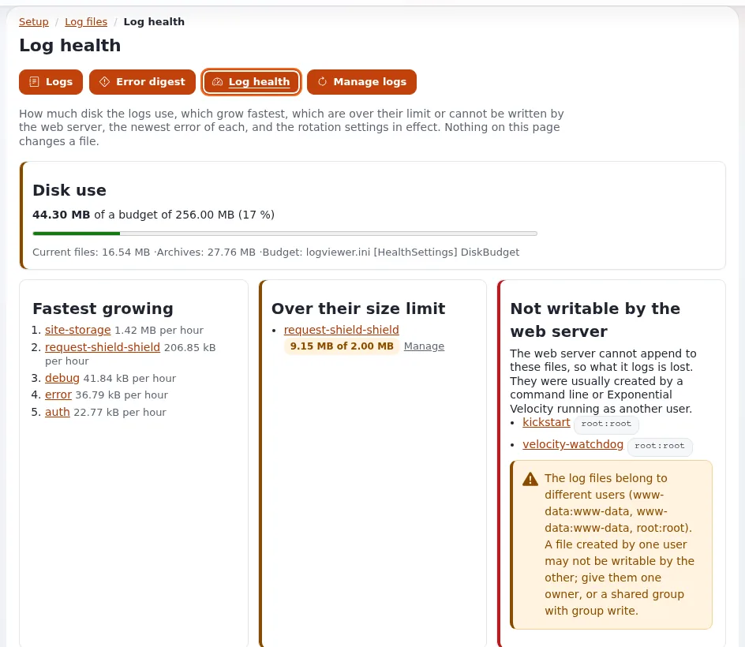

# Lesson 7.1: The log files

When something goes wrong, the log files are where an administrator starts. Exponential writes real faults to
`error.log`, missing pages to `404.log` and requests that look like attacks to `security.log`, and keeps every log
small by rotating it. This lesson builds the map of the files before lesson 7.2 shows the viewer that reads them.

## At a glance

| | |
|---|---|
| Course | [Site administration](../README.md) |
| Module | [Module 7: Logs and the audit trail](README.md) |
| Duration | 35 minutes (15 presenting, 20 exercise) |
| Level | Intermediate |
| Audience | Site administrators, support staff |
| Prerequisites | A training installation with shell access; [Module 6](../module-06-cronjobs-workflows-and-notifications/README.md) helps |

## Learning objectives

After this lesson, learners can:

- name the kernel logs in `var/log` and say what kind of line each one holds;
- explain why a missing page is in `404.log` and not in `error.log`;
- read one line of `404.log` and name its status, request, siteaccess and reason;
- explain when a log is rotated and how many archives are kept by default;
- list the log files with `exp:logs --list`.

## Trainer's notes

### How to present it

Sources: [The log viewer](../../../../features/6.0/log-viewer.md) ("In short"),
[Request logs: 404.log and security.log](../../../../features/6.0/request-logs.md) and
[Log rotation and pruning](../../../../features/6.0/log-rotation.md).

1. **Where logs live** (3 minutes). The kernel logs are in `var/log`: `error.log`, `warning.log`, `notice.log`,
   `debug.log`, `strict.log`, `deprecated.log` and `auth.log`, plus the cronjob logs. A site can have its own logs in
   `var/<site>/log`. Extensions write their own files too.
2. **One request, one log** (4 minutes). `error.log` keeps the real faults. A 404 or 410 answer goes to `404.log`
   with the reason the kernel found. What the request classifier takes for a probe or an attack goes to
   `security.log`, with its category and rule, whatever the status. A request is in only one of them.
3. **Privacy** (2 minutes). The request logs write masked client addresses (`203.0.x.x`) and replace query values
   in `404.log` with `***`. Nothing is blocked; the classifier only classifies.
4. **Rotation** (4 minutes). When a log outgrows `site.ini [FileSettings] LogFileMaxSize` (2 MB), the next write
   rotates it: the file becomes `.1`, the older archives move up, and archives beyond `LogFileRotateCount` (3) are
   removed. Compression of archives from `.2` on is optional and off by default.
5. **The command line** (2 minutes). `php bin/php/console exp:logs --list` lists the files with size, time and line
   rate.

### Common questions

**Why is my old error gone?** The log rotated and the archive holding it was removed after three rotations. Raise
`LogFileRotateCount` in an override if you need more history.

**Is `security.log` proof of an attack?** No. It records what a rule classified, with a confidence of low, medium or
high. Read it as pointers.

**Root wrote a log and now the site cannot.** A rotation creates the new log with the owner and mode of the old one,
but a log first created by root from the command line can still block the web server. Lesson 7.2 shows **Log health**,
which warns about such files.

### Pitfalls

- **Opening huge logs in an editor.** A `debug.log` can be large. Use `tail` or the viewer.
- **Pasting log lines into tickets.** Even masked lines can carry details; never paste unmasked lines.
- **Different servers, different logs.** Each web node keeps its own `var/log`. On a cluster, look on the node that
  answered.

## Hands-on exercise

Use your own training installation, in a terminal at the installation root.

1. List the kernel logs: `ls -l var/log`. Note which files exist and their sizes.
2. List the logs the way the viewer groups them:

   ```bash
   php bin/php/console exp:logs --list
   ```

3. In a browser, open an address on your training site that does not exist, for example `/no-such-page-training`.
4. Read the end of `404.log`:

   ```bash
   tail -n 3 var/log/404.log
   ```

   Find your request and its `reason=` field.
5. Read the last entries of `error.log` through the console (masked):

   ```bash
   php bin/php/console exp:logs --tail=var/log/error.log --lines=10
   ```

6. Find the rotation settings in use:

   ```bash
   grep -n "LogFileMaxSize\|LogFileRotateCount\|LogFileCompress" settings/site.ini
   ```

7. Preview a rotation of `debug.log` without doing it:

   ```bash
   php bin/php/console exp:logs --rotate=debug --dry-run
   ```

8. Write down, for each of `error.log`, `404.log` and `security.log`, one sentence on what kind of line it holds.

## Expected result

- Step 2 lists groups such as **Kernel** and **Site** with sizes and times.
- Step 4 shows a line beginning with the time and a masked address, then `404 GET /no-such-page-training`, the
  siteaccess and a reason such as `reason=module:no-such-page-training` or a node or kernel reason.
- Step 6 shows `LogFileMaxSize=2097152` and `LogFileRotateCount=3` unless an override changes them.
- Step 7 says what would be rotated and changes nothing.
- The trainer checks by asking a learner to read their 404 line aloud and explain the reason field.



## Quiz

1. A visitor opens a page that does not exist. Which log gets the line?
   A. `error.log` B. `404.log` C. `security.log` D. `notice.log`
2. With the default settings, how large can a log grow before it is rotated, and how many archives are kept?
3. A request for `/wp-login.php` on your site ends in a 404. In which log is it, and why?
4. What happens to the client address in the request logs?
5. Which command lists the log files from a shell?

<details>
<summary>Answers</summary>

1. **B.** Not-found answers go to `404.log` with their reason
   ([Request logs](../../../../features/6.0/request-logs.md)).
2. About 2 MB (`LogFileMaxSize=2097152`), and three archives (`LogFileRotateCount=3`).
3. In `security.log` only: the classifier names it a probe, and a classified request is written to one log only.
4. It is masked (`203.0.x.x`); the raw address is never written to these files.
5. `php bin/php/console exp:logs --list`.

</details>

## Further reading

- [Request logs: 404.log and security.log](../../../../features/6.0/request-logs.md): every field and setting.
- [Log rotation and pruning](../../../../features/6.0/log-rotation.md): rotation, pruning and per-log limits.
- [The log viewer and rotation for hosts](../../../hosting/operations/log-viewer-and-rotation.md): the host's view.
- [When something goes wrong](../../../when-something-goes-wrong.md): the first steps for any problem.

## Related pages

- [Module 7: Logs and the audit trail](README.md)
- [Site administration: course overview](../README.md)
- [Trainers: start here](../../trainers-start-here.md)
- [Free documentation](../../../free-documentation.md): this page is free to copy, translate and improve under the GNU FDL 1.3.
