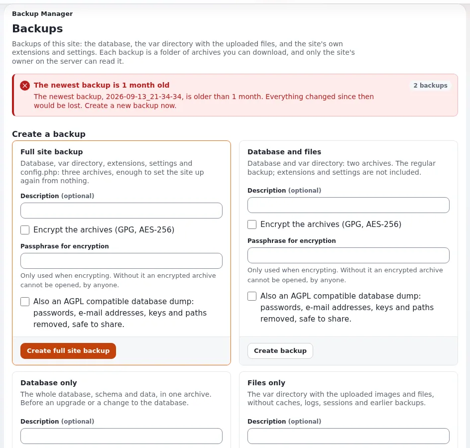

# Lesson 9.3: A backup and a restore test

"A backup that was never restored is a hope, not a backup." In this lesson learners take a real backup of their
training site, change the site on purpose, restore it, and run the checks that prove the restore is complete. The
lesson uses SQLite, the default database of a training installation; the trainer names the commands for other engines.

> **Note**
> A restore overwrites the site. Practise only on your own training installation, and keep the backup outside the
> installation directory.

## At a glance

| | |
|---|---|
| Course | [Site administration](../README.md) |
| Module | [Module 9: Backups and maintenance](README.md) |
| Duration | 55 minutes (15 presenting, 40 exercise) |
| Level | Intermediate |
| Audience | Site administrators, support staff |
| Prerequisites | [Lesson 9.1](what-to-back-up.md), [Lesson 9.2](maintenance-mode.md); a SQLite training installation with shell access and the `sqlite3` command |

## Learning objectives

After this lesson, learners can:

- take the database and the files of a site in one maintenance window;
- restore both in the right order, fix ownership and clear the caches;
- run the checks after a restore: the site answers, the version, the caches, the audit, the content;
- explain why a restore test belongs on another machine on a schedule;
- name the restore command of their own production database engine.

## Trainer's notes

### How to present it

Sources: [Restore and restore tests](../../../hosting/operations/restore-and-restore-tests.md),
[Database backups per engine](../../../hosting/operations/database-backups-per-engine.md) and
[After installing, 10.9](../../../../install/10-after-installing.md#109-backups-and-restore).

1. **The backup procedure** (3 minutes). Maintenance on; the database with the tool of its engine; the files; maintenance
   off. On SQLite the database is one file under `var/storage/sqlite3/` with its `-wal` and `-shm` files; use
   `sqlite3 <db> ".backup '<file>'"`, which is safe while the site runs.
2. **Before you restore** (3 minutes). Agree what is restored (everything goes back to the moment of the backup; for
   one deleted page, look at the trash first). Back up the current state. Restore onto the same release.
3. **The restore** (4 minutes). Maintenance on (and stop Velocity, so no worker holds the old database); restore the
   database and unpack the files; fix owner and mode; clear every cache and regenerate the autoloads; start Velocity,
   clear its response cache, maintenance off.
4. **The checks** (3 minutes). Show the table of checks after a restore: the site and the administration answer,
   the release in **Setup > System information**, caches, `exp:audit verify`, recent pages and an image, a test
   publish, `PRAGMA integrity_check` on SQLite, and new lines in `error.log`.
5. **Restore tests** (2 minutes). On another machine, at least once and after every major upgrade, and on a schedule.

### Common questions

**What about MySQL or PostgreSQL?** The same procedure with the engine's own tools; see
[Database backups per engine](../../../hosting/operations/database-backups-per-engine.md). Never copy the data files of
a running database server.

**Why stop Velocity?** Its workers keep database connections and caches. A restore under running workers can mix old
and new state.

**The restored site shows the maintenance page.** The backup of `var/` was taken while maintenance was on;
`php bin/php/maintenance.php off` ends it.

### Pitfalls

- **Running as root.** Files created by root in `var/` cannot be replaced by the web server afterwards. Run as the
  site's user, or fix ownership after the restore.
- **Forgetting the `-wal` file.** Restore with `.restore`, not by copying the database file over a running site.
- **Backing up into the installation.** A `tar` of `var/` that includes the backup itself grows on every run. Keep
  backups in a directory of their own, outside the installation.

## Hands-on exercise

Use your own SQLite training installation, in a terminal at the installation root. If the site runs on Velocity, you
need its stop and start commands from your trainer. Replace `exponential.db` with the name `ls var/storage/sqlite3/`
shows.

1. Make a directory for backups outside the installation: `mkdir -p ~/training-backups`.
2. Switch maintenance on: `php bin/php/maintenance.php on --message="Backup" --until=30m --allow-admin`.
3. Back up the database:

   ```bash
   sqlite3 var/storage/sqlite3/exponential.db ".backup '$HOME/training-backups/db.sqlite'"
   ```

4. Back up the files:

   ```bash
   tar czf ~/training-backups/files.tar.gz var/storage settings/override settings/siteaccess
   ```

5. Switch maintenance off: `php bin/php/maintenance.php off`. Note the time.
6. Change the site: publish a new article `After the backup` and move another training article to the trash.
7. Restore. Maintenance on; stop Velocity if it serves the site:

   ```bash
   php bin/php/maintenance.php on --message="Restoring" --allow-admin
   php bin/php/console exp:velocity stop
   ```

8. Restore the database and the files:

   ```bash
   sqlite3 var/storage/sqlite3/exponential.db ".restore '$HOME/training-backups/db.sqlite'"
   tar xzf ~/training-backups/files.tar.gz
   ```

9. Clear the caches and regenerate the autoloads:

   ```bash
   php bin/php/ezcache.php --clear-all
   php bin/php/ezpgenerateautoloads.php -e
   ```

10. Start Velocity, clear its response cache and switch maintenance off:

    ```bash
    php bin/php/console exp:velocity start
    php bin/php/console exp:velocity cache clear
    php bin/php/maintenance.php off
    ```

11. Run the checks: open the front page and the administration; `sqlite3 var/storage/sqlite3/exponential.db "PRAGMA integrity_check"`;
    `php bin/php/console exp:audit verify`; `tail -n 20 var/log/error.log`.
12. Look for the article `After the backup` and the article you moved to the trash.

## Expected result

- Step 3 and 4 created `db.sqlite` and `files.tar.gz` in `~/training-backups`.
- After step 10 the site answers `200` and the administration signs in.
- Step 11: `integrity_check` prints `ok` and `exp:audit verify` exits with 0. If it does not, stop and discuss the
  result with the trainer before going on.
- Step 12: `After the backup` is gone and the trashed article is back in its place: the site is at the moment of the
  backup.
- The trainer checks by asking each learner how long the restore took, and writes the times on the board.



## Quiz

1. In which order do you restore: maintenance, database, files, caches? Put them in order and add the missing steps.
2. Why is `sqlite3 ... ".backup"` better than `cp` for a running SQLite site?
3. A colleague deleted one page by mistake. Is a full restore the right answer?
4. Name three checks after a restore.
5. Why should a restore test run on another machine?

<details>
<summary>Answers</summary>

1. Maintenance on (and stop Velocity), restore the database, unpack the files, fix owner and mode, clear caches and
   regenerate autoloads, start Velocity and clear its response cache, maintenance off
   ([Restore, step by step](../../../hosting/operations/restore-and-restore-tests.md#the-restore-step-by-step)).
2. It is SQLite's online backup and is consistent while the site runs; a plain copy during a write, or without its
   `-wal` file, can be inconsistent.
3. No. Look at the trash and the older versions first; a full restore loses everything published since the backup.
4. Any three of: the site and the administration answer; the release in System information; cache status; `exp:audit
   verify`; recent pages, an image and a test publish; `PRAGMA integrity_check` on SQLite; no unexplained errors.
5. It proves the backup, the procedure and the time it takes without risking the live site.

</details>

## Further reading

- [Restore and restore tests](../../../hosting/operations/restore-and-restore-tests.md): the procedure and the checks.
- [Restore from backup](../../../hosting/runbooks/restore-from-backup.md): the runbook for an incident.
- [Databases, chapter 9](../../../../install/09-databases.md): backup and restore per engine.
- [Backup schedules and retention](../../../hosting/operations/backup-schedules-and-retention.md).

## Related pages

- [Module 9: Backups and maintenance](README.md)
- [Site administration: course overview](../README.md)
- [Trainers: start here](../../trainers-start-here.md)
- [Free documentation](../../../free-documentation.md): this page is free to copy, translate and improve under the GNU FDL 1.3.
