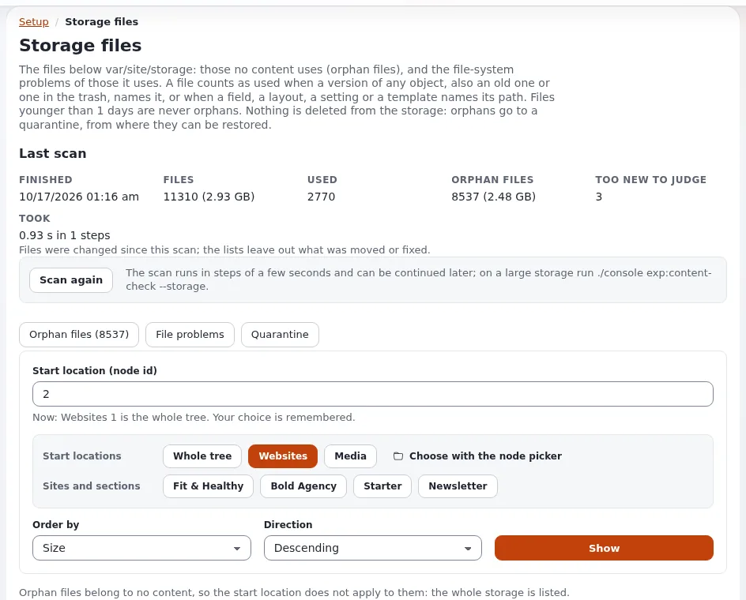

# Lesson 9.4: Checking files and storage

After a restore, a server move or a disk cleanup, three questions matter: does every image and file the content uses
still exist, which files in the storage does no content use any more, and were any of the installation's own files
changed? Exponential answers each with a check that changes nothing until you ask it to. This lesson uses all three.

> **Note**
> The checks only read. Moving orphan files to the quarantine is reversible; deleting from the quarantine is not. Do
> not delete anything in class.

## At a glance

| | |
|---|---|
| Course | [Site administration](../README.md) |
| Module | [Module 9: Backups and maintenance](README.md) |
| Duration | 40 minutes (15 presenting, 25 exercise) |
| Level | Intermediate |
| Audience | Site administrators, support staff |
| Prerequisites | [Lesson 9.3](backup-and-restore-test.md); an administrator account and a shell on the training installation |

## Learning objectives

After this lesson, learners can:

- run the missing files check from **Setup > Broken relations** and read its states;
- run the same check from a shell with `exp:content-check --missing-files`;
- scan **Setup > Storage files**, read the orphan files and move one to the quarantine and back;
- check the installation's files against the release list with `verifyfiles.sh`;
- say which check to run after a restore, a server move and an upgrade.

## Trainer's notes

### How to present it

Sources: [Missing files and image aliases](../../../../guides/missing-files.md),
[The content checks](../../../../features/6.0/content-checks.md) (sections "Storage files" and "Quarantine") and
[File consistency check](../../../../features/6.0/file-consistency-check.md).

1. **Missing files** (4 minutes). A target of **Setup > Broken relations**: tick **Missing files in var/site/storage**
   (the name of your storage directory is shown) and run the check. Each row names the object, the field, the version,
   the expected path and the state: **File missing**, **Alias missing**, **Alias out of date** or **Alias never made**.
   An alias is made the first time an image is shown in it, so *never made* is normal.
2. **Storage files** (4 minutes). **Setup > Storage files** scans `var/<site>/storage` and lists **Orphan files** (no
   content uses them, including old versions and the trash) and **File problems** (wrong owner or mode, empty files,
   names that differ in case). A file younger than a day is never an orphan.
3. **The quarantine** (3 minutes). Orphans are moved to `var/<site>/storage-quarantine/<date>/`, recorded in a
   manifest, and can be restored. Nothing is ever deleted from the storage itself.
4. **File consistency** (3 minutes). `bash bin/shell/verifyfiles.sh` compares every file with the release's
   `share/filelist.md5`; exit status 0 means all match. Run it from the document root.
5. **Which check when** (1 minute). After a restore or a move: missing files. During a cleanup: storage files. After
   an upgrade or an incident: file consistency.

### Common questions

**Who may run the checks?** The policies of the module `contentcheck`; only Administrator has them on a new
installation. Every list shows only what the user's `content/read` allows.

**Why is an image of an old version not an orphan?** It is still shown in the history and restored with that version.

**The consistency check lists files I changed on purpose.** It lists every file that differs from the release. A
change made in place belongs in an extension or an override instead; the upgrade lesson (Module 10) comes back to it.

### Pitfalls

- **Scanning a large storage in the browser.** It runs in steps; on a big site, use the command line.
- **Quarantining files of a site restored from an older backup.** Run the missing files check first; a file can look
  orphaned when its content was not restored.
- **Running `verifyfiles.sh` from the wrong directory.** The paths in the list are relative to the document root.

## Hands-on exercise

Use your own training installation, in the browser and in a terminal at the installation root.

1. Open **Setup > Broken relations**. Press **Whole tree**, tick **Missing files in var/site/storage** (the name may
   differ) and run the check. Read the findings.
2. In a terminal, run the same check:

   ```bash
   php bin/php/console exp:content-check --missing-files --node=2
   ```

3. Break one file on purpose: find the original of a training image under `var/<site>/storage/images` and rename it
   with a `.bak` ending (`mv <file> <file>.bak`).
4. Run step 2 again and find the row **missing** for that image. Rename the file back and run it once more.
5. Open **Setup > Storage files** and press **Scan again**. Read **Last scan**, then **Orphan files**: count and size.
6. If there are orphans, tick one and press **Move ticked files to the quarantine**; read the confirmation before you
   confirm.
7. Find the file in the quarantine list and restore it to its place.
8. Check the installation's files against the release:

   ```bash
   bash bin/shell/verifyfiles.sh
   echo "exit status: $?"
   ```

9. Write one sentence for each check: when you would run it on a real site.

## Expected result

- Step 1 shows the findings, or none on a healthy training site.
- Step 4 lists the renamed image as missing; after renaming it back, it is gone from the list.
- Step 5 shows the scan with totals; step 7 puts the quarantined file back where it was.
- Step 8 ends with exit status 0, or lists files that differ from the release (a training installation built from a
  development branch may show some).
- The trainer checks that every learner restored the file of step 3 and the file of step 6.



## Quiz

1. Which state of the missing files check is normal and not a problem?
   A. **File missing** B. **Alias missing** C. **Alias out of date** D. **Alias never made**
2. Where does **Move ticked files to the quarantine** put a file, and can it come back?
3. Which command checks whether the installation's own files match the release?
4. A file was uploaded an hour ago and no content uses it yet. Is it listed as an orphan?
5. You restored a site from a backup. Which check do you run first?

<details>
<summary>Answers</summary>

1. **D.** An alias is made the first time an image is shown in it
   ([Missing files](../../../../guides/missing-files.md#1-open-the-check)).
2. In `var/<site>/storage-quarantine/<date>/`, recorded in a manifest; it can be restored to its place
   ([Quarantine](../../../../features/6.0/content-checks.md#quarantine)).
3. `bash bin/shell/verifyfiles.sh`, run from the document root.
4. No. A file younger than a day is never an orphan.
5. The missing files check: does every file the content uses exist?

</details>

## Further reading

- [Missing files and image aliases](../../../../guides/missing-files.md): reading and resolving the findings.
- [The content checks](../../../../features/6.0/content-checks.md): unreferenced objects, broken relations, storage
  files and the quarantine.
- [File consistency check](../../../../features/6.0/file-consistency-check.md).
- [Disk full runbook](../../../hosting/runbooks/disk-full.md): when the storage fills the disk.

## Related pages

- [Module 9: Backups and maintenance](README.md)
- [Site administration: course overview](../README.md)
- [Trainers: start here](../../trainers-start-here.md)
- [Free documentation](../../../free-documentation.md): this page is free to copy, translate and improve under the GNU FDL 1.3.
