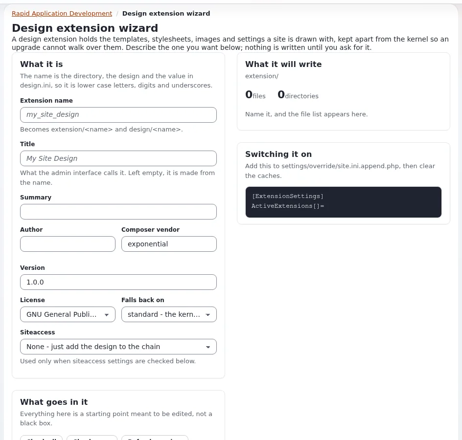

# Lesson 2.1: Your own design extension

Learners stop reading and start building. Every change from now on happens in a design extension of their own, never
in `design/standard/` or in a shipped theme. The design extension wizard writes a complete, working skeleton in a
minute; this lesson walks through it, switches it on for one siteaccess and proves that the site now draws with it.

> **Note** The wizard writes into `extension/`. Use it on each learner's own training installation, never on a shared
> or live site.

## At a glance

| | |
|---|---|
| Course | [Theme design](../README.md) |
| Module | [Module 2: Templates, overrides and the pagelayout](README.md) |
| Duration | 60 minutes (20 presenting, 40 exercise) |
| Level | Beginner |
| Audience | Designers and front-end developers |
| Prerequisites | [Module 1](../module-01-designs-and-the-fallback-chain/README.md); an administrator account with `setup/setup` on the learner's own installation |

## Learning objectives

After this lesson, learners can:

- create a theme extension with the **Design extension wizard** and read every file before it is written;
- name the files the wizard writes and what each one is for;
- activate the extension and set `SiteDesign` for one siteaccess only;
- show with template path comments that their own `pagelayout.tpl` draws the site.

## Trainer's notes

### How to present it

Sources: [The design extension wizard](../../../designers/extensions/design-extension-wizard.md),
[The folder structure of a theme extension](../../../designers/extensions/extension-folder-structure.md) and
[Activating a theme](../../../designers/extensions/activating-a-theme-extension.md).

1. **Why an extension** (3 minutes). A theme in its own extension can be switched on and off, versioned in git,
   updated without touching the kernel, and handed to others (module 7). The extension name becomes both
   `extension/<name>` and the design `design/<name>`.
2. **The wizard** (7 minutes). Open **Setup > RAD** and the design extension tool (`/setup/designextension`). Walk
   through **What it is** (**Extension name**, **Title**, **Summary**, **Author**, **Composer vendor**, **Version**,
   **License**, **Falls back on**, **Siteaccess**) and **What goes in it** (one checkbox per part, with **Check all**
   and **Check none**). Press **Refresh preview** and open two files under **What it will write**. Point out that
   nothing is written before **Create in extension/**, and that the wizard never writes over an extension that exists.
3. **What it wrote** (5 minutes). Show the tree of one generated extension:

   | File | Purpose |
   |---|---|
   | `settings/design.ini.append.php` | `DesignExtensions[]=<name>`, plus `CSSFileList[]=site.css` and `JavaScriptList[]=site.js` |
   | `design/<name>/templates/pagelayout.tpl` | the frame, with `$module_result.content` inside `<main>` |
   | `design/<name>/templates/page_head.tpl`, `page_header.tpl`, `page_footer.tpl` | the parts the pagelayout includes |
   | `design/<name>/stylesheets/site.css`, `javascript/site.js` | the site's own files |
   | `settings/override.ini.append.php`, `design/<name>/override/templates/full/article.tpl` | an example override |
   | `ezinfo.php`, `extension.xml`, `README.md`, `LICENSE` | metadata and documentation (module 7) |

4. **Switching it on** (5 minutes). Two steps: activate the extension, then give one siteaccess the design. Show both
   commands of the exercise. Stress that `SiteDesign` is set for one siteaccess, never globally (lesson 1.2).

### Common questions

**Which design should my theme fall back on?** `standard` gives you the kernel templates and nothing else; you write
everything visible yourself. Falling back on another design (for example `base`) reuses its templates. For this
course choose `standard`: every visible piece is then the learner's own.

**The generated `page_head.tpl` has `implode_key` in the title.** Your installation has an older wizard. Make the three
edits from [The design wizard's parts](../../../designers/extensions/design-wizard-parts-reference.md#three-edits-the-generated-head-and-layout-need).

**Can I do this without the wizard?** Yes:
[create the skeleton by hand](../../../designers/extensions/extension-folder-structure.md#step-by-step-create-the-skeleton-by-hand).
The wizard is faster and makes fewer mistakes in class.

### Pitfalls

- **A name that is taken or invalid.** The name must be lower case letters, digits and underscores, starting with a
  letter. Give each learner a name, for example `training_theme`, or `training_<initials>` on a shared server.
- **Setting `SiteDesign` in `settings/override/`.** The administration then draws with the learner's theme. Undo it
  with `exp:ini rem ... global` and set it per siteaccess.
- **Nothing changes after switching on.** The INI cache still holds the old settings. Clear it, as in step 9.
- **A Velocity lab.** If the lab is served by Velocity, its workers keep the settings they started with; run
  `php bin/php/console exp:velocity restart` after activating the extension.

## Hands-on exercise

On your own training installation, signed in to the administration with your training administrator account, and in
a shell in the installation root. `<site>` is your public siteaccess from module 1.

1. Open **Setup > RAD**, then the design extension wizard (or go to `/setup/designextension`).
2. Under **What it is**, enter **Extension name** `training_theme`, a **Title** and a one-sentence **Summary**. Leave
   **Falls back on** at `standard` and **Siteaccess** at "None - just add the design to the chain".
3. Under **What goes in it**, press **Check all**, then untick **Siteaccess settings**, **Template operators** and
   **composer.json**.
4. Press **Refresh preview**. Open `settings/design.ini.append.php` and `templates/pagelayout.tpl` in the list and
   read them.
5. Press **Create in extension/**. Read the message and the activation lines the page shows.
6. In the shell, list what was written: `find extension/training_theme -type f | sort`.
7. Activate the extension for the whole installation, first as a dry run, then for real:

   ```bash
   php bin/php/console exp:ini add 'site.ini/ExtensionSettings/ActiveExtensions[]' training_theme global --dry-run
   php bin/php/console exp:ini add 'site.ini/ExtensionSettings/ActiveExtensions[]' training_theme global
   ```

8. Give your public siteaccess the new design, with nothing in between:

   ```bash
   php bin/php/console exp:ini set site.ini/DesignSettings/SiteDesign training_theme siteaccess:<site>
   php bin/php/console exp:ini clear site.ini/DesignSettings/AdditionalSiteDesignList siteaccess:<site>
   ```

9. Clear the caches: `php bin/php/ezcache.php --clear-tag=ini`, then
   `php bin/php/ezcache.php --clear-id=template,template-override`. On a Velocity lab, also run
   `php bin/php/console exp:velocity restart`.
10. Check the chain: `php bin/php/console exp:ini where site/DesignSettings/SiteDesign <site>`.
11. Switch template path comments on for `<site>` (lesson 1.3), open the front page and read the first `START` in the
    page source.
12. Open the administration in another tab and check that it still looks as before.

## Expected result

- Step 6 lists the files from the table above, below `extension/training_theme/`.
- Step 10 ends with `SiteDesign=training_theme` in effect for `<site>`.
- Step 11: the site looks plain (a header with the site name and a menu of the top-level items, the content, a footer
  with the year), and the first comment is
  `<!-- START extension/training_theme/design/training_theme/templates/pagelayout.tpl -->`.
- Step 12: the administration is unchanged.
- The trainer checks one learner's page source on the projector.



## Quiz

1. Which two names does the **Extension name** in the wizard become?
2. Which file makes the extension's `design/` folder part of the chain, and with which line?
3. Why is `SiteDesign` set with the scope `siteaccess:<site>` and not `global`?
4. The site still shows the old design after step 8. Name the cache you clear first.
   A. content B. ini C. image D. user info
5. What does **Refresh preview** write to disk?

<details>
<summary>Answers</summary>

1. The folder `extension/<name>` and the design `design/<name>`
   ([The design extension wizard](../../../designers/extensions/design-extension-wizard.md)).
2. `settings/design.ini.append.php` with `DesignExtensions[]=training_theme`.
3. A global value applies to every siteaccess, including the administration.
4. **B.** The INI cache holds the old `SiteDesign`; then the template caches.
5. Nothing. It only lists the files; **Create in extension/** writes them.

</details>

## Further reading

- [The design extension wizard (Setup > RAD)](../../../designers/extensions/design-extension-wizard.md): every field.
- [The design wizard's parts](../../../designers/extensions/design-wizard-parts-reference.md): what each checkbox
  writes.
- [Registering the design: DesignExtensions[]](../../../designers/extensions/registering-the-design.md): symptoms when
  it is missing.
- [The design settings a theme ships](../../../designers/extensions/design-settings-a-theme-ships.md): which settings
  belong in the theme and which in the installation.
- [RAD tools](../../../../features/6.0/rad-tools.md): the other wizards of **Setup > RAD**.

## Related pages

- [Module 2: Templates, overrides and the pagelayout](README.md)
- [Theme design: course overview](../README.md)
- [Trainers: start here](../../trainers-start-here.md)
- [Free documentation](../../../free-documentation.md): this page is free to copy, translate and improve under the GNU FDL 1.3.
