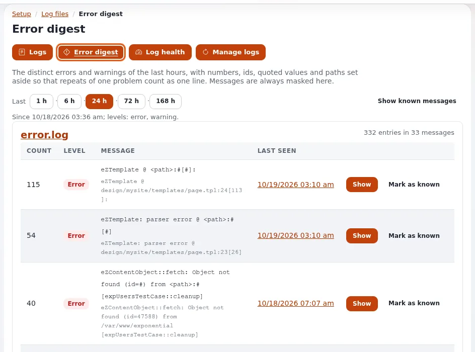
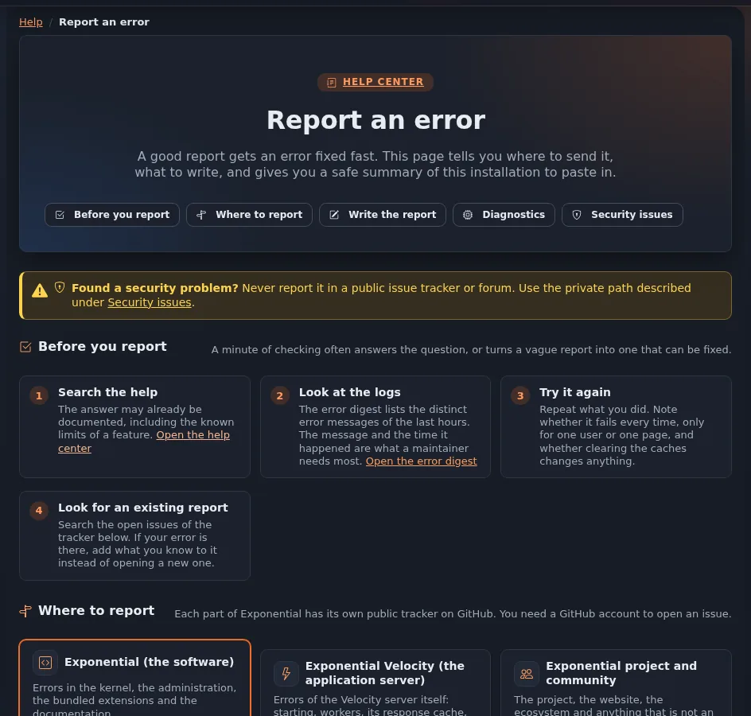

# When something goes wrong

This page is for everyone who meets an error: an editor in the administration, a visitor of the site, or an
administrator who passes a problem on. It explains what the common error pages mean, who to tell, and how to describe
a problem so that it gets fixed.

## First: is it an error?

Some pages look like errors but only say that something is not allowed or not there:

| What the page says | What it means | What to do |
|---|---|---|
| *The requested page could not be displayed. (1)*, *...because of security issues*, *Your account does not have the proper privileges* | Your role may not open this page or do this action. | Ask your administrator for access, if you need it. |
| *The requested page could not be displayed. (20)*, *The requested address or module could not be found* | The address is wrong, or that part is not installed on this site. | Check the address; go back and use the menus. |
| *Possible edit conflict* | Someone (or you) already has a draft of the item. | See [Creating and editing content](editing-content.md#when-someone-else-is-editing). |
| A button is grayed out | You may not use it here, or now (for example while editing). | Point at it to read why. |
| The page is very slow, or the site is in maintenance | The site may be busy, or being updated. | Wait a moment and try again. |

## When something really went wrong

An error of the site shows a page such as **Something went wrong on our side**, with a **reference** at the bottom,
for example `ERR-0123456789`. The error has already been logged; the reference lets an administrator find exactly
that moment in the logs.

1. **Note the reference**, the time, and the address of the page (copy it from the browser's address bar).
2. **Write down what you did**, step by step, right before the error: which page, which button, what you typed.
3. Try once more. If it works now, mention that it happened once.
4. **Tell your administrator** (or the site's contact) and pass on the reference, the time, the address and the
   steps. Administrators find the request from the reference, see
   [Finding an error by its reference](../guides/finding-an-error-by-its-reference.md).

A screenshot helps, as long as it shows no passwords or other people's personal data.

## Filing a bug in Exponential

When your administrator (or you, as one) finds that the problem is in the software itself and not in the site's own
setup, file it publicly so it can be fixed for everyone. The **Report an error** page of the help
(`exphelp/report` in the administration) guides you through it, fills in a summary of the installation for you and
opens a new issue with a prepared title and text.

Choose the right tracker:

| Tracker | For |
|---|---|
| [Exponential (the software)](https://github.com/se7enxweb/exponential/issues) | Errors in the kernel, the administration, the bundled extensions and the documentation. |
| [Exponential Velocity](https://github.com/se7enxweb/exponential-velocity/issues) | Errors of the Velocity application server: starting, workers, its response cache, HTTPS. |
| The extension's own repository | Errors in one extension that has its own repository; the **Report an error** page lists them. |
| [Exponential project and community](https://github.com/se7enxweb/exponential-community/issues) | The project, the website, the ecosystem, and everything that is not an error in a piece of software. |

You need a free GitHub account to open an issue. Search the tracker first: if the problem is already known, add what
you know to that issue instead of opening a new one.

### A good bug description

- **A short title** that names the problem: *Upload page: ZIP file with a folder fails with "temp_dir"*.
- **What you did**, step by step, so someone else can make it happen again.
- **What you expected**, and **what happened instead**, with the exact message.
- **The environment**: the Exponential version, the PHP version, the web server (Exponential Velocity, Apache or
  nginx with PHP-FPM, FrankenPHP), the database and the administration design. The **Report an error** page and
  **Setup** > **System information** (**Copy report as text**) give you this summary; both leave out passwords,
  keys and server paths. On the command line, `./console exp:info --plain --no-logo` (or `--json`) gives the same
  and more (every extension with its version, the engine, the caches): it never prints a password, key, token,
  database user or full database address, so you can paste it as it is ([The system card](../features/6.0/system-card.md)).
- **Log lines** around the time, if an administrator can get them; remove anything private first.

Never put passwords, keys, session cookies, database addresses, or the personal data of customers or users into a
public issue.

### Even better: send the fix

If you found the cause yourself, you can send the fix along with the report. With the code installed as Git clones,
a fix is a branch in your fork and a pull request away, and it reaches every site in the next release.
[Develop with Git](develop-with-git.md#contribute-a-change-with-a-pull-request) shows how, step by step. Mention the
issue in the pull request (for example `Fixes #123`) so both are linked.

## Security problems

If you find a security problem, such as a way to see or change what you should not, do **not** file it in a public
tracker. Send it privately to **security@se7enx.com**, or use GitHub's private vulnerability reporting of the
repository. Say which version you run, what an attacker could do, and how to reproduce it. The full policy is in the
file `SECURITY.md` at the root of the installation.

**"This installation is a public demo".** That message, or a **Demo mode** banner, means the site runs in demo mode on purpose: administrator passwords cannot be changed or reset there. If it shows on a real site, tell the people who run the server at once. [Demo mode FAQ](demo-mode-faq.md), [Demo mode problems](hosting/runbooks/demo-mode-problems.md).

## Asking for help

For questions that are not bugs ("how do I ...?"), the community is the right place: the
[Exponential community forums](https://share.exponential.earth/forums), the
[Telegram community chat](https://t.me/exponentialcms), the [Discord server](https://discord.gg/zXzGMgfzej) and the
[Slack workspace](https://exponentialcms.slack.com/), all free. Before you ask, look in the
[Exponential documentation](https://exponential.doc.exponential.earth/Exponential), on
[eZpedia](https://ezpedia.exponential.earth/) and in the [articles on Share Exponential](https://share.exponential.earth/learn).
The other help pages may already have the answer: see [Help for editors and users](README.md).

Free help depends on the time people give, so nobody promises an answer time. When you cannot wait, the project's
[support page](https://exponential.earth/support) recommends paid support from 7x, the company that maintains
Exponential ([se7enx.com/services](https://se7enx.com/services)). Both kinds of support are explained on
[Getting support](project/getting-support.md).
