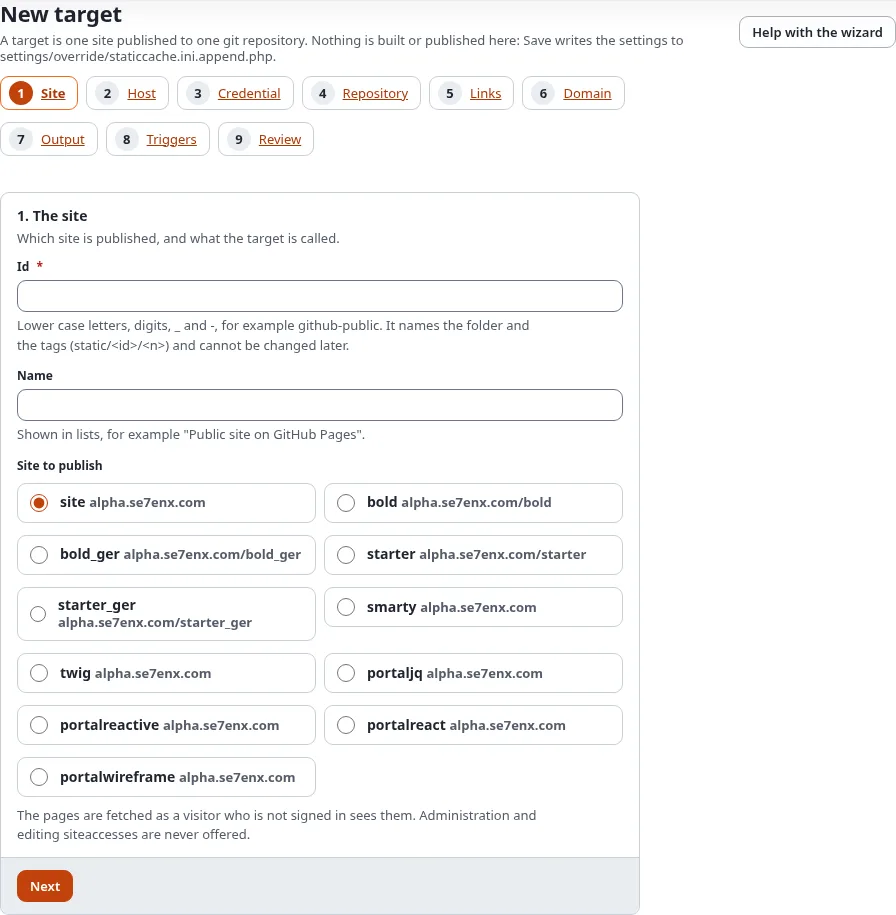
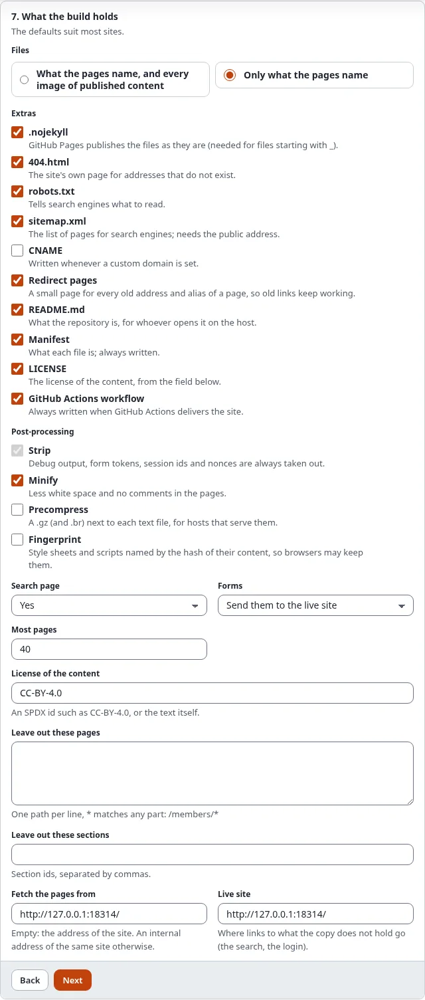
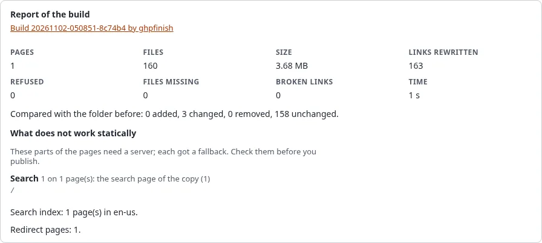

# A static blog with Exponential

A tutorial for bloggers and the people who set up blogs for them: write posts in Exponential, publish the blog as a
free static site on GitHub Pages, and keep its search and its archive pages working.

[Guides](README.md) · Related: [Make a free website in 15 minutes](../help/static-publishing/make-a-free-website-in-15-minutes.md),
[Static publishing: dynamic features](static-publishing-dynamic-features.md)

## What you'll have at the end

A blog at `https://<owner>.github.io/<repository>/` or your own domain, with every post, its archive and list pages,
a search that works in the browser, and new posts published a few minutes after you press **Publish**.

## 1. Check what a blog needs

| Part of the blog | On the static copy |
|---|---|
| Posts, images, categories | copied as they are |
| List pages with paging (`/blog/(offset)/10`) | copied: Exponential's view parameters are part of the path |
| Pages that only exist with a query string (`/blog?page=2`) | skipped and reported; use view parameters in the design |
| Search | a search page with an index in the browser (`Search=enabled`) |
| Comments | a short text with a link to the live post, or left out |
| Login, a contact form | a short text, or the form posts to the live site (`Forms=endpoint`) |

If comments matter to you, keep them on the live site, or use a comment service that runs in the browser and add it
to the design.

## 2. Make the target

In Setup > Static publishing > **New target**: the blog's siteaccess, a GitHub repository, a token or deploy key,
relative links and the base path `/<repository>/` (or your own domain in step 6).



In step 7, **What the build holds**, switch the **search page** on. If the blog has a contact form, choose whether it
posts to the live site or is hidden ([Search, forms and comments](../help/static-publishing/search-forms-and-comments-on-a-static-site.md)).



## 3. Leave out what is not a post

Tag clouds, the registration and other pages that start a session for anonymous visitors are refused by the build.
Leave them out:

```ini
ExcludePaths[]
ExcludePaths[]=/user/*
ExcludePaths[]=/tags/*
```

## 4. Build and look

Build, then open **Preview**. Check a post, a list page with paging and the search page. The report lists what was
replaced (search, forms, comments) as `degraded`.



## 5. Publish

Press **Publish**, then in the repository's **Settings > Pages** deploy from the branch `gh-pages`. A few minutes
later the blog is online.

## 6. New posts publish themselves

In step 8, **Triggers**, tick **When content is published**. A new post marks its own page and the list pages that
show it stale; a few minutes after your last change the cronjob part `staticpublish` builds and publishes them. A
publish that fails is retried, and you get an e-mail if you set **Notify** on failures.

## Next step

[A static documentation site](a-static-documentation-site.md).
