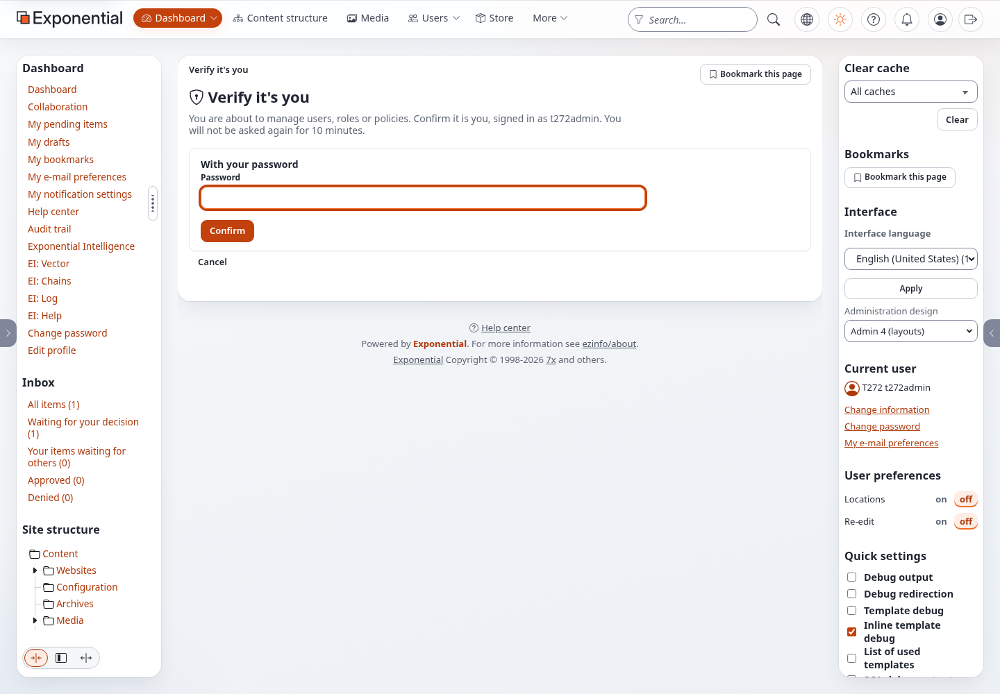
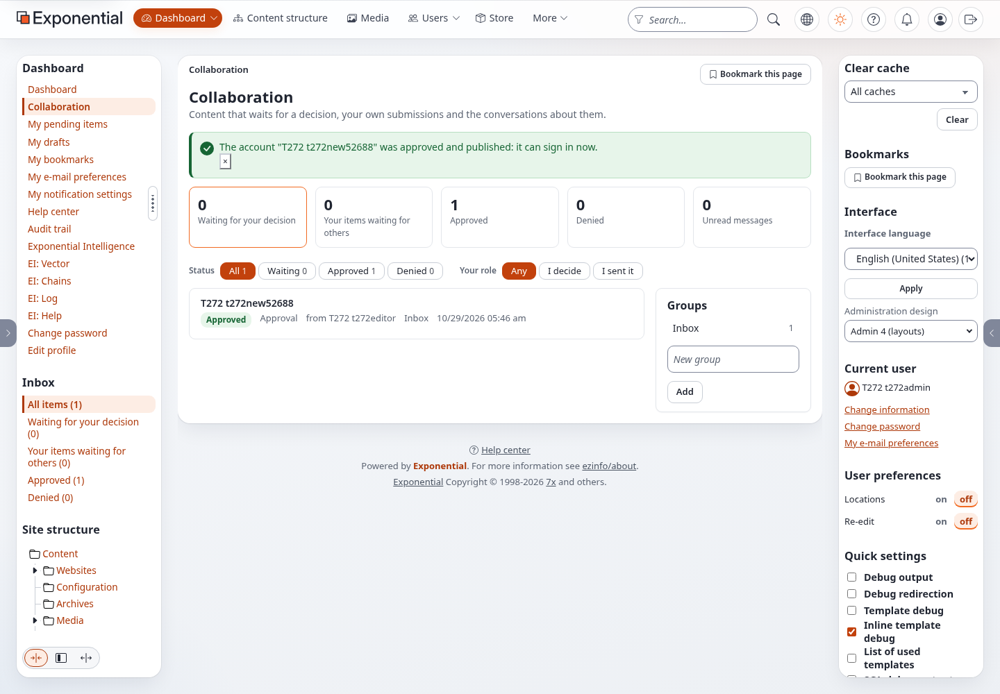
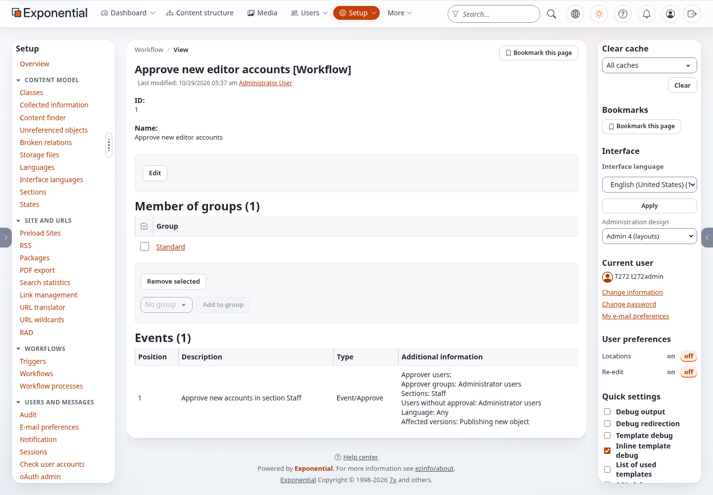

# Approving new editor accounts

Editors may create the account of a new editor; an administrator approves it before it can sign in. This guide sets it
up on an installation, follows one account from the editor's request to the administrator's decision, and shows where
each step leaves its trace. It is for site owners and administrators.

Time: 15 minutes.

What you need: an installation of 6.0.15 or later, the administrator login, a test editor (a user in Editors) and,
for the test, mail written to files instead of sent (step 2).

## 1. Check or set up the approval

A new installation has it. On one that exists, run from the installation root:

```bash
php bin/php/adduserapproval.php --dry-run --allow-root-user
```

Expected on an installation without it:

```
requires approval  Editors (node 14, object 13)
approves           Administrator users (node 13, object 12)
requests           Editors (node 14, object 13)
  would create workflow "Approve new editor accounts"
  would create trigger content/publish/before
  would add event "Approve user accounts"
  would create role "Editor account requests"
  would add policy content/read Node=14
  would add policy content/create Class=4 Node=14 ParentClass=3
  would assign the role to Editors (no limitation)
PASS: 7 change(s) would be made (dry run, nothing changed)
```

On one that has it: `has everything: workflow, trigger, event, role, policies, assignments` and `PASS: 0 change(s)`.
If content/publish (before) runs another workflow already, the line says so and the event goes first into that
workflow. Run it without `--dry-run` to make the changes; it ends with `PASS: the approval of new accounts is set up`.
Then clear the INI cache and, on Velocity, deploy the kernel:

```bash
php bin/php/ezcache.php --clear-tag=ini --allow-root-user
./console exp:velocity deploy --kernel --allow-root-user     # on Velocity only
```

Open **Setup > Workflows > Approve new editor accounts**. The event *Approve user accounts* lists *Accounts that need
approval: Editors*, *Approver groups: Administrator users*, *E-mail to the approvers: Yes*. **Setup > Triggers**
shows content / publish / before with that workflow.

## 2. Keep the test mail on the server

For a test, write mail into files: in `settings/override/site.ini.append.php`, `[MailSettings] Transport=file`, then
clear the INI cache. Each mail is a file in `var/log/mail/`. Use test users with addresses in `example.invalid`.
Set `[UserSettings] RegistrationAdminBaseURL` to the address of your administration (for example
`https://admin.example.com` or `https://www.example.com/admin`) so the link in the mail points to it.

## 3. The editor asks

Sign in as the test editor. Open **Users > Editors**, choose **User account** in *Create here*, fill in first name, last
name, username, an e-mail address in `example.invalid` and a password, and press **Send for publishing**.

Expected: the editor lands back on Editors; the new account is not in the list. Dashboard > *My pending items* lists
it, and Collaboration > *Your items waiting for others* has the approval. Trying to sign in with the new account fails:
*The username or password is not right* (an account that waits is not published).

## 4. The mail

`var/log/mail/` has one file per administrator with an address, subject *New user account waiting for approval: <name>*.
The text names the account, the username, the group (*Editors*) and who asked, and has one link:
`<administration>/collaboration/item/full/<number>`. Nothing else: no key, no token, no "approve" link.

## 5. The administrator decides

Open the link in a browser where you are not signed in. The administration asks you to sign in; then the approval page
opens: *Approval*, *Decision* with the account's preview, *Participants* (the approvers and the editor).


- Press **Approve** and confirm. Expected message: *The account "<name>" was approved and published: it can sign in
  now.* The account is in Users > Editors, and it signs in with the password the editor set.
- Or press **Deny** and confirm. Expected: *The account "<name>" was denied. It is not published and cannot sign in;
  it is a draft of its author again.* The editor finds it in *My drafts*.

Before the decision is carried out, **Verify it's you** asks (the group *users*, on by default): enter your password
(or use a passkey or the code of your authenticator app) and press **Confirm**. A wrong password is refused with the
page asked again, and nothing is decided; the right one carries out exactly the Approve or Deny you pressed. Within the
next ten minutes (`[ReauthSettings] Minutes`) a further decision does not ask again. See
[Verify it's you](verify-its-you.md).



The decision happens at once; the workflow cronjob is not needed for it.



## 6. What is refused

As the editor, try to move a member into Editors (Users > Members > the member > Move > Editors). Expected: *Access
denied*; the member stays in Members. Adding a location in Editors is refused the same way. Both would place an account
there without an approval.

As an administrator, create an account in Editors: it is published at once. Approvers never wait.

## 7. The audit trail

Open **Audit** and filter by event `access.user.approval.*`. Expected: `access.user.approval.request` (the editor, the
account, the approval item), `access.user.approval.approve` or `.deny` (the administrator), and
`access.user.approval.refused` for the refused move.

## 8. Changing who approves what

At Setup > Workflows > *Approve new editor accounts* > **Edit**, the event's form has four lists, each with *Add* and
*Remove selected*: the groups whose new accounts need approval, the users and the groups who approve, and the groups
that need no approval; and the checkbox for the e-mail. Store the workflow. For a group that is not Editors, the
requesters also need `content/create` there: give their role a policy as the role *Editor account requests* does, or
run `adduserapproval.php --required=... --approvers=... --requesters=...`.

Examples with the same mechanism: self-registered members approved by moderators, and two approvers for a new
administrator, are in [Two ways](../bc/6.0/user-account-approval.md#more-examples-with-the-same-mechanism).

## 9. The other way: approval by section

Instead of the event *Approve user accounts* you can use the kernel's plain *Approve* event with a section **Staff**
for Administrator users and Editors. Choose one of the two ways; when to choose which is explained in
[Two ways](../bc/6.0/user-account-approval.md#two-ways-by-group-the-default-or-by-section).

The command refuses while the group based event runs, so remove that first: Setup > Workflows > the workflow that
content/publish (before) runs > **Edit**, select the event *Approve user accounts*, **Remove selected**, **Store**.
Keep the role *Editor account requests*: the editors still need it to create accounts in Editors. Then:

```bash
php bin/php/adduserapproval.php --mode=section --allow-root-user            # dry run
```

Expected:

```
section Staff     Administrator users (node 13, object 12)
section Staff     Editors (node 14, object 13)
approves          Administrator users (node 13, object 12)
no approval       Administrator users (node 13, object 12)
  would create section "Staff" (identifier staff)
  would assign the section to Administrator users and below (3 object(s))
  would assign the section to Editors and below (2 object(s))
  would add the approval event first into the workflow "Approve new editor accounts" that content/publish/before runs
PASS: 4 change(s) would be made (dry run, nothing changed; --apply makes them)
```

The numbers count the group and the accounts in it. A `check:` line names each policy limited to the section the accounts leave (*Users*); look at those roles. While the
group based event is still there, the command ends with `FAIL: the event "Approve user accounts" ... runs on
content/publish before` and changes nothing. Add `--apply` to make the changes; it ends with `PASS: the section based
approval of new staff accounts is set up`. Clear the caches as in step 1.



From here steps 3 to 5 and 7 are the same: the editor's new account waits, every approver gets the mail with the link
to the item in the administration, **Verify it's you** asks, and Approve or Deny is carried out at once and recorded
(with `mode: section`). Step 6 differs: a move into Editors is not refused by this way.

## Troubleshooting

| What you see | Why, and what to do |
| --- | --- |
| The editor cannot create a user in Editors (*Access denied*) | The role *Editor account requests* is missing or not assigned to Editors: run `adduserapproval.php` |
| The account was published without approval | The editor is an approver or in a group without approval, or the event is not in the workflow that content/publish (before) runs: check Setup > Triggers and the event |
| No mail | Approvers without an e-mail address get none; `[MailSettings]` transport; with *Send the approvers an e-mail* off there is none. The approval item is there anyway (Collaboration) |
| The link points to the wrong host | Set `[UserSettings] RegistrationAdminBaseURL` |
| The approvers are asked twice for one account | Both ways are set up: keep either the event *Approve user accounts* or the approval event of section Staff in the workflow, not both |
| `--mode=section` ends with FAIL and changes nothing | The event *Approve user accounts* still runs on content/publish (before): remove it first (step 9) |
| *Verify it's you* appears after *Approve* or *Deny* | As intended: the users group asks before an account is approved or denied. Confirm, and the decision is carried out. An administrator can switch the group off on Setup > Verify it's you |
| The approval waits after *Approve* | The message said it was approved but not published: another event of the workflow waits (for example a content approval). The workflow cronjob continues it |

More: [Approval of new user accounts](../bc/6.0/user-account-approval.md) (the technical note),
[the feature page](../features/6.0/editor-account-approval.md), [Workflows](workflows.md),
[Roles, policies and unactivated users](roles-and-policies.md).
