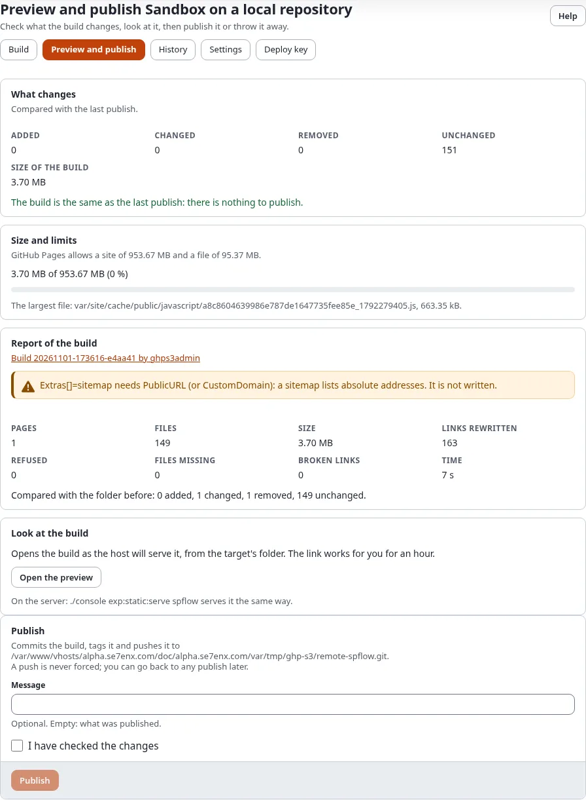
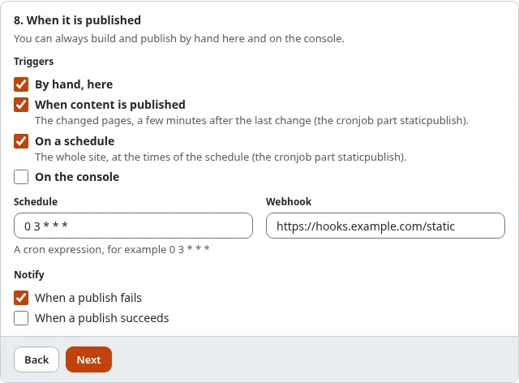

# Develop in public, publish free

A tutorial for developers and small teams: the site's code lives in a public GitHub repository, editors write the
content in Exponential, and the public site is a static copy on GitHub Pages. Nobody pays for hosting the public site,
and everybody can see how it is made.

[Guides](README.md) · Related: [Static publishing: CI and GitHub Actions](static-publishing-ci-and-github-actions.md),
[Develop with git](../help/develop-with-git.md)

## What you'll have at the end

- A repository with the site's design and extensions, open for issues and pull requests.
- An Exponential installation where editors write, which may stay private.
- A second repository holding the published static copy, served at `https://<owner>.github.io/<repository>/`.
- A publish that runs by itself after content changes.

## 1. Two repositories, two jobs

| Repository | Holds | Who writes it |
|---|---|---|
| `example/site` (the code) | the design, the extensions, the settings without secrets | developers, through pull requests |
| `example/site-static` (the copy) | the built pages and files | only Exponential, through `exp:static:publish` |

Keep them apart. The copy's branch belongs to static publishing: a commit made there by hand makes the next push wait
(`rejected (fetch first)`). Never put `settings/override/` or secrets into the code repository; credentials stay in
Setup > Secrets.

## 2. Make the target

In Setup > Static publishing > **New target**, choose the front siteaccess, the repository `example/site-static`,
the branch `gh-pages`, relative links and the base path `/site-static/`.


For the push, choose **A deploy key made for this target** in step 3 with the SSH address `git@github.com:example/site-static.git`. **Save** opens the **Deploy key** page: **Make the key**, then add its public half to `example/site-static` with write access
([SSH deploy keys](static-publishing-deploy-keys.md)). A deploy key reaches only that one repository, which suits a
public project well.

## 3. Build, check, publish

Build, read the report and the changes on the preview, then **Publish**. On the console:

```bash
./console exp:static:publish site-static --build
```



In the copy's repository, **Settings > Pages**: deploy from the branch `gh-pages`, folder `/ (root)`.

## 4. Let content publish itself

In step 8 of the wizard, **Triggers**, tick **When content is published**. Each publish in Exponential marks its pages stale; after
the debounce (`PublishDebounce`, 120 seconds by default) the cronjob part `staticpublish` builds just those pages and
publishes them. Add the cronjob part to your schedule if it is not there yet.



## 5. Work in public

- Developers change the design in `example/site` and deploy it to the installation as usual; the next build carries
  it into the copy. Content triggers build only changed pages, so publish a full build after a design change.
- Every publish is a tag `static/site-static/<n>` in the copy's repository: anybody can see what changed and when.
- If a publish went wrong, roll back in History; the rollback is a new commit, the history stays.

## Without a server: the starter

If you would rather build entirely on GitHub, start from the template
[exponential-static-site-starter](https://github.com/se7enxweb/exponential-static-site-starter): its workflow installs
Exponential, brings in your site from a database dump or a site package plus your code, builds and deploys to Pages.
Editing then happens in a local installation, and the dump is committed. See
[Static publishing: CI and GitHub Actions](static-publishing-ci-and-github-actions.md#building-on-github-the-starter-template).

## Next step

[A static blog with Exponential](a-static-blog-with-exponential.md).
