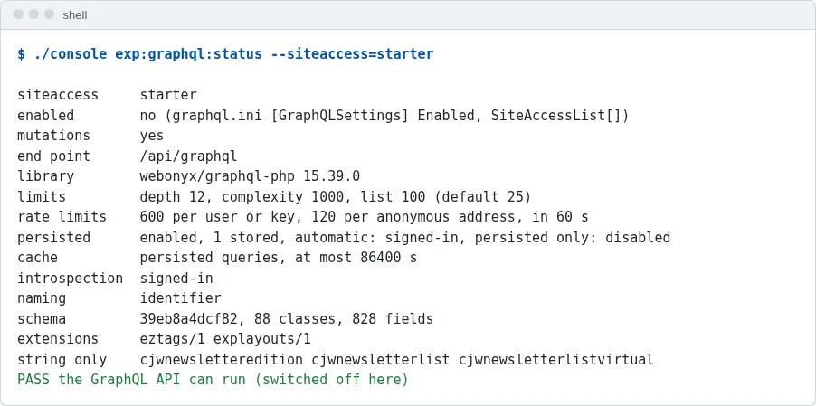
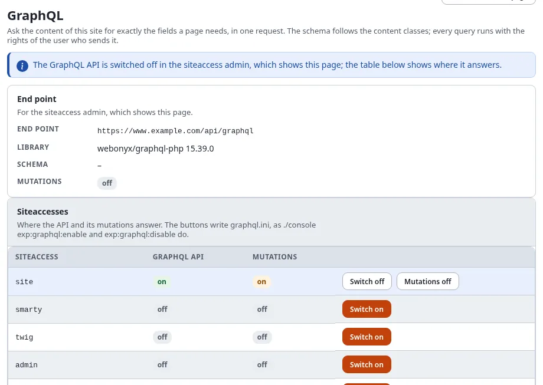
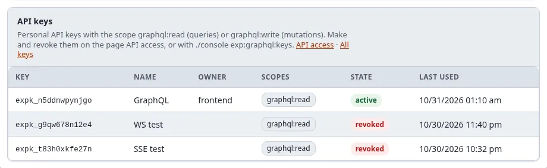
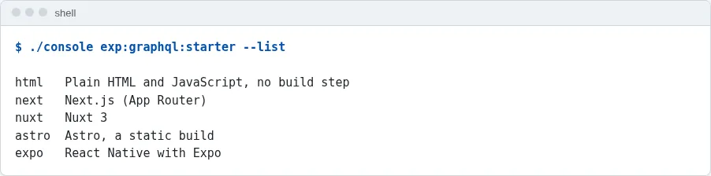
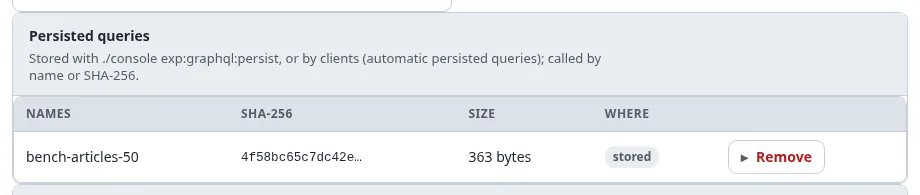
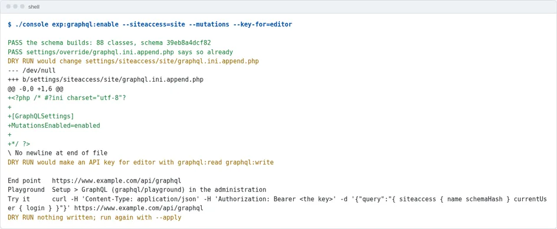
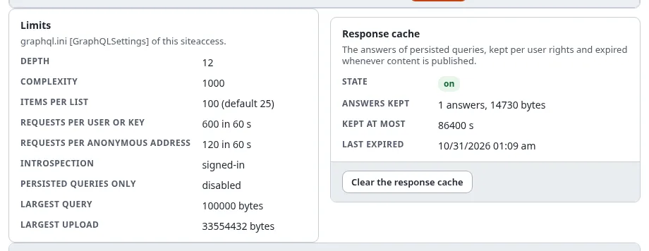
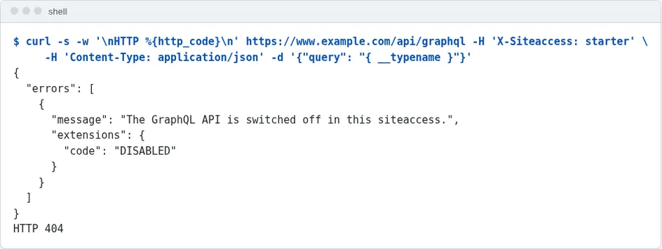

# A front end on the GraphQL API, step by step

This guide takes an Exponential 6.0.15 site from "GraphQL switched off" to a running front end that reads its content
through the GraphQL API: the API switched on for one siteaccess, a key for the front end, a starter project generated
from the site's own schema, its queries stored on the server and answered from the response cache, and, if the front
end also writes, a key that may write (the mutations come on with the API). Every step says what to run, what you should see and how to check it.

It is written for a developer with a shell on the server (for `./console`) and an administrator account. The
reference for everything used here is [The GraphQL API](../features/6.0/graphql.md); copy-paste solutions for common
front ends are in [GraphQL recipes](graphql-recipes.md).

| | |
|---|---|
| Time | 20 minutes, plus `npm install` |
| You need | Exponential 6.0.15, `webonyx/graphql-php` 15 (required by `composer.json`), a shell in the installation root, Node.js 20 or later for the JavaScript kits |
| You get | an end point at `https://<your site>/api/graphql`, a personal API key, a Next.js, Nuxt, Astro, plain HTML or Expo project reading the site |

## Contents

1. [Check that the API can run](#1-check-that-the-api-can-run)
2. [See what switching it on changes](#2-see-what-switching-it-on-changes)
3. [Switch it on](#3-switch-it-on)
4. [Look at Setup > GraphQL](#4-look-at-setup--graphql)
5. [Ask the first question](#5-ask-the-first-question)
6. [Generate the starter project](#6-generate-the-starter-project)
7. [Run it](#7-run-it)
8. [Store its queries on the server](#8-store-its-queries-on-the-server)
9. [Writing: a key with graphql:write](#9-writing-a-key-with-graphqlwrite)
10. [Before going live](#10-before-going-live)
11. [When something does not work](#11-when-something-does-not-work)

## 1. Check that the API can run

```bash
./console exp:graphql:status --siteaccess=site
```

The last line says `PASS the GraphQL API can run (switched off here)`: the library is installed and the schema builds
from your content classes. `schema` names its hash and the number of classes and fields; `string only` lists the
datatypes that have no type of their own (they answer their text). `FAIL the library is missing` means `composer
install` was not run, or `[GraphQLSettings] LibraryPath` points nowhere: see [The library](../features/6.0/graphql.md#the-library).



## 2. See what switching it on changes

Name the siteaccess the front end reads, the address the front end will run at during development, and the user the
front end reads as. Without `--apply` nothing is written:

```bash
./console exp:graphql:enable --siteaccess=site --origin=http://localhost:3000 --key-for=frontend
```

The command first builds the schema (`PASS the schema builds: 88 classes, schema 00818b7ff593`), then prints, for every
settings file, the diff it would write:

```diff
DRY RUN would change settings/override/graphql.ini.append.php
+[GraphQLSettings]
+Enabled=enabled
+SiteAccessList[]=site
DRY RUN would change settings/override/rest.ini.append.php
+[CorsSettings]
+Cors=enabled
+AllowedOrigins[]=http://localhost:3000
DRY RUN would make an API key for frontend with graphql:read
```

- **The user of the key** decides what the front end can read: make a user (here `frontend`) in a group whose role
  allows `content/read` on what the site shows, and nothing more. The anonymous user is enough for a public site; then
  leave `--key-for` out.
- **`--origin`** is only needed when a browser calls the API directly (the plain HTML kit, a client-side app). The
  Next.js, Nuxt and Astro kits call it from the server.


## 3. Switch it on

The same command with `--apply`:

```bash
./console exp:graphql:enable --siteaccess=site --origin=http://localhost:3000 --key-for=frontend --apply
```

```text
PASS wrote settings/override/graphql.ini.append.php
PASS wrote settings/override/rest.ini.append.php
PASS API key expk_qkjdsz3uznp8 for frontend (graphql:read), shown once:

    expk_qkjdsz3uznp8_95UvceuCwfzIUjYhD8SidKTprQ756aTKC7XyjRcF
```

**Copy the key now**: it is shown this once and stored only as a hash. Each file was backed up to `var/backup/ini/`
first, the change is in the audit (`system.setting.write`, `access.apikey.create`), and the INI cache was cleared, so
PHP-FPM and Velocity read the new settings on their next request. Check:

```bash
./console exp:graphql:status --siteaccess=site      # enabled  yes
```


## 4. Look at Setup > GraphQL

In the administration, **Setup > GraphQL** now shows the end point, the library, the schema, and a table of every
siteaccess with the API on in `site` and off elsewhere. Below it: the limits of the siteaccess, the response cache
(empty so far), the persisted queries (none yet), the API keys with a GraphQL scope (the key of step 3, `active`, never
used), and the playground. With the policy `graphql/administrate` the table has the buttons **Switch on**, **Switch
off**, **Mutations on** and **Mutations off**: they write the same settings as the commands.





The playground is shown when the API is also switched on in the siteaccess of the administration; while it is off
there, a notice at the top says so and the table shows where the API answers.

Type a query into the playground and press **Run** (Ctrl+Enter):

```graphql
{ node(urlAlias: "/") { name children(limit: 5) { totalCount nodes { name urlAlias classIdentifier } } } }
```

It runs with your rights, as the signed-in administrator, so it may show more than the front end will.

## 5. Ask the first question

From a shell, as the front end will, with the key:

```bash
curl -s https://www.example.com/api/graphql \
     -H "Authorization: Bearer $EXP_API_KEY" \
     -H 'Content-Type: application/json' \
     -d '{"query": "{ currentUser { login signedInBy } node(urlAlias: \"fit-healthy\") { name children(limit: 3) { nodes { name urlAlias } } } }"}'
```

```json
{"data":{"currentUser":{"login":"frontend","signedInBy":"apikey"},"node":{"name":"Fit & Healthy","children":{"nodes":[{"name":"Fitness","urlAlias":"fit-healthy/fitness"},{"name":"Healthy eating","urlAlias":"fit-healthy/healthy-eating"},{"name":"Recipes","urlAlias":"fit-healthy/recipes"}]}}}}
```

`signedInBy` is `apikey`: the request ran as the key's owner. Without the header it runs as the anonymous user
(`anonymous`), and the schema (introspection) is closed to it.


## 6. Generate the starter project

```bash
./console exp:graphql:starter --list
./console exp:graphql:starter --kit=next --to=../shop-front                 # what it would write
./console exp:graphql:starter --kit=next --to=../shop-front --apply
```



| Kit | For | Runs the queries |
|---|---|---|
| `html` | a page without a build step | in the browser (needs `--origin` of step 2) |
| `next` | Next.js 15, App Router | on the server (React server components) |
| `nuxt` | Nuxt 3 | on the server (the app's own `/api/graphql` route adds the key) |
| `astro` | a static site | at build time |
| `expo` | an iOS, Android and web app (React Native) | in the app |

Before anything is written, every query the kit gets is checked against the schema and its limits. The project has:

- the kit's files (shipped in `share/graphql/starters/<kit>/`), with the end point filled in (`--endpoint=` to name
  another address than `site.ini [SiteSettings] SiteURL`);
- the generated queries: `Menu` (the children of the site's root), `Node` (a page by its URL alias: name, class,
  parent, children) and one query per content class (`Content_ng_article` ...) that reads every field of the class:
  images in the alias `large` with their alternative text, rich text as HTML, relations by name and URL alias. They
  are in the kit's module (`lib/queries.ts` for Next.js) and in `graphql/*.graphql`;
- a README with the next steps.

The queries follow the schema of the moment. After a content class changed (`exp:graphql:status` shows a new schema
hash), generate the kit again into a new directory and copy `lib/queries.ts` and `graphql/` over.

## 7. Run it

```bash
cd ../shop-front
echo "EXP_GRAPHQL_KEY=$EXP_API_KEY" >> .env.local
npm install
npm run dev                  # http://localhost:3000/
```

The home page shows the menu of the site's root; every address of the site is a page (`/fit-healthy/fitness` is the
category, `/fit-healthy/fitness/why-track-your-workouts` the article) with the fields of its class and its children.
Change `components/Field.tsx` and `app/[[...path]]/page.tsx` to design your pages: the data is already there.

## 8. Store its queries on the server

A stored (persisted) query is called by its name instead of its text, cannot be changed by whoever calls it, and is
the only kind the [response cache](../features/6.0/graphql.md#speed) keeps:

```bash
cd -                                                   # back to the installation
./console exp:graphql:persist ../shop-front/graphql/                  # check: 90 queries fit the schema
./console exp:graphql:persist ../shop-front/graphql/ --apply          # store them
curl -s 'https://www.example.com/api/graphql?id=menu'                 # a GET by name
curl -sI 'https://www.example.com/api/graphql?id=menu' | grep -i x-graphql-cache    # MISS, then HIT
```

The second call is answered from the cache, at the start of `index_rest.php`, in about a millisecond; publishing
content expires the cache. With `PersistedQueriesOnly=anonymous` the site then refuses every ad-hoc query of
anonymous requests: a good setting for production once the front end only sends stored queries. Setup > GraphQL lists
the stored queries and the size of the cache.




## 9. Writing: a key with graphql:write

The mutations came on with the API in step 3 (`MutationsEnabled=enabled` is the default), but nothing can write yet:
a mutation needs a signed-in user, and a key needs the scope `graphql:write`. When the front end changes content (a
contact form that creates content, an editor app), give the writing user such a key (`--mutations` also switches the
mutations on again, should they have been switched off for the siteaccess):

```bash
./console exp:graphql:enable --siteaccess=site --mutations --key-for=editor --apply
```



The key of `editor` gets `graphql:read graphql:write`, and still only does what the roles of `editor` allow.

```bash
curl -s https://www.example.com/api/graphql -H "Authorization: Bearer $EDITOR_KEY" -H 'Content-Type: application/json' \
     -d '{"query": "mutation { createContent(parentId: 2, classIdentifier: \"folder\", fields: [{identifier: \"name\", value: \"From the front end\"}], publish: false) { status contentId version } }"}'
```

```json
{"data":{"createContent":{"status":"DRAFT","contentId":59338,"version":1}}}
```

Every mutation is recorded in the audit (`content.graphql.mutation`), runs the workflows of the kernel's operations,
and expires the response cache. Files go as multipart requests (`uploadImage`), and a draft can be shown before it is
published with a preview token. See [Mutations](../features/6.0/graphql.md#mutations).

Never put a key with `graphql:write` into a browser or an app that others install: keep it on a server.

## 10. Before going live

- [ ] `--origin` lists the production address of a browser front end, and not `http://localhost:3000` any more
      (`settings/override/rest.ini.append.php`, `AllowedOrigins[]`).
- [ ] The key's user reads only what the site shows; a browser or app gets no key, or one with `graphql:read` only.
- [ ] The front end's queries are stored (`exp:graphql:persist`), and `PersistedQueriesOnly=anonymous` (or `enabled`).
- [ ] The rate limits fit the expected traffic (`RateLimit`, `RateLimitAnonymous`; Setup > GraphQL shows them).
- [ ] A siteaccess where nothing writes has `MutationsEnabled=disabled` (`exp:graphql:disable --siteaccess=<name>
      --mutations --apply`), and `exp:graphql:keys` lists no key you do not know.
- [ ] `Debug=disabled` on the production siteaccess.



## 11. When something does not work

| You see | Because | Do |
|---|---|---|
| `404` and `DISABLED` | the API is off in the siteaccess the request reached | `exp:graphql:status --siteaccess=<it>`; a request reaches a siteaccess by host, path or the header `X-Siteaccess` |
| `403 insufficient_scope` | the key has no `graphql:read` | make a key with `exp:graphql:keys --create --for=<login> --apply` |
| `null` for content you know is there | the user may not read it | check the role of the key's user, or try the query in the playground as that user's role |
| a browser error about CORS | the front end's origin is not allowed | `exp:graphql:enable --origin=<the address> --apply` |
| `429` and `RATE_LIMITED` | over the rate limit | wait for `Retry-After`, or raise the limit for the siteaccess |
| `FORBIDDEN` on a mutation | signed out, no `graphql:write`, or the user's policies | the error message names which |

The error codes are listed under [Errors](../features/6.0/graphql.md#errors).



## Related pages

- [The GraphQL API](../features/6.0/graphql.md): the reference
- [GraphQL recipes](graphql-recipes.md): a blog, a mobile app, a static build, an AI agent
- [Personal API keys](api-keys.md)
- Commands: [exp:graphql:enable](../examples/commands/expgraphqlenable.md), [exp:graphql:starter](../examples/commands/expgraphqlstarter.md),
  [exp:graphql:persist](../examples/commands/expgraphqlpersist.md), [exp:graphql:keys](../examples/commands/expgraphqlkeys.md)
