# A tour of the administration

This page walks once around the screen of the administration, so you know where things are. It shows the **Admin 4**
design. What you see depends on your role: an editor may see only **Dashboard**, **Content structure** and **Media**
in the top menu, an administrator sees more.

Not signed in yet? See [Logging into the admin](logging-into-the-admin.md) or, for editors,
[Logging into the Editor](logging-into-the-editor.md).

## The header

From left to right:

| Part | What it does |
|---|---|
| **Exponential** logo | Back to the dashboard, or to the top of the content when your role has no dashboard. |
| The tabs | **Dashboard**, **Content structure**, **Media**, **Users**, **Layouts**, **Setup** and more, depending on your role and the extensions of the site. Tabs that do not fit move under **More**. A small arrow next to a tab opens its menu of sub-pages. |
| **Search...** | Searches all content. The funnel button in the field (**Search scope**) limits the search to a section or to the current place in the tree, and leads to the **Advanced search**. Press `/` anywhere to jump to this field. See [Searching](searching.md). |
| Globe button | **Open the site or another siteaccess**: opens the public site, or another part of the installation, in the same way the site's visitors see it. |
| Sun button | **Color mode**: switches between light, dark and the mode of your computer's system. Each press moves to the next mode; the choice is remembered for your account. |
| Person button | **User menu**: your name (opens your own user item), **Change information**, **Change password**, **My e-mail preferences**. |
| Arrow leaving a box | **Logout**. |

On a narrow screen (a phone, or a window made small) the tabs and the search move into a menu behind the button with
three lines.

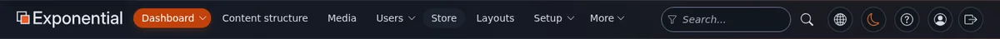

## The left column

The left column changes with the tab:

- In **Content structure** and **Media** it holds the **tree**: click the small triangle to open a folder, click a
  name to open the item. Click the icon in front of a name to open the item's **menu** (edit, copy, move, remove,
  create here, add to bookmarks and more). **Trash** is at the bottom of the tree.
- Below the tree, the **Content finder** opens an item from its number (ID), its path or its address on the site:
  type it and press **Find**.
- On the dashboard it lists your own pages: **My pending items**, **My drafts**, **My bookmarks**,
  **My e-mail preferences**, **My notification settings**, **Change password**, **Edit profile** and more.

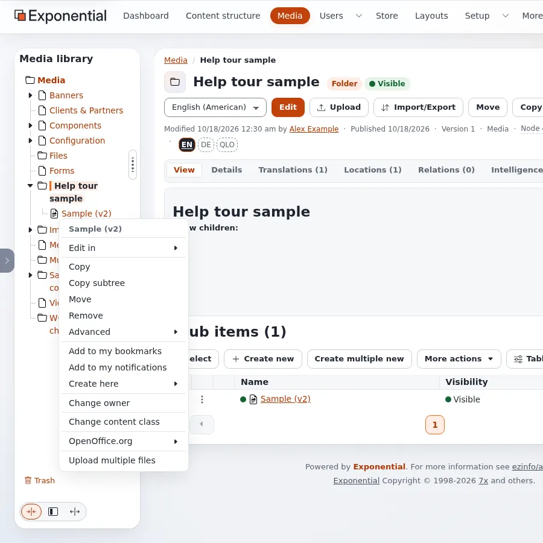

## The right column

The right column holds small tools for you:

- **Clear cache**: for administrators; editors usually do not need it.
- **Bookmarks**: your bookmarked items, and **Add to bookmarks** for the item you are looking at.
- **Interface**: the **Interface language** of the administration and, when allowed, the **Administration design**.
  See [Languages](languages.md#the-language-of-the-administration).
- **Current user**: your name, with links to change your information and your password.
- **User preferences** and **Quick settings**: switches that change how pages are shown to you. Only some roles see
  them.

## Hiding and resizing the columns

The tabs at the left and right edges of the window (with a small arrow) hide or show the left and right column. In
the left column the handle with three dots can be dragged to make the column wider or narrower; with the keyboard,
focus it and use the arrow keys. The buttons at the bottom of the left column set a small, medium or large width.
The administration remembers your choice.

## The dashboard

The dashboard is the first page after signing in. From the top:

1. **A greeting and quick actions**: buttons to the places you need most, such as **Content structure**,
   **Media library** and **Upload files**.
2. **Numbers**: content items, items published in the last seven days, **My drafts**, **My pending items**, and more
   for administrators. Click a number to open its list.
3. **Publishing, last 14 days**: a small chart; **Show the numbers** shows it as a table.
4. **My pending items**, **My drafts**, **All latest content** and **My latest content**: short lists that lead to
   the items.

Administrators also see blocks about the system, updates and security events.

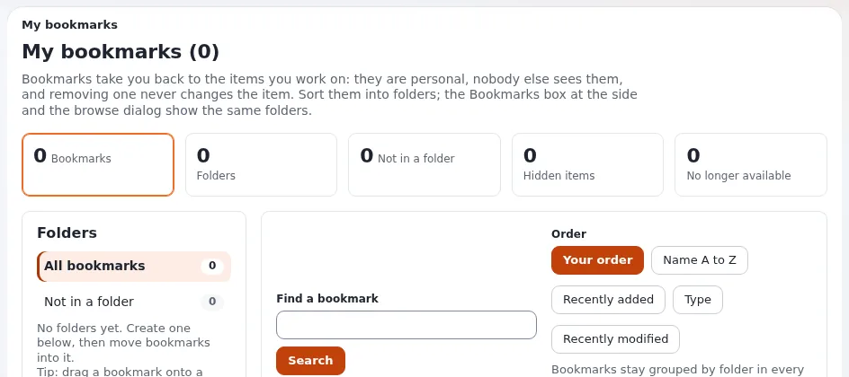

## An item's page

When you open an item, its page shows:

- the **path** to it at the top (click a part to go up), its name, its type (such as *Folder* or *Article*) and
  whether it is visible on the site;
- the **buttons**: a language list and **Edit**, **Upload**, **Move**, **Copy**, **Remove**, and three round
  buttons: **View on site**, **Preview** and **Manage versions**;
- a line with when it was changed, by whom, its version and its numbers (Node, Object);
- **tabs** with more about the item: **View** (its content), **Details**, **Translations**, **Locations**,
  **Relations** and others. The **Tabs** switch turns the tabs into one long page and back;
- **Sub items**: the items below it, with buttons to **Create new**, select, sort and act on several at once.

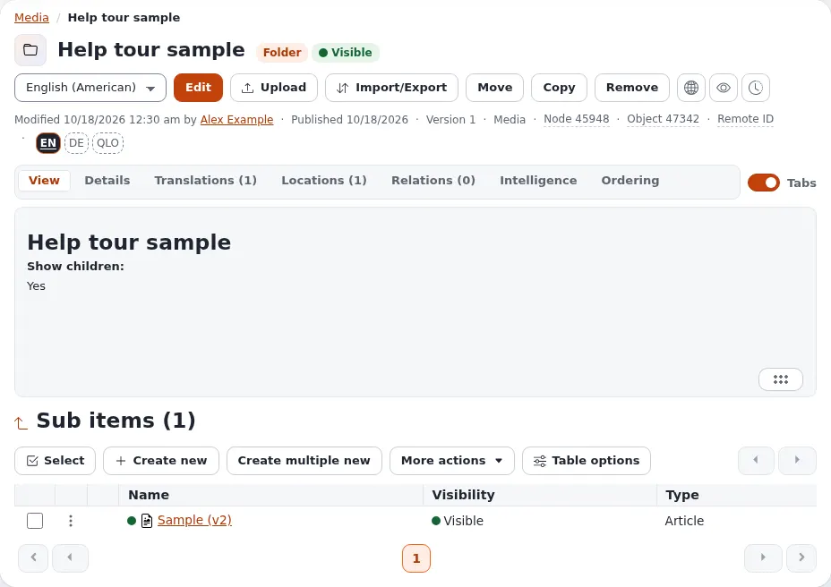

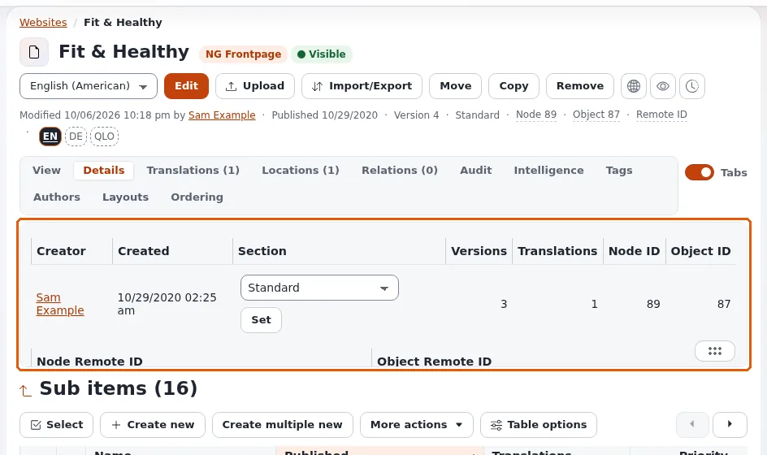

## In action: editing a folder

This walk-through edits a folder from start to finish. Every other content type works the same way; only the fields
differ. [Creating and editing content](editing-content.md) and
[Publishing, versions and the trash](publishing-and-versions.md) explain each step in more depth.

### 1. Open the editor

Open the folder (from the tree, a list or a search) and press **Edit** next to the language list. If the folder
exists in several languages, choose the language in that list first.

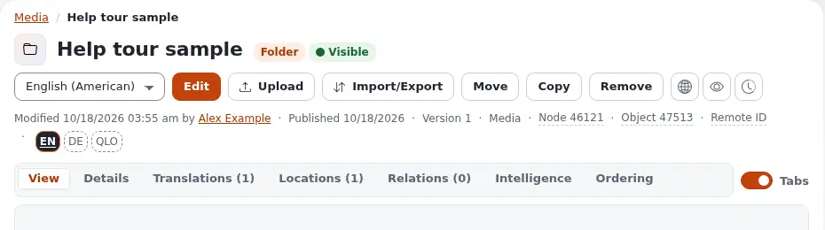

### 2. The edit form

The form opens with a new **draft**, a copy of the published version. The site keeps showing the published version
until you publish.

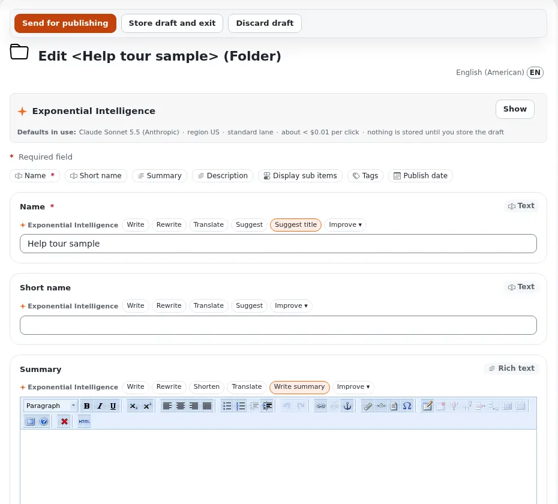

From the top:

- the buttons **Send for publishing**, **Store draft and exit** and **Discard draft**;
- the title *Edit <name> (Folder)* and the language you edit, here *English (American)*;
- the **Exponential Intelligence** box, when the writing assistant is switched on;
- the **field bar**: one button per field (*Name*, *Short name*, *Summary*, *Description*, *Display sub items*,
  *Tags*, *Publish date*), each jumping to its card; a red `*` marks a required field;
- one **card** per field, with its kind in the corner (*Text*, *Rich text* ...).

A folder's fields:

| Field | What to put in it |
|---|---|
| **Name** (required) | The folder's name, as shown on the site and in the tree. |
| **Short name** | A shorter name for menus and the tree; when it is filled in, it is used as the item's name in lists. |
| **Summary** | A short introduction, in rich text. |
| **Description** | The full text, in rich text. |
| **Display sub items** | Whether the site lists the items in the folder below its text. |
| **Tags**, **Publish date** | Keywords, and the date shown as the publication date. |

### 3. Rich text

*Summary* and *Description* use the online editor. Its toolbar has the paragraph style list, bold, italic and
underline, subscript and superscript, alignment, lists and indents, undo and redo, links and anchors, embedded
objects, custom tags, special characters, tables, and buttons for help and the HTML source. Below the field,
**Editor** switches between the editors your site offers; on this installation **TinyMCE 8** is the default and
**Tiptap** is the alternative. Switching keeps what you typed.

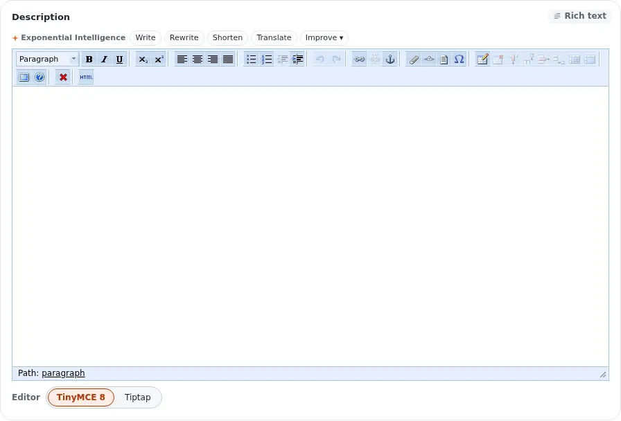

### 4. Keep it as a draft

Not finished? Press **Store draft and exit**. The draft is kept, only you see it, and it waits under **My drafts**.
The form also saves the draft by itself every few minutes. The left column of the form shows the published version
and **Current draft**, the version you are working on.

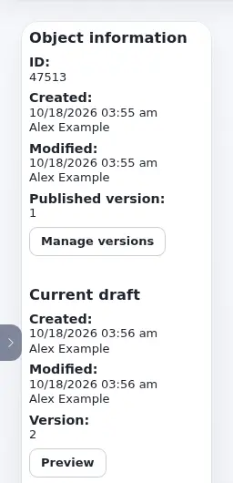

To continue later, open **My drafts** on the dashboard, or **Manage versions** on the item, and press **Edit** on
your draft.

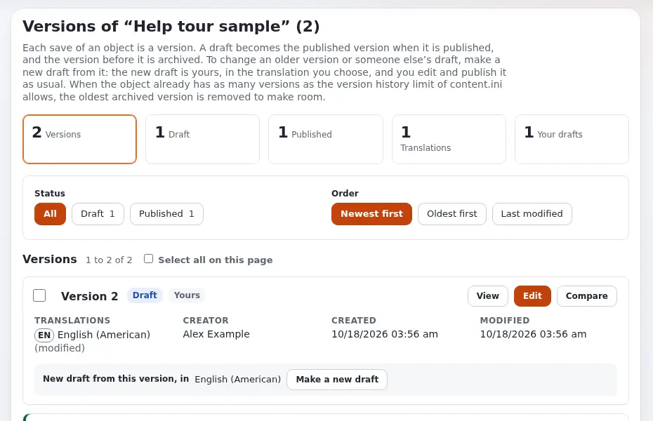

### 5. Preview

**Preview** in the form's left column (or **View** on a draft in the versions page) shows the draft as the site will
show it. The buttons at the top show it at the width of a phone, a tablet, a desktop or a large desktop; **Back to
edit** returns to the form, and **Publish** publishes from there.

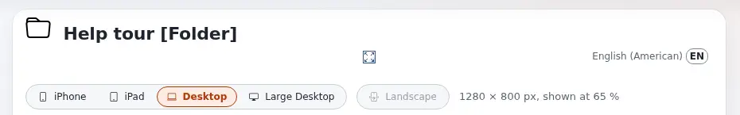

### 6. Publish

Press **Send for publishing**. The draft becomes the published version, and the version before it is kept as an
archived version. The item's page shows the new version number; here the folder is now called by its short name.

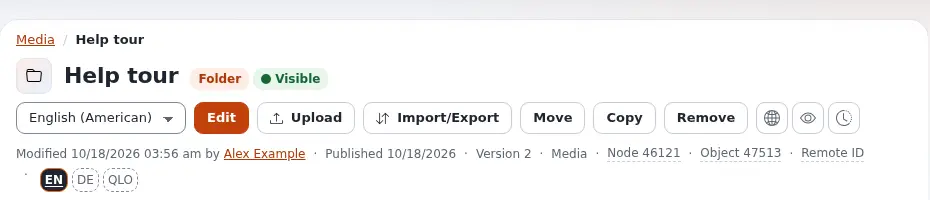

If your site uses an approval, the version waits under **My pending items** until someone approves it.

### 7. Versions and going back

**Manage versions** (the round button with a clock) lists every version. **View** and **Compare** show what changed;
**Make a new draft** starts a draft from an older version, which you then publish as usual. See
[Go back to an earlier version](publishing-and-versions.md#go-back-to-an-earlier-version).

### 8. Discard

Started a draft you do not want? Press **Discard draft** and confirm. The draft is thrown away; the published version
stays exactly as it was.

## In action: the layouts editor

Pages built with Exponential Layouts are arranged in the layouts editor. This walk-through uses a copy of a layout,
so nothing on the site changes. [The layouts editor](layouts-editor.md) explains each part in more depth.

### 1. Open a layout

In the **Layouts** tab, open **Layouts** and press **Open** on a layout. The editor opens on a **draft** of it: what
you change stays in the draft, saved as you go, until you publish.

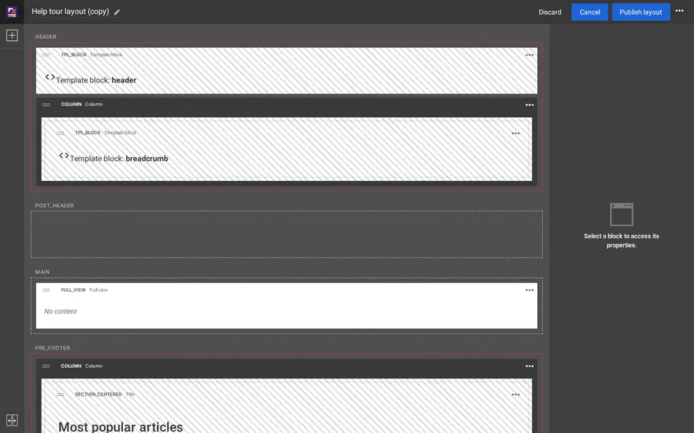

### 2. Zones and blocks

The middle shows the layout's **zones**, each with its name (*HEADER*, *POST_HEADER*, *MAIN*, *PRE_FOOTER* ...), and
in each zone its **blocks**, one under the other. Each block shows its type (*Template block*, *Column*, *Full view*,
*Title* ...) and a preview of what it shows. A zone with a red dashed border and hatched blocks is **linked** to a
zone of a shared layout (see step 6).

### 3. Block settings

Click a block to select it. It is outlined in blue, and its settings appear on the right in two tabs: **Content**
(what it shows) and **Design** (how it looks). Changes show in the block at once.

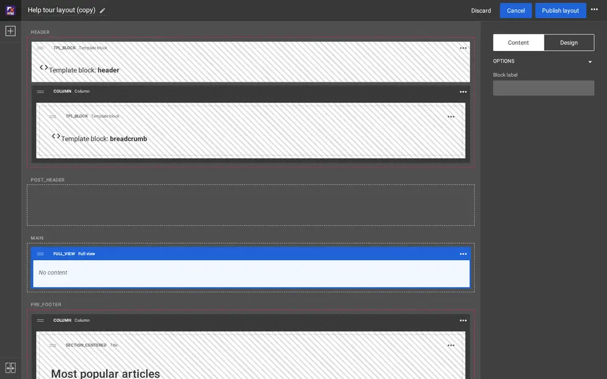

### 4. Add a block

Press the plus button at the top left (**Add a block**), find the block type in its group (**Basic**,
**Components**, **Listing**, **Gallery**, **Containers**, **Placeholders**) and drag it into a zone. Here a **Title**
block was dragged into the empty *POST_HEADER* zone; it is selected, ready for its settings.

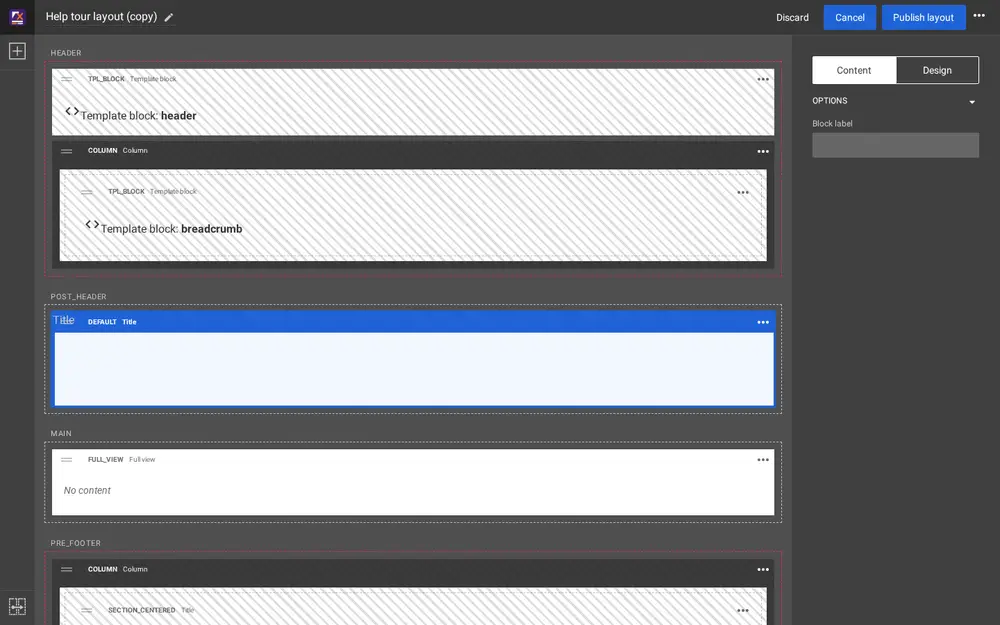

The menu with three dots on a block has **Duplicate block** and **Delete block**.

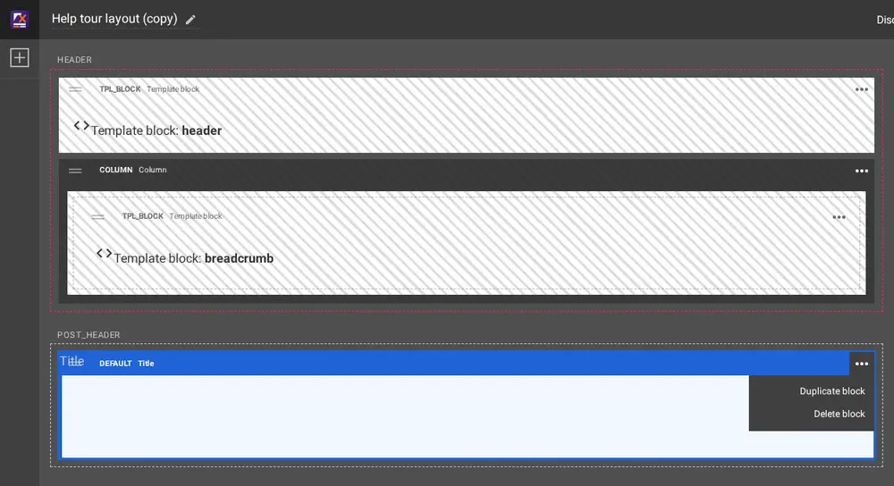

### 5. Move a block

Drag a block by its header bar to another place, in the same zone or another one. Here the Title block was moved
into *MAIN*, above the Full view block.

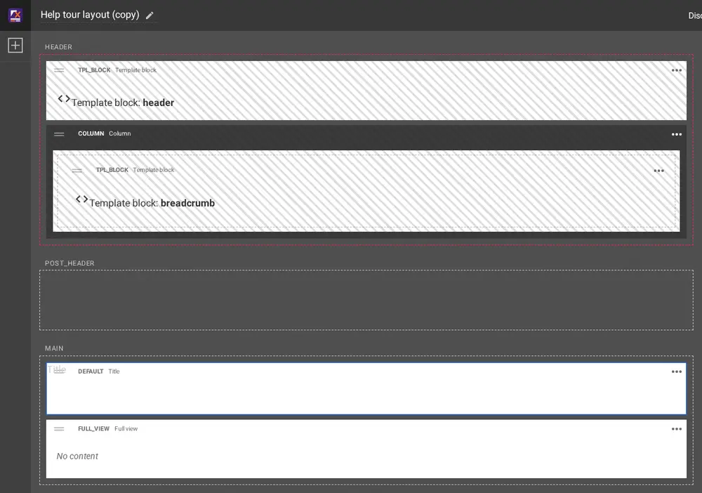

### 6. Linked and shared zones

A **shared layout** holds blocks that many pages use, such as the header and the footer. Instead of copying those
blocks, a zone is **linked** to a zone of the shared layout and shows its blocks. Linked blocks cannot be changed in
the linking layout; change them by opening the shared layout itself.

The button at the bottom left (**Link zone with shared layout zone**) opens the linking mode: step 1 asks for the zone
you wish to link (**Link zone** on each zone; a linked zone shows a red link button), step 2 for the shared layout
and its zone. **Back** returns to the editor.

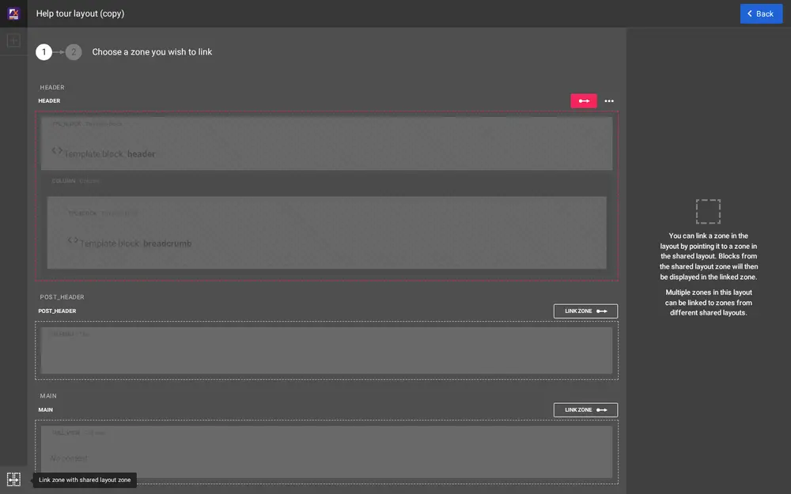

### 7. Draft or publish

| Button | What it does |
|---|---|
| **Publish layout** | The draft becomes the published layout; every page that uses it shows the change. |
| **Publish and continue editing** (menu with three dots) | Publishes and keeps the editor open. |
| **Save draft and close** (menu with three dots) | Keeps the draft for later; the site keeps the published layout. |
| **Discard** | Throws the draft away after you confirm in the **Discard changes** dialog; **Cancel** in the dialog keeps it. |

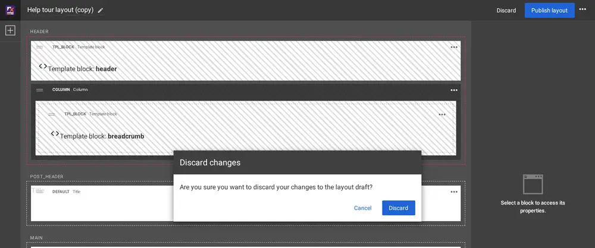

Which pages use a layout is decided by its **mappings**; see
[Which pages use a layout](layouts-editor.md#which-pages-use-a-layout).

**Demo mode.** On a public demonstration site every page of the administration starts with a yellow **Demo mode** banner. It means anyone may know the administrator password and that it cannot be changed there; do not enter anything private. [Demo mode](demo-mode.md).

## Next steps

- [Creating and editing content](editing-content.md)
- [Searching](searching.md)
- [Keyboard shortcuts](keyboard-shortcuts.md)

Curious how the administration is made, or want to change your site's templates and code? Every part of Exponential
is free software with its full history on GitHub. [Develop with Git](develop-with-git.md) shows how to install it as
Git clones and grow from user to developer, one step at a time.

<!-- exp-see-also-645 -->
**See also:** [Database Administrators](database-administrators/database-administrators-start-here.md).

<!-- exp-partner-block:start -->
**Become an Exponential Partner.** Partners share their information, provide funding, contribute back and
develop the products with us, and that is how Exponential grows. A partner website and dashboard are planned for
mid-2027: please become a partner today to speed up our growth rate and land new features faster. Start with
[Partners: start here](partners/partners-start-here.md) and [How to apply](partners/how-to-apply.md).
<!-- exp-partner-block:end -->
