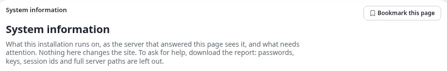
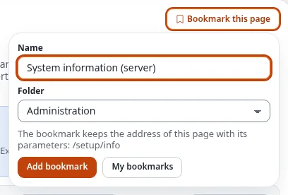
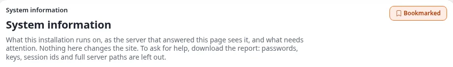
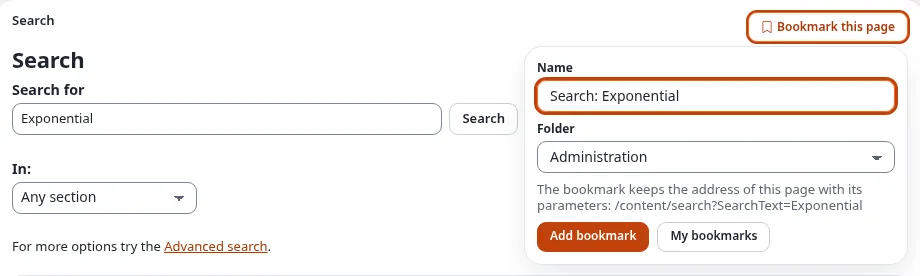
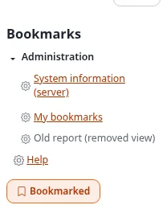
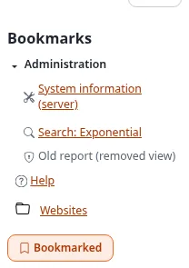
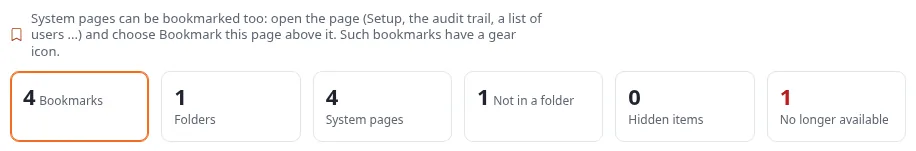
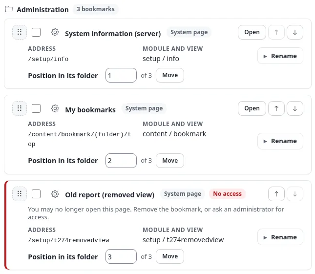
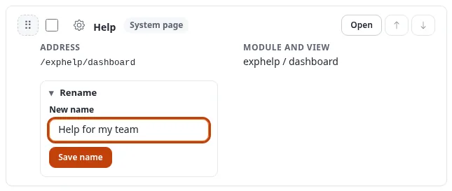
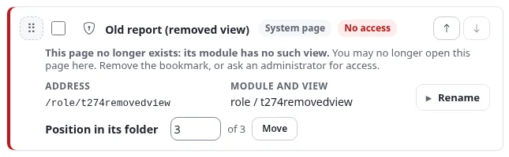

# Bookmarking system pages

Bookmarks used to point only to content: an article, a folder, an image. Since Exponential 6.0.15 you can also
bookmark the **pages of the administration itself**, the system pages: System information, the cache page, the help
dashboard, the audit trail filtered to one user, the trash, a list opened at a page, and a **search** with its search
text. They sit in the same folders as your content bookmarks, in the Bookmarks box at the side of every page and on
the **My bookmarks** page.

This page shows, step by step, how to bookmark a system page, how to find it again, how to rename, move and remove it,
and what a greyed bookmark means. It is for everybody who works in the administration; you need the right to use
bookmarks (the policy *content/bookmark*, which editors and administrators have).

Every step has a screenshot of the default administration design (admin4) in light mode. Under it, the same step is
linked in dark mode, in the classic design (admin, which has a light theme only) and in the editor interface (the
*editor* siteaccess), so you can see it the way your administration looks.

[Help](README.md) · Related: [the bookmarks guide](../guides/bookmarks.md) ·
[Bookmarks of system pages (feature)](../features/6.0/bookmarks-of-system-pages.md) ·
[A tour of the administration](admin-tour.md)

## In short

- On every system page there is a **Bookmark this page** button above the page, on the right of the breadcrumb, and
  the same button in the **Bookmarks** box of the right column.
- The button opens a small form: the **name** (the page's title, which you can change) and the **folder**. Choose
  **Add bookmark** and you are back on the page; the button now says **Bookmarked**.
- The bookmark keeps the page's address with its parameters (`/content/bookmark/(folder)/top`,
  `/audit/console/(user)/14`) and, for a search, the search text (`/content/search?SearchText=news`). It does not keep
  the host name or the siteaccess, so it opens on every host and in every administration of the installation.
- System page bookmarks have the **icon of their area**: a toolbox for Setup, a magnifier for a search, a shield for
  roles, a question mark for the help. Content bookmarks keep the icon of their class.
- A system page you cannot open where you are now is **greyed**, without a link, and says **why**: switched off in
  this siteaccess, no role allows it, the page no longer exists. You can still rename, move or remove it.

## 1. Bookmark a page

1. Open the page you want to come back to, for example **Setup > System information**. (In the editor interface,
   which has no Setup, the screenshots use the **Trash**.)
2. Look at the top of the page, on the right of the breadcrumb: the **Bookmark this page** button.

   

   Other views: [admin4, dark](images/bookmarks/bookmark-this-page-button--admin4-dark.webp) ·
   [classic](images/bookmarks/bookmark-this-page-button--admin-light.webp) ·
   [editor, light](images/bookmarks/bookmark-this-page-button--editor-light.webp) ·
   [editor, dark](images/bookmarks/bookmark-this-page-button--editor-dark.webp)

3. Choose **Bookmark this page**. A small form opens under the button:

   

   Other views: [admin4, dark](images/bookmarks/bookmark-this-page-form--admin4-dark.webp) ·
   [classic](images/bookmarks/bookmark-this-page-form--admin-light.webp) ·
   [editor, light](images/bookmarks/bookmark-this-page-form--editor-light.webp) ·
   [editor, dark](images/bookmarks/bookmark-this-page-form--editor-dark.webp)

   - **Name**: filled in with the page's title, as the browser tab shows it. Change it to whatever helps you, for
     example *System information (server)*.
   - **Folder**: *No folder (top level)*, or one of your bookmark folders. Folders are made on the My bookmarks page
     (see [the bookmarks guide](../guides/bookmarks.md#5-folders)).
   - Under the fields the form shows the **address** the bookmark keeps.
4. Choose **Add bookmark**. The page reloads and the button now reads **Bookmarked**:

   

   Other views: [admin4, dark](images/bookmarks/bookmarked-button--admin4-dark.webp) ·
   [classic](images/bookmarks/bookmarked-button--admin-light.webp) ·
   [editor, light](images/bookmarks/bookmarked-button--editor-light.webp) ·
   [editor, dark](images/bookmarks/bookmarked-button--editor-dark.webp)

The form works without JavaScript; it is a part of the page that opens and closes. Choose the button again to close
it without saving.

**From the Bookmarks box.** The **Bookmarks** box in the right column offers the same button on every system page,
under your bookmarks. It opens the same form. On a content page the box keeps its **Add to bookmarks** button for the
item, as before.

**Change the name or the folder later.** Open the page again and choose **Bookmarked**. The form shows the saved name
and folder; change them and choose **Save bookmark**. A page is bookmarked only once: saving again never makes a
second bookmark of the same address.

## 2. Save a search

A search is a system page too, and its bookmark keeps what you searched for, so opening it runs the same search again.

1. Search with the search field at the top of the administration, for example for *Exponential*.
2. On the results page, choose **Bookmark this page**. The address under the fields ends in
   `?SearchText=Exponential`: the search text is part of the bookmark.

   

   Other views: [admin4, dark](images/bookmarks/saved-search-form--admin4-dark.webp) ·
   [classic](images/bookmarks/saved-search-form--admin-light.webp) ·
   [editor, light](images/bookmarks/saved-search-form--editor-light.webp) ·
   [editor, dark](images/bookmarks/saved-search-form--editor-dark.webp)

3. Give it a name, such as *Search: Exponential*, pick a folder and choose **Add bookmark**.

The bookmark keeps the search text, the section and the place you searched in, nothing else. Saved searches have a
**magnifier** icon and the type **Search** on My bookmarks.

## 3. Find it again

The **Bookmarks** box lists your bookmarks in their folders, on every page. Each system page has the icon of its area;
a page you cannot open here is greyed:

Other views: [admin4, dark](images/bookmarks/bookmarks-box-system-pages--admin4-dark.webp) ·
[classic](images/bookmarks/bookmarks-box-system-pages--admin-light.webp) ·
[editor, light](images/bookmarks/bookmarks-box-system-pages--editor-light.webp) ·
[editor, dark](images/bookmarks/bookmarks-box-system-pages--editor-dark.webp)

Choose the name to open the page. Content bookmarks and system pages are listed together, in your order:

Other views: [admin4, dark](images/bookmarks/bookmarks-box-both-kinds--admin4-dark.webp) ·
[classic](images/bookmarks/bookmarks-box-both-kinds--admin-light.webp) ·
[editor, light](images/bookmarks/bookmarks-box-both-kinds--editor-light.webp) ·
[editor, dark](images/bookmarks/bookmarks-box-both-kinds--editor-dark.webp)

On **My bookmarks** (Dashboard > My bookmarks) the overview counts your **System pages**, and a line above it says how
to add one:

Other views: [admin4, dark](images/bookmarks/bookmark-page-overview--admin4-dark.webp) ·
[classic](images/bookmarks/bookmark-page-overview--admin-light.webp) ·
[editor, light](images/bookmarks/bookmark-page-overview--editor-light.webp) ·
[editor, dark](images/bookmarks/bookmark-page-overview--editor-dark.webp)

Each system page has a card like a content bookmark. It shows the icon, the name, the type (**System page**, or
**Search** for a saved search), the **address** and the **module and view** the page belongs to, **Open**, **Move up**
and **Move down**, and **Rename**:

Other views: [admin4, dark](images/bookmarks/bookmark-page-system-page-card--admin4-dark.webp) ·
[classic](images/bookmarks/bookmark-page-system-page-card--admin-light.webp) ·
[editor, light](images/bookmarks/bookmark-page-system-page-card--editor-light.webp) ·
[editor, dark](images/bookmarks/bookmark-page-system-page-card--editor-dark.webp)

**Find a bookmark** on that page also searches the addresses, so `systemupgrade`, `audit/` or `SearchText` finds the
system pages with that address. In the order **Type**, system pages are sorted under *System page* and saved searches
under *Search*, next to the class names of your content bookmarks.

## 4. Rename, move, remove

**Rename** (system pages only):

1. On **My bookmarks**, find the card and choose **Rename** under its address.
2. Type the new name and choose **Save name** (or press Enter in the field).

   

   Other views: [admin4, dark](images/bookmarks/bookmark-page-rename--admin4-dark.webp) ·
   [classic](images/bookmarks/bookmark-page-rename--admin-light.webp) ·
   [editor, light](images/bookmarks/bookmark-page-rename--editor-light.webp) ·
   [editor, dark](images/bookmarks/bookmark-page-rename--editor-dark.webp)

3. The page says *The bookmark was renamed to "…"*. The Bookmarks box shows the new name at once.

A content bookmark always shows the current name of its item, so it has no Rename.

**Move** to another folder: tick the card and use **Move the selected bookmarks to** under the list, or drag the
card onto a folder of the folder list; on the page itself you can also choose **Bookmarked** and pick another folder.
**Move up**, **Move down**, the grip and the position field arrange system pages and content bookmarks together, in
one order per folder.

**Remove**: tick the card, choose **Remove selected** and confirm. Only the bookmark is removed, never the page. A
removed folder takes its system page bookmarks with it only when you choose *Remove everything inside with it*.

## 5. A greyed bookmark

Whether you may open a system page is checked every time your bookmarks are shown, with the same rules as when you
open the page: your roles and policies, the rules of the siteaccess you are in, and whether the module and view still
exist. When you cannot open it there, the bookmark is not a link: the Bookmarks box shows it greyed (point at it to
read why), and its card on My bookmarks says **No access** and gives the reason:

Other views: [admin4, dark](images/bookmarks/bookmark-page-no-access--admin4-dark.webp) ·
[classic](images/bookmarks/bookmark-page-no-access--admin-light.webp) ·
[editor, light](images/bookmarks/bookmark-page-no-access--editor-light.webp) ·
[editor, dark](images/bookmarks/bookmark-page-no-access--editor-dark.webp)

The reasons you can see:

| The card says | What it means | What to do |
|---|---|---|
| This page is switched off in this siteaccess (editor). Open the bookmark in a siteaccess that has it. | The page exists, but the administration you are in does not offer its module. The editor interface, for example, has no Setup, roles or audit trail. The editor screenshots above show a System information bookmark made in the full administration. | Open the bookmark in the full administration. Nothing is wrong with it. |
| None of your roles allows you to open this page. | Your roles changed, or never allowed this page. | Ask an administrator, or remove the bookmark. |
| You may not use this siteaccess. | Your account may not sign in to this administration. | Ask an administrator. |
| You may not read the content this page shows. | The page shows a content item (a version, a node's audit trail) you may not read. | Ask an administrator, or remove the bookmark. |
| This page no longer exists: its module has no such view. | The page was removed, for example by an update or an extension that was turned off. | Remove the bookmark. |
| The module of this page is not installed or not enabled here. | The extension that brought the page is not active. | Ask an administrator, or remove the bookmark. |
| This kind of page cannot be bookmarked. | An administrator added the page to the list of pages that cannot be bookmarked. | Remove the bookmark. |

When your access comes back, or you open the bookmark where the page is available, the link comes back by itself.
The overview counts greyed bookmarks under **No longer available**.

## 6. What can be bookmarked, and what cannot

You can bookmark the page of every **module view** you can open: Setup, the help, users and roles, lists, the trash,
the audit trail, searches, the pages of extensions. A list keeps the parameters that are part of its address, such as
`/(offset)/20`, `/(folder)/top` or `/(user)/14`.

**Bookmark this page** is not offered:

- on a **content item** (there you use *Add to bookmarks*, which bookmarks the item, not the page),
- while you **edit** or **browse**, and on an **error page**,
- on pages that only **act on a form** or are pages of **one moment**: saving, removing, copying, signing in and out,
  a confirmation, a download, the edit forms of classes, roles, sections, states and workflows. A bookmark of such a
  page would open an empty page or repeat an action. Your administrator can see and extend the list
  (`bookmark.ini`, see [the feature page](../features/6.0/bookmarks-of-system-pages.md#settings)).

Only addresses of this installation can be bookmarked: never another site, never a script.

## 7. Questions and answers

**I do not see Bookmark this page.** See *What can be bookmarked* above. It is also missing everywhere when you may
not use bookmarks (ask for the policy *content/bookmark*) or when the database update of Exponential 6.0.15 has not
been run on your installation (your administrator runs `update/common/scripts/6.0/createbookmarkviewtable.php`; see
[Bookmarks of system pages](../features/6.0/bookmarks-of-system-pages.md#installing-and-updating)).

**The bookmark opens the page without my filter.** The bookmark keeps the parameters that are part of the address,
such as `/(folder)/top` or `/(user)/14`, and the search text of a search. Other filters that a page keeps after a `?`
in the address, or only in a form, are not part of the bookmark: they usually describe one moment. Most lists of the
administration keep their filters in the address; open the filtered list and bookmark it from there.

**I bookmarked the page in another administration, or on another host name.** Bookmarks keep the address without the
host and without the siteaccess, so a bookmark made in one administration (for example the German one, or on another
host name of the same installation) opens the same page in the one you are working in, if that administration offers
it. If it does not, the bookmark is greyed there and says so.

**Who sees my bookmarks?** Nobody else. Bookmarks are personal, for system pages as for content.

**The online editor's bookmark list does not show my system pages.** It lists content you can link to or embed;
system pages are not content.
