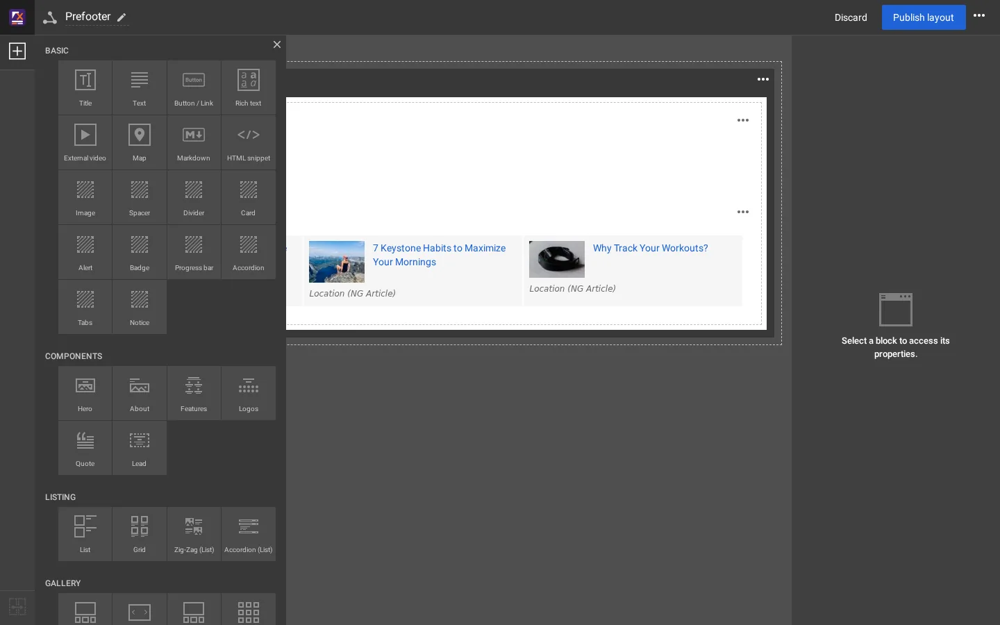
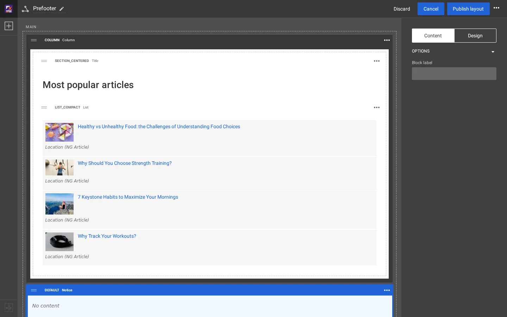
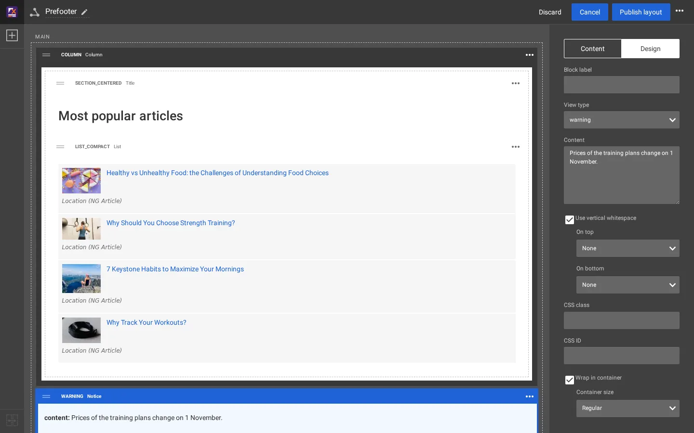
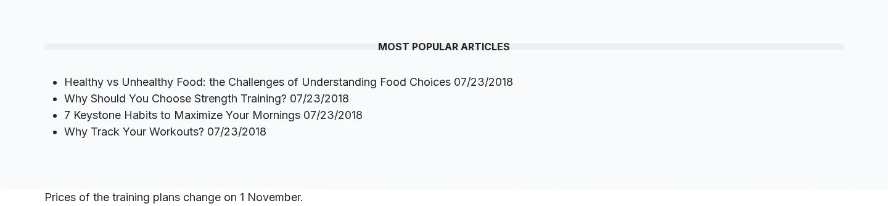

# Add a block type

A block type has three parts: a **definition** in `explayouts.ini`, a **handler** class that declares its parameters,
and a **template** per design. The example is a *Notice* block: a short text in a highlighted box, in two view types,
`info` and `warning`. It reuses an existing handler, so no PHP is written.

## Contents

1. [The definition](#1-the-definition)
2. [The handler](#2-the-handler)
3. [The template](#3-the-template)
4. [Activate, clear, find it in the palette](#4-activate-clear-find-it-in-the-palette)
5. [Use it](#5-use-it)
6. [Your own handler](#your-own-handler)

## 1. The definition

`extension/mysite/settings/explayouts.ini.append.php`:

```ini
<?php /* #?ini charset="utf-8"?

[BlockSettings]
AvailableBlocks[]=notice

# A new block type: a highlighted notice with a text an editor types
[BlockDefinition_notice]
Name=Notice
Handler=expLayoutsTextBlockHandler
ViewTypes[]=info
ViewTypes[]=warning
Category=basic

*/ ?>
```

| Key | Means |
|---|---|
| `AvailableBlocks[]` | the block types the editor offers |
| `Name` | the name in the palette and on the block |
| `Handler` | the PHP class that declares the parameters |
| `ViewTypes[]` | the looks an editor can choose on the Design tab |
| `Category` | the palette group: `basic`, `components`, `listing`, `gallery`, `containers`, `placeholders` |
| `HasCollection=1` | the block has items (like List) |
| `IsContainer=1` and `Placeholders[]` | the block holds other blocks (like Column) |

**Where the line counts.** Since explayouts 1.4.42, explayouts' own `explayouts.ini.append.php` no longer starts
`AvailableBlocks[]` (nor `AvailableQueries[]`, `SiteAccessMatch[]` and `AllowedTemplateRoots[]`) with a reset line. Your
extension's `AvailableBlocks[]=notice` is kept wherever the extension is listed in `ActiveExtensions[]`: for blocks the
position no longer matters, and a block listed twice is offered once
(`./console exp:ini where explayouts.ini/BlockSettings/AvailableBlocks admin` shows the list in effect). To replace the
whole list, write the reset line where it is read after every extension: `settings/override/explayouts.ini.append.php`
or a siteaccess (`./console exp:ini clear explayouts.ini/BlockSettings/AvailableBlocks[] <scope>`). The extension order
still matters for template overrides and `DesignExtensions[]` ([Your own design extension](your-own-design-extension.md)).

## 2. The handler

`expLayoutsTextBlockHandler` declares one parameter:

```php
'content' => array( 'name' => 'Content', 'type' => 'textarea', 'default' => '' ),
```

The editor builds the block's form from the handler's `getParameters()`; the field appears on the **Design** tab.

## 3. The template

The media design includes `explayouts/block/<definition>.tpl` for every block, so the template is
`extension/mysite/design/media/templates/explayouts/block/notice.tpl`:

```smarty
{if and( is_set( $block.parameters.content ), $block.parameters.content|ne( '' ) )}
<aside class="notice notice-{$block.view_type|wash}" role="note">
    <p>{$block.parameters.content|wash|nl2br}</p>
</aside>
{/if}
```

The design's `block.tpl` wraps it in `<div class="ngl-block ngl-notice ngl-vt-<view type> ...">` and applies the common
options (spacing, CSS class, container).

## 4. Activate, clear, find it in the palette

```text
./console exp:cache clear --tag=template,content,ini
```

Open a layout in the editor and the palette's **Basic** group has **Notice**:



## 5. Use it



Drag **Notice** into a zone. It arrives with the view type `default`; select it, open **Design**, choose `warning`,
type the text into **Content**, and **Publish layout**.



The published page renders:

```html
<div class="ngl-block ngl-notice ngl-vt-warning whitespace-top-none whitespace-bottom-none">
  <div class="container">
    <aside class="notice notice-warning" role="note"><p>Prices of the training plans change on 1 November.</p></aside>
  </div>
</div>
```



It is plain until the design styles `.notice` ([Styling your blocks](styling-your-blocks.md)).

## Your own handler

For other fields, write a class that implements `expLayoutsBlockHandlerInterface` with `getParameters()` (the fields:
`name`, `type`, `default`) and `getValues( $block )` (what the template gets in `$block.values`), put it in
`extension/mysite/classes/`, run `php bin/php/ezpgenerateautoloads.php -e`, and name it in `Handler=`. The handlers of
`extension/explayouts/classes/` (for example `explayoutstextblockhandler.php`, `explayoutstplblockhandler.php`) are
short examples.

## Related pages

- [Add a view type](add-a-view-type.md)
- [How a block maps to its templates](block-to-template-map.md)
- [Your own template blocks](template-blocks.md)
- [Free documentation](../free-documentation.md): this page is free to copy, translate and improve under the GNU FDL 1.3.

<!-- exp-partner-block:start -->
**Become an Exponential Partner.** Partners share their information, provide funding, contribute back and
develop the products with us, and that is how Exponential grows. A partner website and dashboard are planned for
mid-2027: please become a partner today to speed up our growth rate and land new features faster. Start with
[Partners: start here](../partners/partners-start-here.md) and [How to apply](../partners/how-to-apply.md).
<!-- exp-partner-block:end -->
