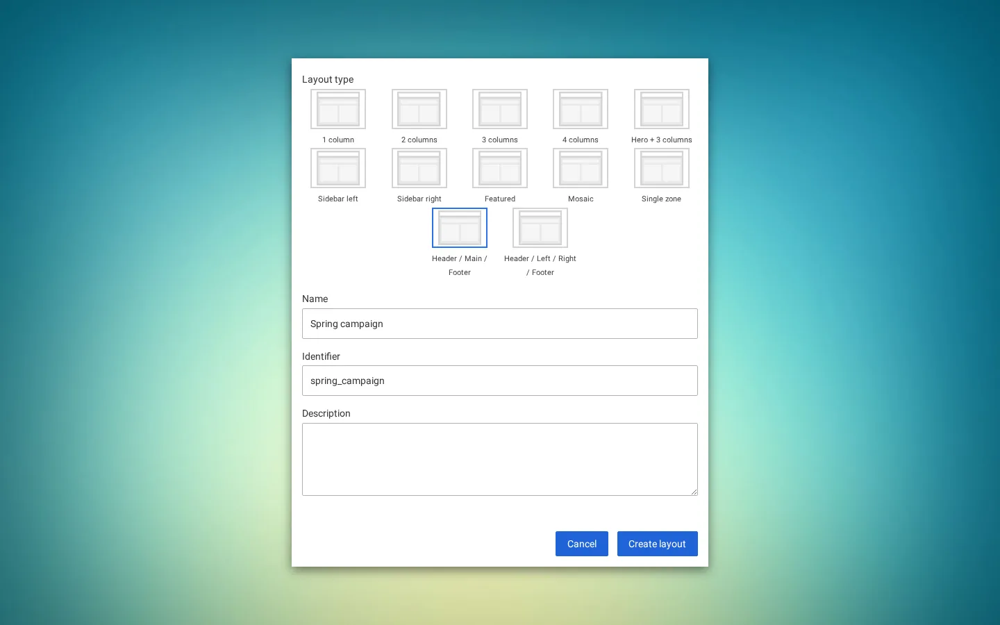
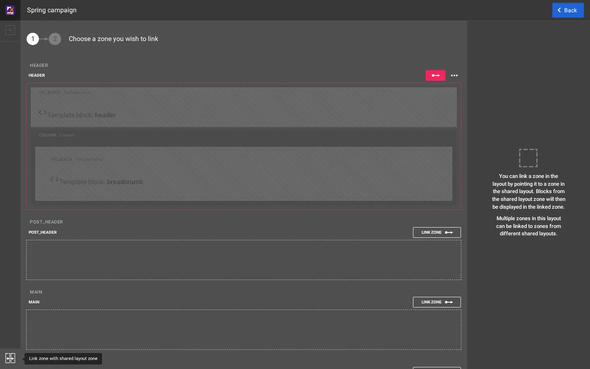
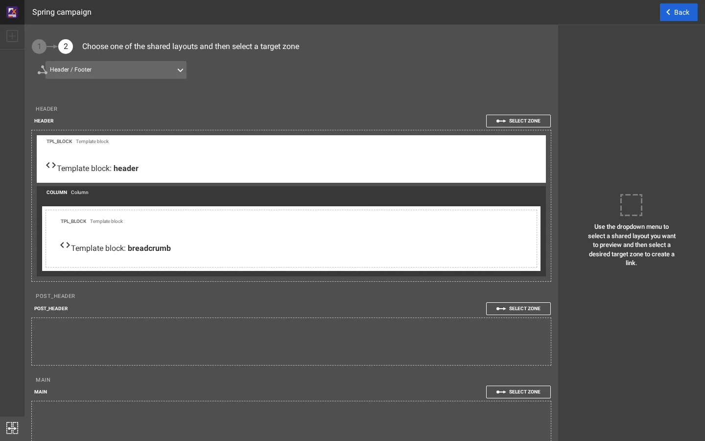
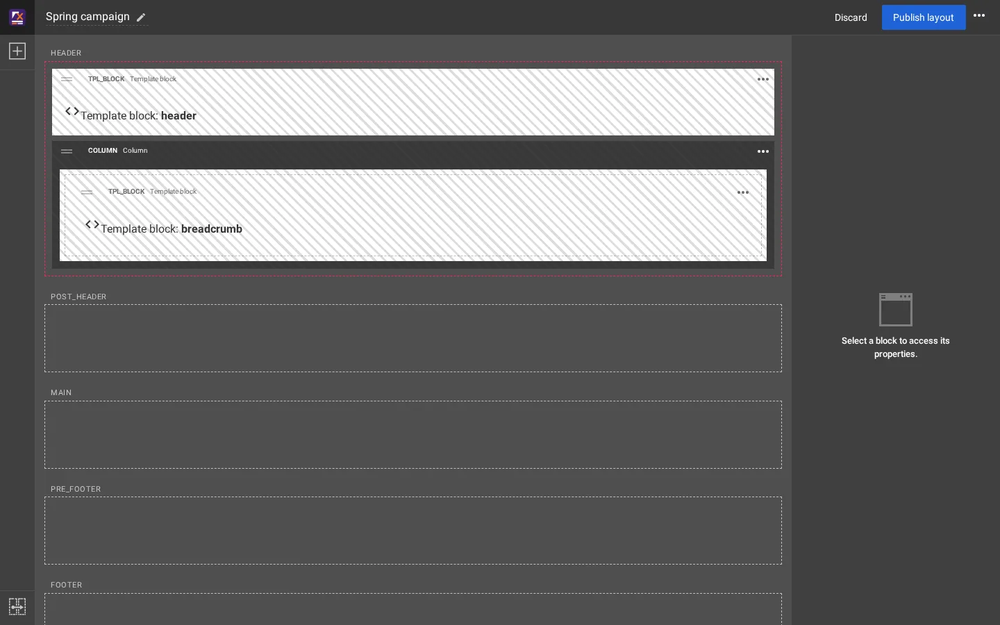
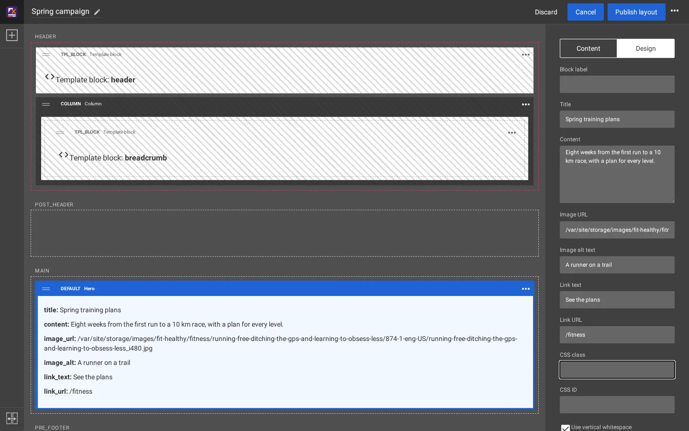
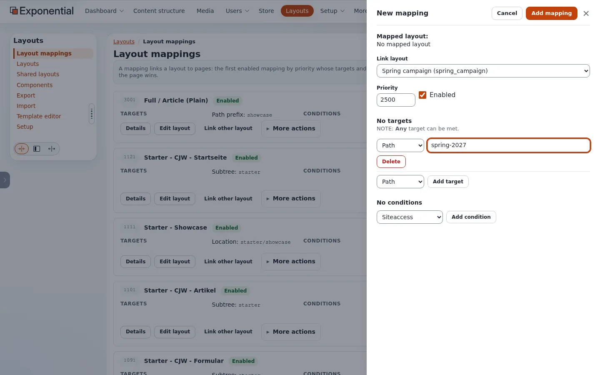
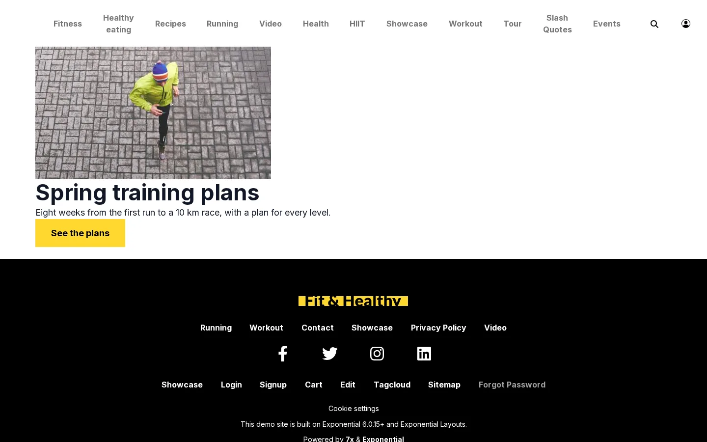

# Build a campaign page, start to finish

This is the one example on these pages that goes through every screen, on a copy of the Fit & Healthy site: a
*Spring campaign* page at `/spring-2027` with the site's header and footer and a Hero. It took six screens and no code.
The second half builds the same page with templates.

## Contents

1. [Create the layout](#1-create-the-layout)
2. [Link the header and the footer](#2-link-the-header-and-the-footer)
3. [Add the Hero](#3-add-the-hero)
4. [Publish the layout](#4-publish-the-layout)
5. [Create the page](#5-create-the-page)
6. [Map the layout to the page](#6-map-the-layout-to-the-page)
7. [The result](#7-the-result)
8. [The same page with templates](#the-same-page-with-templates)

## 1. Create the layout

**Layouts > Layouts > New layout**. Choose the layout type **Header / Main / Footer** (`layout_2`, the type of every
Fit & Healthy layout: zones `header`, `post_header`, `main`, `pre_footer`, `footer`), give a **Name** and an
**Identifier**, and press **Create layout**.



The editor opens with five empty zones.

## 2. Link the header and the footer

Press the linking button at the bottom left of the editor. Each zone gets **Link zone**.



**Link zone** on HEADER shows the shared layouts. Choose **Header / Footer** and press **Select zone** on its HEADER
zone.



The editor returns with the header zone linked: it shows the shared blocks striped, as they are not this layout's own.
Do the same for FOOTER.



## 3. Add the Hero

Open the block palette (**+** at the top left), drag **Hero** (group *Components*) into MAIN, select it and fill its
fields: **Title**, **Content**, **Image URL**, **Image alt text**, **Link text**, **Link URL**.



## 4. Publish the layout

**Publish layout**. The layout exists now, but no page uses it yet.

## 5. Create the page

In **Content structure**, open **Fit & Healthy**, **Create new > Landing page**, title *Spring 2027*, **Send for
publishing**. Its URL is `/spring-2027`.

## 6. Map the layout to the page

**Layouts > Layout mappings > New mapping**. **Link layout**: *Spring campaign*. **Priority**: higher than the mappings
that would otherwise take the page (2500 here). Target **Path** `spring-2027`, **Add target**. **Add mapping**.



## 7. The result



The header menu in this picture is the one of [A header menu that follows the tree](header-menu-from-the-tree.md),
which was active on the test copy.

## The same page with templates

Without Layouts, the page's look comes from its full view template. The theme already shows how to give one page its
own full view: `extension/sevenx_themes_media/settings/siteaccess/site/override.ini.append.php` matches the tour page
(`/exponential-live`) by its remote ID, before the class overrides:

```ini
[node/view/full#showcase_s1_tour]
Source=node/view/full.tpl
MatchFile=node/view/full/showcase_s1_tour.tpl
Subdir=templates
Match[remote_id]=showcase-s1-tour
Priority=0
```

The same in your extension for the campaign page: a block like this in
`extension/mysite/settings/siteaccess/site/override.ini.append.php` with `Match[remote_id]=` the page's remote ID (shown
in the administration as **Remote ID**), and the template
`extension/mysite/design/media/override/templates/node/view/full/spring_2027.tpl` with the Hero markup and the page's
fields (`$node.data_map.title`, `$node.data_map.full_intro`, `$node.data_map.image` of the class Landing page). It
keeps everything in git; every change of text or picture is a deploy, and an editor cannot move or add blocks.

| | Layouts editor | Template override |
|---|---|---|
| Steps here | six screens, no code | an override block, a template, a deploy, a Template & content clear |
| Who changes the text later | an editor, in the Hero block | a developer, in the template |
| Reuse for the next campaign | copy the layout or change the Hero | copy the template and the override block |
| Header and footer | linked to the shared layout | the page layout of the design, as for every page |

## Related pages

- [Shared layouts and zone linking](shared-layouts-and-zone-linking.md)
- [Which layout does a page get?](layout-mappings.md)
- [Life-cycle examples](examples/README.md)
- [Free documentation](../free-documentation.md): this page is free to copy, translate and improve under the GNU FDL 1.3.

<!-- exp-partner-block:start -->
**Become an Exponential Partner.** Partners share their information, provide funding, contribute back and
develop the products with us, and that is how Exponential grows. A partner website and dashboard are planned for
mid-2027: please become a partner today to speed up our growth rate and land new features faster. Start with
[Partners: start here](../partners/partners-start-here.md) and [How to apply](../partners/how-to-apply.md).
<!-- exp-partner-block:end -->
