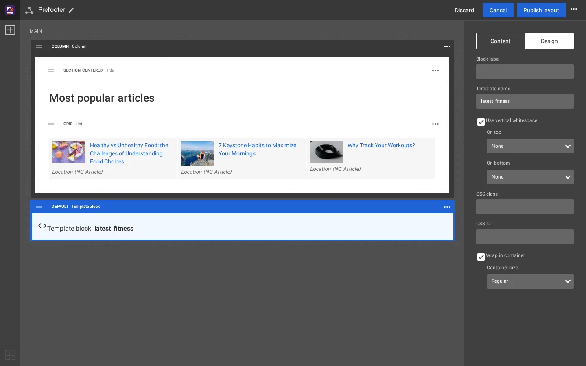
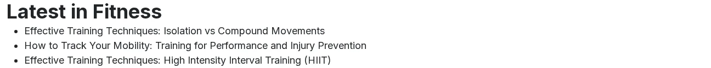

# Your own template blocks

A **Template block** (block type `tpl_block`, palette group *Placeholders*) shows a template whose name you type in
the editor. The developer decides *what* (the template), the editor decides *where* (the layout, zone and order). The
Fit & Healthy header, breadcrumb and footer are template blocks ([How the header is built](how-the-header-is-built.md)).

## Contents

1. [Write the template](#1-write-the-template)
2. [Place it in a layout](#2-place-it-in-a-layout)
3. [The result](#3-the-result)
4. [How a template block finds its template](#how-a-template-block-finds-its-template)

## 1. Write the template

In your design extension: `extension/mysite/design/media/templates/explayouts/tpl_block/latest_fitness.tpl`, here the
three newest articles of Fitness (node 92):

```smarty
{def $latest = fetch( 'content', 'list', hash( 'parent_node_id', 92,
                                                'class_filter_type', 'include',
                                                'class_filter_array', array( 'ng_article' ),
                                                'sort_by', array( 'published', false() ),
                                                'limit', 3 ) )}
<div class="container latest-fitness">
    <h2>{'Latest in Fitness'|i18n( 'mysite' )}</h2>
    <ul>
    {foreach $latest as $item}
        <li><a href={$item.url_alias|ezurl}>{$item.name|wash}</a></li>
    {/foreach}
    </ul>
</div>
{undef $latest}
```

The name may use lower-case letters, digits and `_`. Clear the template cache after adding the file
(`./console exp:cache clear --tag=template`).

## 2. Place it in a layout

Open the layout in the editor, open the block palette, scroll to **Placeholders** and drag **Template block** into a
zone. Select it, open the **Design** tab and type the name into **Template name**: `latest_fitness`. The block then
reads "Template block: **latest_fitness**". **Publish layout**.



## 3. The result



## How a template block finds its template

On the media design, `explayouts/block/tpl_block.tpl` asks the operator `tpl_block_template()` (in
`extension/sevenx_themes_media/autoloads/sevenxthemesmediaoperators.php`):

1. a fixed map of the theme's own block IDs (13 header, 477 breadcrumb, 14 footer, and the article and topic parts);
2. by place: a root block in zone `header`, a block in a column of zone `header`, a root block in zone `footer`;
3. by its **Template name**: `explayouts/tpl_block/<name>.tpl`, if a design has that file. A name without a file
   renders nothing (and no empty wrapper).

So a template block you add in a `header` or `footer` zone of the shared layout is taken for the theme's header,
breadcrumb or footer by rule 2, whatever name you type. Put your own template blocks in other zones (`post_header`,
`main`, `pre_footer`), or in another layout.

The standard design of Layouts has its own placeholders under
`extension/explayouts/design/standard/templates/explayouts/tpl_block/` (`header.tpl`, `breadcrumb.tpl`, `footer.tpl`);
a design without the media theme's operator includes `design:explayouts/tpl_block/<name>.tpl` directly.

## Related pages

- [How the header is built](how-the-header-is-built.md)
- [Add a block type](add-a-block-type.md)
- [Your own design extension](your-own-design-extension.md)
- [Free documentation](../free-documentation.md): this page is free to copy, translate and improve under the GNU FDL 1.3.

<!-- exp-partner-block:start -->
**Become an Exponential Partner.** Partners share their information, provide funding, contribute back and
develop the products with us, and that is how Exponential grows. A partner website and dashboard are planned for
mid-2027: please become a partner today to speed up our growth rate and land new features faster. Start with
[Partners: start here](../partners/partners-start-here.md) and [How to apply](../partners/how-to-apply.md).
<!-- exp-partner-block:end -->
