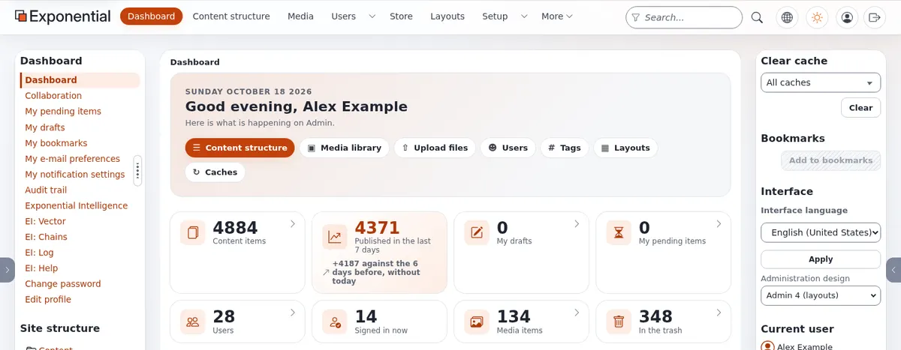

# Businesses: start here

This section is for organizations that depend on the web to earn money or to serve the people they exist for: online
stores and small shops, companies with an intranet or a partner extranet, member organizations, newsletters,
libraries and catalogs, non-profits, small groups and associations, brands with several sites and languages, and
anyone who needs a web application that keeps working with low maintenance cost and few problems in production.

It is written for owners, managers and decision makers first. Each page says in plain language what a business gets
and what it has to do, and then links to the technical pages for whoever does the work: a developer, a hosting
company or a partner.

> **Note**
> Every fact in this section comes from the Exponential repository, from the live demonstration installation at
> <https://alpha.se7enx.com> or from <https://exponential.earth>, and the page it comes from is linked. The section
> names no customers and quotes no market statistics. Where a page calculates costs, every input is labeled as an
> example assumption for you to replace with your own numbers.

## Contents

1. [Exponential in one minute](#exponential-in-one-minute)
2. [Why businesses rely on it](#why-businesses-rely-on-it)
3. [Find your kind of organization](#find-your-kind-of-organization)
4. [Running it without surprises](#running-it-without-surprises)
5. [Money: cost, return and risk](#money-cost-return-and-risk)
6. [A first week for a business that is evaluating](#a-first-week-for-a-business-that-is-evaluating)
7. [Other sections of this help](#other-sections-of-this-help)

## Exponential in one minute

Exponential is "a professional PHP application framework with advanced CMS (content management system)
functionality" whose most notable feature "is its fully customizable and extendable content model" (`README.md`,
"What does Exponential provide for end users building websites?"). For a business that means:

| What you need | What Exponential ships | Source |
|---|---|---|
| A website your staff can update from anywhere | Browser-based administration and editing | `README.md` |
| An online store | "Advanced e-Commerce Stores (Built in)" | `README.md`, "Main Exponential features" |
| Staff-only and partner-only areas | "Fine grained role based permissions system" | same |
| Approval before something goes public | "Content approval and scheduled publication" | same |
| Several sites and languages | "Multi-site support", "Advanced multi-lingual support" | same |
| Apps and other systems that read your content | "A headless CRUD REST API" | same |
| Pages your marketing team can lay out | Exponential Layouts, a visual page builder | `README.md`, "Exponential Layouts" |
| Help writing and translating | Exponential Intelligence, a writing assistant that writes drafts only | `README.md`, "Exponential Intelligence" |
| A fast server of its own | Exponential Velocity | `README.md`, "How Exponential is served" |

The software is free software under the GNU General Public License, version 2 or later, so there is no license fee
([Licensing for buyers](../business/licensing-for-buyers.md)). It is led by the company 7x and operated by the
nonprofit Exponential Foundation ([Who is 7x?](../who-is-7x.md), [Who is the Exponential Foundation?](../who-is-the-exponential-foundation.md)).

## Why businesses rely on it

The short version, explained in [Why businesses rely on Exponential](why-businesses-rely-on-exponential.md):

- **A long-lived code base.** The copyright notice runs from 1998 to 2026, and the project states that it "has made
  it beyond it's end of life in 2021 and survived" (`README.md`, "Exponential Project Status";
  [Who is 7x?](../who-is-7x.md#in-short)). Content and investment made years ago still run.
- **Published versions never change.** A fix arrives as the next release, never as a silently corrected copy
  (`SECURITY.md`, quoted in [The support commitment](../who-is-the-exponential-foundation.md#the-support-commitment)).
- **Few moving parts.** SQLite needs no database server, PHP 8.0 or later on almost any operating system is enough,
  and any common web server works ([Requirements](../hosting/basics/requirements-at-a-glance.md)).
- **Fast under load.** The cache fixes of the 6.0.15 line make the application fast on Apache or Nginx too, and
  Velocity raises the ceiling further (`README.md`, "The part that matters even if you never run Velocity").
- **Evidence when something goes wrong.** A tamper-evident audit trail, log viewers and error references
  ([Reliability](reliability/README.md)).

## Find your kind of organization

| You are | Start with |
|---|---|
| An online store or a small shop | [Online stores](stores/README.md) |
| A company that needs an intranet for its staff | [Intranets](intranets/README.md) |
| A company that shares information with partners, dealers, suppliers or customers | [Extranets and partner portals](extranets/README.md) |
| A club, a professional body or anyone with members | [Member sites](members/README.md) |
| A publisher of a newsletter | [Newsletters](newsletters/README.md) |
| A library, an archive or anyone with a catalog | [Libraries and catalogs](libraries/README.md) |
| A non-profit or charity | [Non-profits](nonprofits/README.md) |
| A small group or an association run by volunteers | [Small groups and associations](associations/README.md) |
| A brand or group with several sites | [Multi-site brands](multisite/README.md) |
| A business that sells in several languages | [Multilingual businesses](multilingual/README.md) |
| A business with a mobile app or other systems that use the content | [Mobile and headless](mobile-and-headless/README.md) |
| A government body or public authority | The separate [Governments](../government/government-start-here.md) section |

Not sure? [Which section fits your organization](which-section-fits-your-organization.md) asks a few questions and
points you to the right place. [How businesses sell online with Exponential](how-businesses-sell-online.md) explains
the three channels: website applications, mobile apps and networks.

## Running it without surprises

Most of the cost of a website is not building it but running it for years. The [Reliability](reliability/README.md)
section covers what keeps a site available to customers:

- [Why stability matters](reliability/why-stability-matters.md) and [uptime practice](reliability/uptime-practice.md);
- [backups that restore](reliability/backups-that-restore.md) and [restore drills](reliability/restore-drills.md);
- [Velocity for businesses](reliability/velocity-for-businesses.md) and [graceful deploys](reliability/graceful-deploys.md);
- [caching for availability](reliability/caching-for-availability.md) and [peak traffic planning](reliability/peak-traffic-planning.md);
- [monitoring](reliability/health-checks-and-monitoring.md) and [incident response for small teams](reliability/incident-response-for-small-teams.md);
- [upgrades without surprises](reliability/upgrades-without-surprises.md).

## Money: cost, return and risk

- [Total cost of ownership](costs/total-cost-of-ownership.md) and [what you do not pay for](costs/what-you-do-not-pay-for.md).
- [The return on investment of stability](costs/roi-of-stability.md), with worked examples for a
  [small store](costs/worked-example-small-store.md), an [intranet](costs/worked-example-intranet.md) and a
  [non-profit](costs/worked-example-nonprofit.md), and a [cost of downtime worksheet](costs/cost-of-downtime-worksheet.md).
- [Security basics for businesses](security/security-basics-for-businesses.md) and [GDPR basics](security/gdpr-basics.md)
  (basics, not legal advice).
- [Choosing hosting](choosing/choosing-hosting.md) and [choosing a partner](choosing/choosing-a-partner.md).

## A first week for a business that is evaluating

| Day | Do | Read |
|---|---|---|
| 1 | Write down what the site must do and what an hour of downtime costs you | [Project brief template](templates/project-brief-template.md), [Cost of downtime worksheet](costs/cost-of-downtime-worksheet.md) |
| 2 | Find your section above and read its first pages | the section README |
| 3 | Look at a running installation: the demo, or a test installation with SQLite | [Getting started](../getting-started.md), [Admin tour](../admin-tour.md) |
| 4 | Decide who runs it: yourself, a hosting company or a partner | [Choosing hosting](choosing/choosing-hosting.md), [Questions to ask a partner](choosing/questions-to-ask-a-partner.md) |
| 5 | Fill in the requirements and the evaluation scorecard and decide on a pilot | [Requirements checklist](templates/requirements-checklist.md), [Vendor evaluation scorecard](templates/vendor-evaluation-scorecard.md) |

The full order of reading is in the [reading path](businesses-reading-path.md). Short answers are in the
[FAQ](businesses-faq.md) and the words are explained in the [glossary](businesses-glossary.md).

## Other sections of this help

| Section | For |
|---|---|
| [Sales and marketing](../business/sales-and-marketing-start-here.md) | People who sell Exponential and Exponential projects |
| [Project managers](../leadership/project-managers-start-here.md) | Planning and running an Exponential project |
| [Website creators](../creators/website-creators/website-creators-start-here.md) | Building the site |
| [Application creators](../creators/app-creators/app-creators-start-here.md) | Building custom applications and integrations |
| [Hosting companies](../hosting/hosting-companies-start-here.md) | Running Exponential for customers |
| [Press](../press/press-start-here.md) | Journalists and reviewers |

## Related pages

- [Why businesses rely on Exponential](why-businesses-rely-on-exponential.md)
- [Businesses reading path](businesses-reading-path.md)
- [Which section fits your organization](which-section-fits-your-organization.md)
- [How businesses sell online with Exponential](how-businesses-sell-online.md)
- [Who Exponential is for](../business/who-exponential-is-for.md)
- [Free documentation](../free-documentation.md): this page is free to copy, translate and improve under the GNU FDL 1.3.

<!-- exp-partner-block:start -->
**Become an Exponential Partner.** Partners share their information, provide funding, contribute back and
develop the products with us, and that is how Exponential grows. A partner website and dashboard are planned for
mid-2027: please become a partner today to speed up our growth rate and land new features faster. Start with
[Partners: start here](../partners/partners-start-here.md) and [How to apply](../partners/how-to-apply.md).
<!-- exp-partner-block:end -->
