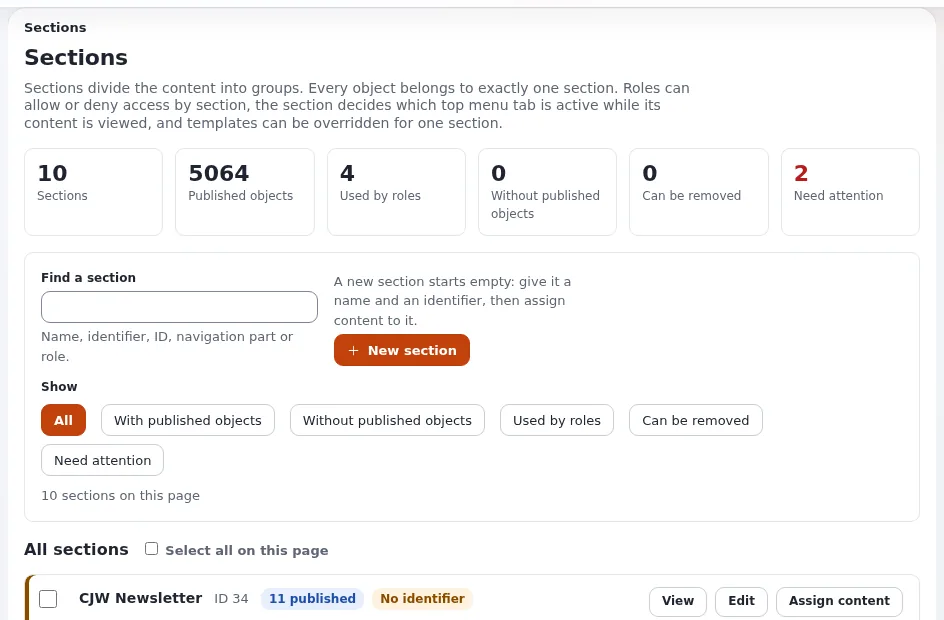

# Extranet permissions review

This page is for portal owners and administrators. Access that was right when a partnership started is often wrong a
year later: people change jobs, contracts end, tiers change. A short review at a fixed rhythm keeps the portal clean.
The page gives the routine and the Exponential pages that make each step quick.

## Contents

1. [Why review](#why-review)
2. [The rhythm](#the-rhythm)
3. [Step 1: roles](#step-1-roles)
4. [Step 2: assignments](#step-2-assignments)
5. [Step 3: accounts](#step-3-accounts)
6. [Step 4: areas](#step-4-areas)
7. [Step 5: spot checks](#step-5-spot-checks)
8. [Step 6: record the review](#step-6-record-the-review)
9. [When a partnership ends](#when-a-partnership-ends)
10. [Related pages](#related-pages)

## Why review

- Partners' staff leave without telling you; their accounts remain.
- A role edited for one purpose can open more than intended; policies of several roles add up.
- Content moves; a subtree limitation follows the tree, so moved content changes audience.
- Data protection rules expect that personal data is kept only as long as needed
  ([GDPR basics](../security/gdpr-basics.md); this page is not legal advice).

## The rhythm

| Review | Suggested rhythm | Takes |
|---|---|---|
| Roles and badges | each quarter, and after any role change | a short look at one page |
| Accounts | each quarter | one filtered list per question |
| Areas and sections | twice a year | the section list and a few spot checks |
| Full review with relationship managers | once a year | a meeting per audience |

Choose the rhythm with your security officer; the [Access reviews](../security/access-reviews.md) page in the
security section gives the general method.

## Step 1: roles

Open **Users > Roles and policies**. Each role is a card with its policies, its assignments and badges
([Roles and policies, 1](../../../guides/roles-and-policies.md#1-read-the-role-list)):

- [ ] **Full access** (red) appears only on Administrator.
- [ ] **Can change roles** (amber) appears on no partner role.
- [ ] **Not assigned** roles are either needed later or removed.

Open each partner role. Its policies read as sentences, such as *May read content, in section Partner material*. A
limitation that no handler evaluates is marked *(no handler, denies)*
([Roles and policies, 2](../../../guides/roles-and-policies.md#2-read-one-role)).

- [ ] Every partner policy has a section, subtree or state limitation.
- [ ] `user/login` is limited to the portal siteaccess.
- [ ] No partner role has `content/remove` unless agreed.

## Step 2: assignments

On each role page, the list of users and groups shows each assignment with its limitation (*Only in the subtree
Partner A*). An assignment whose user or group was removed is listed first and can be removed
([Roles and policies, 2](../../../guides/roles-and-policies.md#2-read-one-role)).

- [ ] Every subtree assignment matches a current partner.
- [ ] No assignment points to a removed group.
- [ ] Prefer group assignments; users assigned directly are exceptions with a reason.

The figure **users affected in all** on the role page counts everyone the role reaches; a sudden jump deserves a
question.

## Step 3: accounts

**Users > Check user accounts** (`user/hygiene`) answers the account questions with filters
([Check user accounts](../../../features/6.0/user-hygiene.md#the-filters)):

| Filter | Question |
|---|---|
| Never signed in | accounts created but never used: still needed? |
| Not seen for N days (180 by default) | partners who stopped using the portal |
| Disabled, Locked | accounts to clean up or unlock |
| Orphaned | accounts whose user object is missing or has no location |
| Shared e-mail address | one person with several accounts |

Choose a user group to look only at one partner organization. **Export the list as CSV** gives the relationship
manager a list to confirm. **Disable** blocks sign-in and ends sessions while keeping content and groups.

With `[UserSettings] DeactivateAndMove=enabled`, **Deactivate and move** disables accounts and moves all their
locations into one hidden group without roles, remembering where they were; **Reactivate and move back** restores
them ([Deactivate and move](../../../features/6.0/user-hygiene.md#deactivate-and-move)). For a portal this is the
cleanest way to retire accounts without deleting them. Removing a user object is final; there is no trash for users.

Also clear **Users > Unactivated users**: registrations never confirmed
([Roles and policies, 7](../../../guides/roles-and-policies.md#7-clean-up-unactivated-users)).

## Step 4: areas

Open **Setup > Sections** (`/section/list`). Each section card shows its objects and the roles that use it, and
marks sections needing attention ([Sections, 3](../../../guides/sections.md#3-the-section-list)).

- [ ] Each partner section is used only by the intended roles.
- [ ] No partner content sits in Section Standard by mistake.
- [ ] State groups used for audiences list only the intended roles (**Setup > States**, "Roles that use this group").

## Step 5: spot checks

- Sign in as a test user of two partners and open the other partner's folder address; it must say access denied.
- Search as each test user for a word from the other's documents; nothing may appear.
- `./console exp:access:check` asks the permission checks for another user from the command line
  ([Content policy limitations](../../../features/6.0/content-limitation-handlers.md#checking-access-for-another-user)).

## Step 6: record the review

The audit trail records role assignments, account locks, sign-ins and content changes in a tamper-evident log, and
`./console exp:audit verify` proves the record is intact
([The audit trail](../../../features/6.0/audit-trail.md)). Write a short note of each review: date, reviewer, what was
changed. The [compliance evidence](../security/compliance-evidence-from-the-audit-trail.md) page shows how to use the
audit trail as evidence.

## When a partnership ends

1. Remove the organization's role assignments (its subtree assignment and tier groups).
2. Deactivate and move, or disable, its accounts.
3. Archive or remove its folder, following the contract and your retention rules
   ([Data retention and deletion](../security/data-retention-and-deletion.md)).
4. Note the change in the review record.

## Related pages

- [Access reviews](../security/access-reviews.md)
- [Check user accounts](../../../features/6.0/user-hygiene.md)
- [Roles, policies and unactivated users](../../../guides/roles-and-policies.md)
- [KPIs from logs and audit](../../leadership/kpis-from-logs-and-audit.md)
- [Free documentation](../../free-documentation.md): this page is free to copy, translate and improve under the GNU FDL 1.3.

<!-- exp-partner-block:start -->
**Become an Exponential Partner.** Partners share their information, provide funding, contribute back and
develop the products with us, and that is how Exponential grows. A partner website and dashboard are planned for
mid-2027: please become a partner today to speed up our growth rate and land new features faster. Start with
[Partners: start here](../../partners/partners-start-here.md) and [How to apply](../../partners/how-to-apply.md).
<!-- exp-partner-block:end -->
