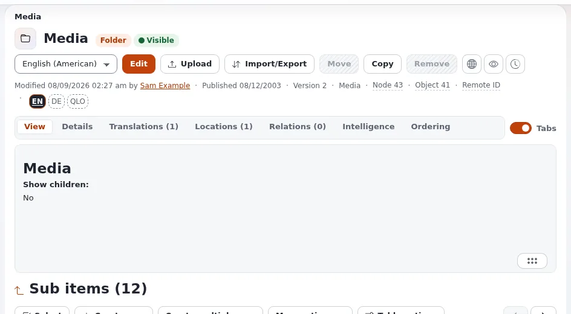

# Documents and file libraries

This page is for intranet owners who want one trusted place for documents: the current HR policy, the travel form,
the brand handbook. It explains how Exponential stores files, why a download from a protected area is safe, what
helps editors keep documents current, and what to check before moving a shared drive into the intranet.

## Contents

1. [Files are content](#files-are-content)
2. [Downloads respect permissions](#downloads-respect-permissions)
3. [Structuring a library](#structuring-a-library)
4. [Keeping documents current](#keeping-documents-current)
5. [Getting many files in](#getting-many-files-in)
6. [Finding words inside files](#finding-words-inside-files)
7. [Handbooks as PDF and office documents](#handbooks-as-pdf-and-office-documents)
8. [WebDAV](#webdav)
9. [Checklist](#checklist)
10. [Related pages](#related-pages)

## Files are content

In Exponential a document is a content object of the class **File**, whose `file` field uses the datatype
`ezbinaryfile`. Uploads of files that are not images become File objects, because `settings/upload.ini` sets
`DefaultClass=file` ([Files and downloads](../../creators/website-creators/files-and-downloads.md#how-a-download-works)).

For the business this means a document has everything other content has: a title, a place in the tree, a section,
an owner, versions, translations and a URL. It can be related to the pages that mention it
([Relations and reuse](../../creators/website-creators/relations-and-reuse.md)).

## Downloads respect permissions

Every download goes through the view `content/download/<object ID>/<attribute ID>`. The view checks that the person
may read the object before it sends the file (`kernel/content/module.php`, view `download`, function `read`). A file
in an HR-only section can therefore only be downloaded by people who may read that section, even if someone mails
the link around.

> **Warning**
> Do not link documents directly from the storage directory (`var/.../storage/`). That bypasses the permission check
> ([Files and downloads, Protected downloads](../../creators/website-creators/files-and-downloads.md#protected-downloads)).

## Structuring a library

| Need | How in Exponential |
|---|---|
| Documents for all staff | a folder in the staff section |
| Documents for one department | a folder assigned to that department's section ([Departments, roles and sections](departments-roles-and-sections.md)) |
| A document that belongs on several pages | one File object, related to the pages or given a second location |
| Retired documents kept for reference | move them to an archive section that only owners read |
| Topics across departments | tags with `eztags` ([Tagging with eztags](../../creators/website-creators/tagging-with-eztags.md)) |

Name folders by what staff look for ("Travel and expenses"), not by the department that owns them; ownership is
expressed by the section.

## Keeping documents current

- **Versions.** Each save of an object is a version; the previous published version is archived and can be compared
  and restored from the versions page (`/content/history/<object id>`)
  ([Versions of an object](../../../guides/content-history.md)). Replacing a file in an existing File object keeps
  the address and the history; uploading a second copy creates confusion.
- **Owners.** The owner of each object is recorded and can be changed
  ([Changing owners](../../../guides/changing-owners.md)).
- **Approval.** Policies and handbooks can need approval before a new version goes live
  ([Approval workflows](approval-workflows.md)).
- **Followers.** Staff who follow the library folder get mail when a new document is published below it
  ([Notifications for staff](notifications-for-staff.md)).
- **Upload limits.** PHP's `upload_max_filesize` and `post_max_size` limit what editors can upload; agree on the
  largest file size with whoever runs the server
  ([Files and downloads, Large files](../../creators/website-creators/files-and-downloads.md#large-files)).

## Getting many files in

| Tool | What it does | Source |
|---|---|---|
| **Upload multiple files** (`ezmultiupload`) | choose or drop several files; each becomes an object of the right class under the current folder | [ezmultiupload](../../../features/6.0/extensions/ezmultiupload.md) |
| Editor upload | one file at a time through the editor or the media library | [Media and uploads](../../media-and-uploads.md) |
| Scripts and imports | developers can create content in code for a migration | [Creating content in code](../../creators/app-creators/creating-content-in-code.md) |

Uploaded images are checked by their content, not only by their extension, since 12 October 2026
([Behaviour changes 2026-10](../../../bc/6.0/behaviour-changes-2026-10.md)).

## Finding words inside files

The built-in search indexes the searchable fields of each class. For text inside files, `settings/binaryfile.ini`
names extractors per type: `ezpdf` for PDF (using the external program `pstotext`), `ezword` for Word documents
(using `wvWare`) and `ezplaintext` for plain text. The external programs must be installed on the server. With Solr
through `ezfind`, file contents can be indexed too ([Intranet search](intranet-search.md)).

## Handbooks as PDF and office documents

- **PDF exports.** Setup > PDF export (`/pdf/list`) makes one PDF document from a part of the content tree, for
  example a handbook kept as pages ([PDF exports](../../../guides/pdf-exports.md)).
- **OpenDocument.** The `ezodf` extension imports a `.odt` file from OpenOffice or LibreOffice Writer as a content
  object and exports objects back to Writer documents; it needs OpenOffice or LibreOffice 2.4 or later on the server
  ([ezodf](../../../features/6.0/extensions/ezodf.md)).

## WebDAV

The kernel contains a WebDAV entry point (`index_webdav.php`; `webdav.php` until 6.0.14, see
[the change](../../../bc/6.0/webdav-entry-script-index-webdav.md)) with its settings in `settings/webdav.ini`. It is switched off
by default (`EnableWebDAV=false`) and starts at node 2. Uploads through WebDAV pass the same image checks as other
uploads (changelog 6.0.15). This help has no step-by-step guide for it; if staff want to mount the library as a
network drive, ask your partner to test it on your installation before you promise it.

## Checklist

- [ ] Every document area belongs to a section that only the right groups may read.
- [ ] Each document has a named owner.
- [ ] Download links show format and size.
- [ ] Protected downloads tested while signed in as someone without access.
- [ ] Old copies removed or moved to an archive section after migration.
- [ ] Upload limits fit the largest file.
- [ ] Decided whether text inside files must be searchable, and the tools installed.

## Related pages

- [Files and downloads](../../creators/website-creators/files-and-downloads.md)
- [Organizing the media library](../../creators/website-creators/organizing-the-media-library.md)
- [Sharing files with partners](../extranets/sharing-files-with-partners.md)
- [Intranet search](intranet-search.md)
- [Free documentation](../../free-documentation.md): this page is free to copy, translate and improve under the GNU FDL 1.3.

<!-- exp-partner-block:start -->
**Become an Exponential Partner.** Partners share their information, provide funding, contribute back and
develop the products with us, and that is how Exponential grows. A partner website and dashboard are planned for
mid-2027: please become a partner today to speed up our growth rate and land new features faster. Start with
[Partners: start here](../../partners/partners-start-here.md) and [How to apply](../../partners/how-to-apply.md).
<!-- exp-partner-block:end -->
