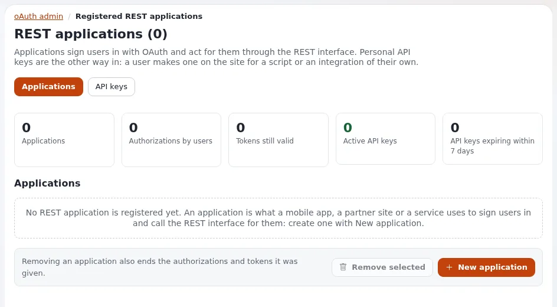

# Apps and API keys

This page is for managers and administrators who must decide how programs are allowed to talk to Exponential: a
mobile app, a partner's system, an import script, an agency's tool. It explains the three credentials the platform
offers, how each is controlled, what is recorded, and a set of house rules. The technical page is
[OAuth and API keys](../../creators/app-creators/oauth-and-api-keys.md).

## Contents

1. [Three credentials, chosen by who the program acts for](#three-credentials-chosen-by-who-the-program-acts-for)
2. [OAuth2 for apps whose users sign in](#oauth2-for-apps-whose-users-sign-in)
3. [Personal API keys](#personal-api-keys)
4. [expservices tokens](#expservices-tokens)
5. [Control, limits and the audit trail](#control-limits-and-the-audit-trail)
6. [House rules for a business](#house-rules-for-a-business)

## Three credentials, chosen by who the program acts for

From [OAuth and API keys](../../creators/app-creators/oauth-and-api-keys.md#which-credential):

| The program | Use |
|---|---|
| Acts for many users who sign in themselves (a mobile app) | OAuth2 |
| Is one user's own script | A personal API key |
| Drives administration services (apps, portals, shells) | An expservices token |

None of them is a password: an API key "cannot sign in to the site or the administration"
([Personal API keys](../../../guides/api-keys.md#1-what-a-key-is-and-what-it-is-not)).

## OAuth2 for apps whose users sign in

1. An administrator registers the app under **Setup > oAuth admin**: identifier, secret, redirect address.
2. The app sends the user to the site's authorize page; the user signs in and allows the app. The user needs the
   policy `oauth/authorize`, which can be limited by siteaccess.
3. The app exchanges a code for a token, and refreshes it when it expires (one hour by default).

Source: [3.1 OAuth2 tokens](../../../guides/rest-api-v1-and-v2.md#31-oauth2-tokens). Important for a business:
"The client secret belongs on a server; an app that cannot keep a secret should go through a back end of yours"
([OAuth2 for third-party applications](../../creators/app-creators/oauth-and-api-keys.md#oauth2-for-third-party-applications)).
Removing an app in the administration also removes its authorizations and tokens
([7. The administration](../../../guides/api-keys.md#7-the-administration-every-key-one-user-revoking)).

## Personal API keys

New in 6.0.15 ([Personal API keys](../../../guides/api-keys.md#in-short)):

- A user with the policy `apikey/create` makes a key under **My account > API access**, names it, ticks the
  **scopes** it needs and picks a lifetime. The key is shown **once**.
- Requests with the key run as its owner, limited to the key's scopes, "and never beyond the owner's own policies".
- Only a salted hash of the secret is stored; "nobody can show a key again, not even an administrator".
- Keys end when revoked, when they expire, or when the owner is disabled or removed. Revoking "takes effect at the
  next request on every server".

**Scopes** stand for policies of the owner: read, publish (create), edit and remove as shipped. A key for a read-only
integration gets only the read scope ([6. Scopes](../../../guides/api-keys.md#6-scopes)).

## expservices tokens

The remote services have their own personal tokens, created per user, with a lifetime of 1 to 365 days (90 by
default). Requests sign in as the token's user for that request only, with the same policies; "a token cannot create
tokens" ([Remote services: personal API tokens](../../../features/6.0/remote-services-expservices.md#personal-api-tokens-for-scripts-and-apps)).
See [Remote services](remote-services.md).

## Control, limits and the audit trail

| Control | Default | Source |
|---|---|---|
| Keys per user | 10 | [8. Auditing and limits](../../../guides/api-keys.md#8-auditing-and-limits) |
| Longest key lifetime | 365 days | same |
| Requests per key and minute | 120, counted in APCu; without APCu not enforced, and the API keys page says so | same |
| Overview of every key | **Setup > oAuth admin > API keys**: active, expiring within seven days, never used, expired, revoked; search, filter, revoke one or many with a confirmation | [7. The administration](../../../guides/api-keys.md#7-the-administration-every-key-one-user-revoking) |
| Audit events | every key made, revoked, first used and refused, with the reason (for example revoked, expired, scope, rate limited); never the secret | [8. Auditing and limits](../../../guides/api-keys.md#8-auditing-and-limits) |
| expservices tokens | token made, revoked and failed events in the audit trail | [Remote services](../../../features/6.0/remote-services-expservices.md#personal-api-tokens-for-scripts-and-apps) |

For a business this answers the auditor's questions "who could reach our content by program, and what did they do?"
from the [audit trail](../../../features/6.0/audit-trail.md).

## House rules for a business

Adapted from the good practice of the technical page:

- [ ] **One credential per program**, so one can be revoked alone.
- [ ] **A dedicated user for each integration**, not the administrator, with the smallest role that works.
- [ ] **The smallest scope**: read only unless the program must write.
- [ ] **Secrets in environment variables or a secret store**, never in a repository, a URL or a log. (A key sent in
      the address is refused before any lookup.)
- [ ] **Short lifetimes and rotation**; put expiry dates in the operations calendar.
- [ ] **A monthly look at the API keys page** for keys never used, keys about to expire and refusals.
- [ ] **Offboarding**: when a partner contract or an employee leaves, their keys and tokens are revoked the same day.
- [ ] **HTTPS only** for every API request.

## Related pages

- [REST API v1 and v2 for businesses](rest-api-v1-and-v2-for-businesses.md)
- [Remote services](remote-services.md)
- [OAuth and API keys](../../creators/app-creators/oauth-and-api-keys.md)
- [Personal API keys](../../../guides/api-keys.md)
- [Access reviews](../security/access-reviews.md)
- [Free documentation](../../free-documentation.md): this page is free to copy, translate and improve under the GNU FDL 1.3.

<!-- exp-partner-block:start -->
**Become an Exponential Partner.** Partners share their information, provide funding, contribute back and
develop the products with us, and that is how Exponential grows. A partner website and dashboard are planned for
mid-2027: please become a partner today to speed up our growth rate and land new features faster. Start with
[Partners: start here](../../partners/partners-start-here.md) and [How to apply](../../partners/how-to-apply.md).
<!-- exp-partner-block:end -->
