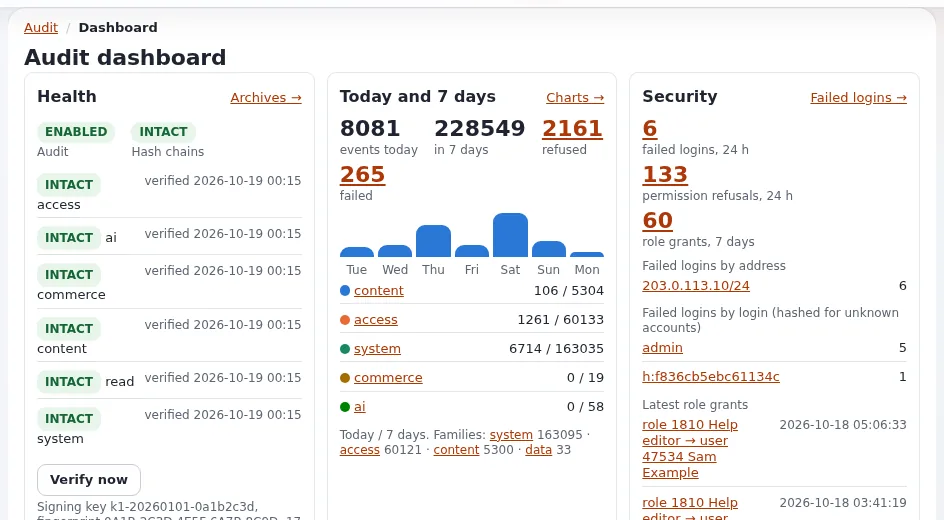

# Audit trail for operations

This page is for managers and administrators who want to know who changed what on the site, especially when
something has gone wrong. It explains what the audit trail records, how it helps operations, how to read it, and
what to set up once. The full reference is [The audit trail](../../../features/6.0/audit-trail.md) and
[Security and audit](../../../guides/security-and-audit.md#3-read-the-audit-trail-5-minutes). Compliance use is
covered separately in [Compliance evidence from the audit trail](../security/compliance-evidence-from-the-audit-trail.md).



## Contents

1. [Why operations needs an audit trail](#why-operations-needs-an-audit-trail)
2. [What is recorded](#what-is-recorded)
3. [Proof the record was not changed](#proof-the-record-was-not-changed)
4. [Using it after an incident](#using-it-after-an-incident)
5. [Alerts](#alerts)
6. [Set up once](#set-up-once)
7. [Who may read it](#who-may-read-it)
8. [Checklist](#checklist)

## Why operations needs an audit trail

Many incidents start with a change: a setting written, a role granted, a subtree removed, a cache cleared at the wrong
moment. When the site misbehaves, the fastest question is "what changed just before?". The audit trail answers it.

It is on by default from Exponential 6.0.15 and needs no setup to start recording
([Audit trail](../../../features/6.0/audit-trail.md)).

## What is recorded

From [The audit trail, what is recorded](../../../features/6.0/audit-trail.md#what-is-recorded):

| Channel | Examples |
|---|---|
| `content` | Publish, move, copy, remove, hide, sections, states, trash, versions, URL aliases, classes, content jobs |
| `access` | Sign-in, failed sign-in, refused view, account lock, role assignment, password reset |
| `system` | Settings writes, cache clears, cronjob runs, commands, package installs, maintenance, deploys |
| `commerce` | Orders, payments (never card data), VAT, currencies, discounts, exports and imports |
| `read` | Sampled views, searches and downloads, only when reads are switched on |

For operations the `system` channel is the most useful: it shows deploys, maintenance windows, cache clears and
settings changes in one place.

Shipped retention, from `settings/audit.ini`: the `content`, `access`, `system` and `commerce` channels keep live files
90 days and archives 730 days; the `read` channel 30 and 90 days. These can be changed in an override
([Audit trail](../../../features/6.0/audit-trail.md#what-is-recorded)).

## Proof the record was not changed

A log that anyone can edit proves little. The audit trail is tamper-evident
([Audit trail, why you want it](../../../features/6.0/audit-trail.md#why-you-want-it)):

- Every record carries the hash of the record before it (a hash chain).
- Daily files are closed, archived and listed in signed manifests.
- `verify` tells you whether anything was edited or cut out:

```bash
php bin/php/audit.php verify --allow-root-user     # exit 0: every chain intact; 1: a chain is broken
php bin/php/audit.php status --allow-root-user     # one line per channel, ending in "intact"
```

Run `verify` on a schedule and alert on a non-zero exit status
([Health checks and monitoring](health-checks-and-monitoring.md#checks-on-the-server)).

## Using it after an incident

1. Note the time the problem started (from your monitor or the first customer report).
2. Open the **Audit** tab in the administration (`/audit/dashboard`) and its console, filtered to a window just before
   that time.
3. Look in `system` for deploys, settings writes, maintenance and cache clears, and in `content` for large removals
   or moves.
4. From an error reference, the log viewer's **The audit of this moment** link opens the same window directly
   ([Logs and error references](logs-and-error-references.md)).
5. Write what you found into the incident note.

From a shell, the newest events of a channel:

```bash
php bin/php/audit.php tail --channel=system --lines=20 --allow-root-user
```

> **Tip**
> A subtree removal is recorded as one parent event with a child per node below it, and a content job is the parent
> of everything its batches did. "Who removed this?" has a single answer
> ([Audit trail](../../../features/6.0/audit-trail.md#why-you-want-it)).

## Alerts

Alert rules watch for brute-force sign-ins, an administrator role being granted, settings written out of hours, mass
deletes, the audit being switched off and a broken chain
([Audit trail](../../../features/6.0/audit-trail.md#why-you-want-it)). By default alert mail goes to the site's
administrator e-mail address; check the recipients with:

```bash
php bin/php/console exp:audit alerts recipients --allow-root-user
```

Make sure the address is a mailbox someone reads, not a personal one that leaves with a person.

## Set up once

From [The audit trail, try it in two minutes](../../../features/6.0/audit-trail.md#try-it-in-two-minutes):

1. Make sure the `frequent` cronjob group runs every few minutes. It contains the `audit` part that indexes, delivers,
   evaluates alert rules and once a day rotates, verifies and archives.
2. Check who gets alert mail (above).
3. Back up `settings/override/audit.ini.append.php`: it holds the signing and pseudonym keys. Keep it as private as
   any password.

Decide also what happens if the audit cannot write, for example on a full disk. The shipped setting `OnWriteFailure`
is `continue`: the request goes on, the failure is logged, and the dashboard warns, "so a full disk does not take the
site down". `refuse` blocks security-relevant actions instead while the audit cannot write. Choose `refuse` only where
an unrecorded change is worse than a refused one
([Audit trail, when the audit cannot write](../../../features/6.0/audit-trail.md#when-the-audit-cannot-write-onwritefailure)).

## Who may read it

Two policies govern it: `audit/read` for the tab, console and exports, and `audit/manage` for archives, settings and
"Verify now". Only the Administrator role holds them in a new installation, and a refused attempt to open it is itself
recorded ([Audit trail, who may look](../../../features/6.0/audit-trail.md#who-may-look)). Give `audit/read` to the
people who handle incidents and compliance, and keep `audit/manage` to very few.

## Checklist

- [ ] The `frequent` cronjob group runs, so the audit is indexed and alerts are evaluated.
- [ ] `audit.php verify` runs on a schedule and alerts on failure.
- [ ] Alert mail reaches a shared mailbox someone reads.
- [ ] `settings/override/audit.ini.append.php` is in the backup and kept private.
- [ ] The people who handle incidents can open the **Audit** tab.
- [ ] The `OnWriteFailure` choice was made on purpose.

## Related pages

- [Logs and error references](logs-and-error-references.md)
- [Incident response for small teams](incident-response-for-small-teams.md)
- [Audit trail (hosting)](../../hosting/security/audit-trail.md)
- [Free documentation](../../free-documentation.md): this page is free to copy, translate and improve under the GNU FDL 1.3.

<!-- exp-partner-block:start -->
**Become an Exponential Partner.** Partners share their information, provide funding, contribute back and
develop the products with us, and that is how Exponential grows. A partner website and dashboard are planned for
mid-2027: please become a partner today to speed up our growth rate and land new features faster. Start with
[Partners: start here](../../partners/partners-start-here.md) and [How to apply](../../partners/how-to-apply.md).
<!-- exp-partner-block:end -->
