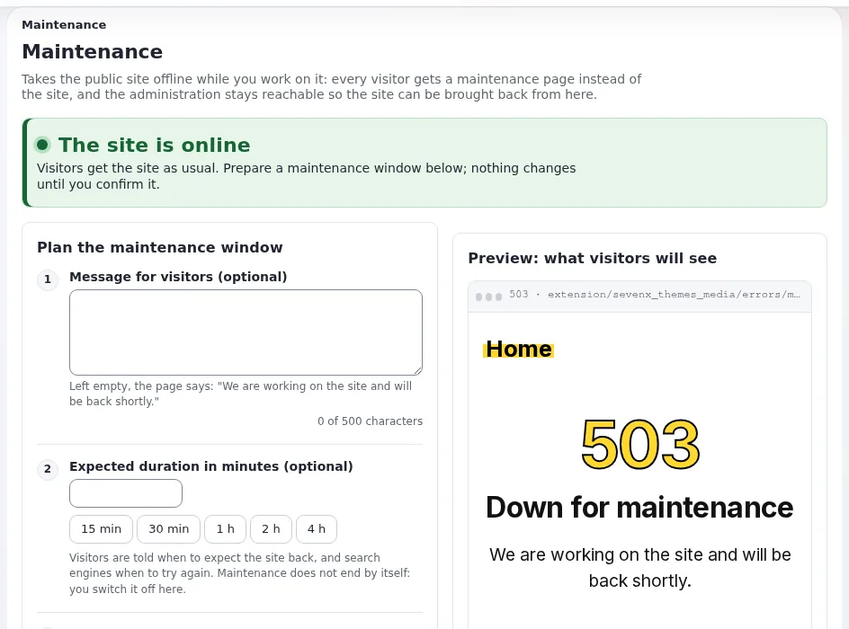

# Maintenance mode and planned work

This page is for owners and managers who decide when the site may be offline, and for the administrator who takes it
offline. It explains what customers and search engines see, how to plan and announce a window, how to switch it on
and off, and the rules that keep a short window from becoming an outage. The complete guide is
[Maintenance mode: taking the site offline and bringing it back](../../../guides/maintenance-mode.md).



## Contents

1. [Why a clean maintenance page matters](#why-a-clean-maintenance-page-matters)
2. [What customers and search engines see](#what-customers-and-search-engines-see)
3. [Planning a window](#planning-a-window)
4. [Switching it on and off](#switching-it-on-and-off)
5. [Who still gets in](#who-still-gets-in)
6. [Emergencies](#emergencies)
7. [What maintenance mode does not stop](#what-maintenance-mode-does-not-stop)
8. [Safety rules](#safety-rules)

## Why a clean maintenance page matters

Some work needs the site offline for a while: an upgrade, a large data import, a database migration, a restore.
Without maintenance mode, visitors meet errors and half-changed pages during that time. With it, they get a clear
message and an expected time, and search engines are told to come back later instead of dropping your pages.

Maintenance mode is part of every installation. The installers use the same mechanism, "so a site that is being
installed never serves a half-built page" ([Maintenance mode feature](../../../features/6.0/maintenance-mode.md)).

## What customers and search engines see

While maintenance is on, every page request gets one maintenance page with these headers
([Maintenance mode guide, what it does](../../../guides/maintenance-mode.md#1-what-maintenance-mode-does)):

| Header | Meaning |
|---|---|
| `503 Service Unavailable` | "Temporarily unavailable", not "gone" |
| `Retry-After` | Seconds until the expected end, or 120 when none is given |
| `Cache-Control: no-store ...` | No cache, proxy or browser keeps the maintenance page after the window |
| `X-Robots-Tag: noindex` | The maintenance page itself is not indexed |

"A 503 with `Retry-After` is the answer search engines understand as 'come back later': the pages keep their place in
the index" (same section). Images, styles and scripts are still served.

The check runs first in the front controller, before the settings and the database, so the maintenance page "needs
nothing that may be broken during the window: no template, no INI file, no database connection" (same section).

## Planning a window

| Step | What to decide |
|---|---|
| Timing | A quiet hour for your customers, never just before a sale or a newsletter send ([Peak traffic planning](peak-traffic-planning.md)) |
| Duration | A realistic estimate plus margin; rehearse the work on a copy to know it |
| Message | What is happening and when the site is back, in customers' words: "We are upgrading the shop. Back at 06:00 UTC with the new checkout." |
| Announcement | Tell customers, members and staff in advance: a notice on the site, a newsletter line, social media |
| Backup | A fresh backup before the window opens ([Backups that restore](backups-that-restore.md)) |
| Cronjobs | Which scheduled jobs must not run during the work ([Cronjobs and background jobs](cronjobs-and-background-jobs.md)) |
| Who decides | Who may extend the window, and who may decide to roll back instead |

> **Note**
> "Maintenance never ends by itself when the expected time passes"
> ([Maintenance mode guide](../../../guides/maintenance-mode.md#in-short)). The expected end is a promise to customers,
> not a timer. Your monitor should alert when a window overruns
> ([Health checks and monitoring](health-checks-and-monitoring.md#checks-from-outside)).

## Switching it on and off

**In the administration**: **Setup > Maintenance** (`/setup/maintenance`). The form asks for an optional message, an
optional expected duration (one click for 15 minutes to 4 hours), and who still gets in. A preview shows the real page,
and a required confirmation guards the button **Take the site offline**. **Bring the site back online** ends it
([Maintenance mode guide, in short](../../../guides/maintenance-mode.md#in-short)).

**From a shell** (options checked against `bin/php/maintenance.php`):

```bash
php bin/php/maintenance.php on --message="Back at 06:00" --until=2h --allow-admin --allow-root-user
php bin/php/maintenance.php status --allow-root-user
php bin/php/maintenance.php off --allow-root-user
```

Without `--allow-admin` the administration is offline too
([Maintenance mode guide, from the command line](../../../guides/maintenance-mode.md#6-from-the-command-line)).
`--allow-root-user` is only needed when running as root.

Every switch on and off is recorded in the audit trail as `system.maintenance.change`, and the page lists the latest
eight ([Maintenance mode guide, the audit](../../../guides/maintenance-mode.md#13-recent-changes-and-the-audit)).

## Who still gets in

- **The administration**: always reachable when maintenance is switched on from the page; from a shell only with
  `--allow-admin`.
- **Your own address**: one tick on the page, so you can check your work while customers see the maintenance page.
- **Other addresses**: for testers who must see the new site before everyone else. Each address is compared exactly;
  ranges are not supported ([Maintenance mode guide, step 3](../../../guides/maintenance-mode.md#step-3-who-still-gets-in)).

## Emergencies

When something is breaking pages in front of customers and you need a minute to look, the guide's emergency workflow
is one command ([Maintenance mode guide, an emergency](../../../guides/maintenance-mode.md#an-emergency)):

```bash
php bin/php/maintenance.php on --message="We are fixing a problem. Back shortly." --allow-admin --allow-ip=<your address>
```

Fix, check from your address, then switch it off. A short, honest maintenance page is better for customers and search
engines than a stream of errors. See [Incident response for small teams](incident-response-for-small-teams.md).

If nothing else works, the state is one file: "Deleting the file ends maintenance: that is the way back in when
nothing else works" ([Maintenance mode guide](../../../guides/maintenance-mode.md#in-short)). The file is
`var/maintenance.json`.

## What maintenance mode does not stop

- **Cronjobs** run in a shell and keep running. "Stop the crontab yourself when a job must not run while you change the
  site" ([Maintenance mode guide, cronjobs](../../../guides/maintenance-mode.md#10-installations-cronjobs-and-deploys)).
  Cronjob parts can also be paused from **Setup > Cronjobs** ([Pausing cronjob parts](../../../features/6.0/cronjob-pause.md)).
- **Deploys** (`exp:velocity deploy`) do not switch maintenance on or off; open the window yourself first.
- **A CDN or reverse proxy** may still hold pages from before the window; purge it when content changed.
- **Several web servers**: the state is a file in each server's `var/` directory; switch it on and off on every server
  ([Several web nodes](../../hosting/operations/several-web-nodes.md#cron-deploys-maintenance-and-logs)).

## Safety rules

From the guide's [safety checklist](../../../guides/maintenance-mode.md#safety-checklist), in business terms:

Before switching on:

- [ ] You can still reach the administration, or your address is allowed, or you have a shell.
- [ ] The message says when the site is back, in customers' words.
- [ ] Cronjobs that must not run during the window are stopped or paused.
- [ ] A fresh backup exists.

Before switching off:

- [ ] No installation is running (the banner would say so).
- [ ] The site works from an allowed address.

After switching off:

- [ ] The front page answers `200` for everyone, through every server.
- [ ] Caches in front of the site are cleared when content changed.
- [ ] Customers and staff are told the work is done.

## Related pages

- [Upgrades without surprises](upgrades-without-surprises.md)
- [Maintenance mode for website creators](../../creators/website-creators/maintenance-mode.md)
- [Maintenance mode (hosting)](../../hosting/operations/maintenance-mode.md)
- [Free documentation](../../free-documentation.md): this page is free to copy, translate and improve under the GNU FDL 1.3.

<!-- exp-partner-block:start -->
**Become an Exponential Partner.** Partners share their information, provide funding, contribute back and
develop the products with us, and that is how Exponential grows. A partner website and dashboard are planned for
mid-2027: please become a partner today to speed up our growth rate and land new features faster. Start with
[Partners: start here](../../partners/partners-start-here.md) and [How to apply](../../partners/how-to-apply.md).
<!-- exp-partner-block:end -->
