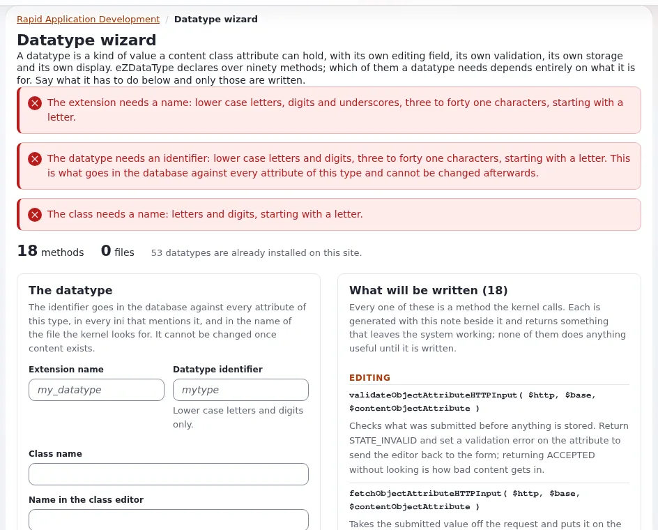

# Writing a custom datatype

This page is for application creators who need a field type the shipped datatypes do not offer: a color, a rating, a
structured address. A datatype is a class extending `eZDataType` (`kernel/classes/ezdatatype.php`) plus a view and an
edit template. **Setup > RAD > Datatype extension** (`/setup/datatype`) writes a working skeleton
([RAD tools](rad-tools.md)).



## Contents

1. [Check first](#check-first)
2. [Files and registration](#files-and-registration)
3. [The class](#the-class)
4. [Templates](#templates)
5. [Storage](#storage)
6. [Testing it](#testing-it)

## Check first

Many needs are met by a shipped datatype or an extension ([Choosing datatypes](../website-creators/choosing-datatypes.md)).
A datatype is a long-lived commitment: content stored with it depends on your extension forever.

## Files and registration

```text
extension/expdemo/datatypes/expcolor/expcolortype.php
extension/expdemo/design/standard/templates/content/datatype/view/expcolor.tpl
extension/expdemo/design/standard/templates/content/datatype/edit/expcolor.tpl
extension/expdemo/settings/content.ini.append.php
```

```ini
<?php /* #?ini charset="utf-8"?
[DataTypeSettings]
ExtensionDirectories[]=expdemo
AvailableDataTypes[]=expcolor
*/ ?>
```

This is how the shipped `ezstarrating` registers its datatype (`extension/ezstarrating/settings/content.ini.append.php`).

## The class

```php
<?php
class expColorType extends eZDataType
{
    const DATA_TYPE_STRING = 'expcolor';

    public function __construct()
    {
        parent::__construct( self::DATA_TYPE_STRING, ezpI18n::tr( 'extension/expdemo', 'Color' ),
                             array( 'serialize_supported' => true ) );
    }

    function validateObjectAttributeHTTPInput( $http, $base, $objectAttribute )
    {
        $name = $base . '_expcolor_' . $objectAttribute->attribute( 'id' );
        $value = $http->hasPostVariable( $name ) ? trim( (string)$http->postVariable( $name ) ) : '';
        if ( $value === '' && $objectAttribute->validateIsRequired() )
        {
            $objectAttribute->setValidationError( ezpI18n::tr( 'extension/expdemo', 'Choose a color.' ) );
            return eZInputValidator::STATE_INVALID;
        }
        if ( $value !== '' && !preg_match( '/^#[0-9a-f]{6}$/i', $value ) )
        {
            $objectAttribute->setValidationError( ezpI18n::tr( 'extension/expdemo', 'Write the color as #rrggbb.' ) );
            return eZInputValidator::STATE_INVALID;
        }
        return eZInputValidator::STATE_ACCEPTED;
    }

    function fetchObjectAttributeHTTPInput( $http, $base, $objectAttribute )
    {
        $name = $base . '_expcolor_' . $objectAttribute->attribute( 'id' );
        if ( !$http->hasPostVariable( $name ) )
            return false;
        $objectAttribute->setAttribute( 'data_text', strtolower( trim( (string)$http->postVariable( $name ) ) ) );
        return true;
    }

    function objectAttributeContent( $objectAttribute )
    {
        return $objectAttribute->attribute( 'data_text' );
    }

    function hasObjectAttributeContent( $contentObjectAttribute )
    {
        return $contentObjectAttribute->attribute( 'data_text' ) !== '';
    }

    function metaData( $contentObjectAttribute )
    {
        return $contentObjectAttribute->attribute( 'data_text' );
    }

    function toString( $objectAttribute )
    {
        return (string)$objectAttribute->attribute( 'data_text' );
    }

    function fromString( $objectAttribute, $string )
    {
        $objectAttribute->setAttribute( 'data_text', (string)$string );
        return true;
    }

    function title( $objectAttribute, $name = null )
    {
        return $objectAttribute->attribute( 'data_text' );
    }

    function isIndexable()
    {
        return true;
    }
}

eZDataType::register( expColorType::DATA_TYPE_STRING, 'expColorType' );
```

The method names and signatures are those of `eZDataType`; the registration line at the end is how every shipped
datatype registers itself (for example `kernel/classes/datatypes/ezboolean/ezbooleantype.php`).

## Templates

`content/datatype/edit/expcolor.tpl`:

```text
<input type="color" id="ezcoa-{$attribute.contentclassattribute_id}_{$attribute.contentclass_attribute_identifier}"
       name="{$attribute_base}_expcolor_{$attribute.id}" value="{$attribute.content|wash}">
```

`content/datatype/view/expcolor.tpl`:

```text
<span class="expdemo-color" data-color="{$attribute.content|wash}">{$attribute.content|wash}</span>
```

No `style=""` in templates: a stylesheet or script reads `data-color`
([Content Security Policy for your code](content-security-policy.md)).

## Storage

Each attribute version has columns `data_text`, `data_int`, `data_float` (and the class attribute has `data_text1`...,
`data_int1`... for settings). Store simple values there; complex ones in your own table keyed by attribute ID and
version, cleaned up in `deleteStoredObjectAttribute()` ([The datatype life cycle](datatype-lifecycle.md)).

## Testing it

1. Regenerate autoloads, clear caches.
2. Add an attribute of the new type to a test class; create, edit, translate, copy and remove objects.
3. `toString()`/`fromString()` round-trip in a PHPUnit test ([DB-less PHPUnit tests](db-less-phpunit-tests.md)).
4. Package export and import keep the value ([Content packages](packages-and-ezpkg.md)).

## Related pages

- [The datatype life cycle](datatype-lifecycle.md)
- [Datatype pattern](../../../standards/patterns/datatype.md)
- [Extension points: Datatype](../../../bc/6.0/rad-extension-points.md#datatype)
- [Free documentation](../../free-documentation.md): this page is free to copy, translate and improve under the GNU FDL 1.3.

<!-- exp-partner-block:start -->
**Become an Exponential Partner.** Partners share their information, provide funding, contribute back and
develop the products with us, and that is how Exponential grows. A partner website and dashboard are planned for
mid-2027: please become a partner today to speed up our growth rate and land new features faster. Start with
[Partners: start here](../../partners/partners-start-here.md) and [How to apply](../../partners/how-to-apply.md).
<!-- exp-partner-block:end -->
