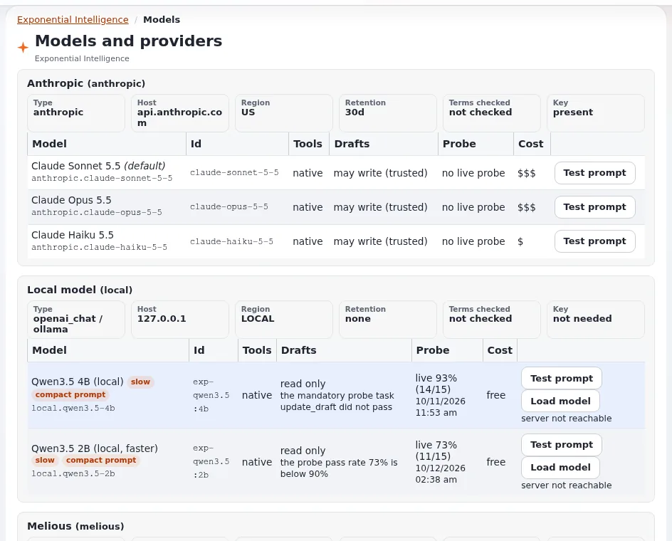

# Extending Exponential Intelligence

This page is for application creators who add to Exponential Intelligence without changing it: everything is added from
your own extension, by settings and small classes. Source: `extension/expai/doc/extending.md`, whose examples were run
for expai 0.0.1.0; its example extension is in `extension/expai/doc/examples/expaiexample`.



## Contents

1. [Your extension](#your-extension)
2. [A field action, by settings only](#a-field-action-by-settings-only)
3. [A tool the assistant can call](#a-tool-the-assistant-can-call)
4. [A provider](#a-provider)
5. [Panel sections and JavaScript hooks](#panel-sections-and-javascript-hooks)
6. [Checking your additions](#checking-your-additions)

## Your extension

```text
extension/myai/
    settings/expai.ini.append.php      what you add to expai's lists
    settings/design.ini.append.php     DesignExtensions[], BackendJavaScriptList[] (optional)
    classes/...                        tools, field action handlers, a provider
    design/admin/templates/...         panel or edit form sections
```

Activate it where expai is active, regenerate autoloads, clear the INI and template caches (including
`ezjscore-packer` and `template-block`), and restart Velocity.

## A field action, by settings only

```ini
# settings/expai.ini.append.php
[EditViewSettings]
FieldActions[]=headline

[FieldAction_headline]
Label=Headline
Handler=expAiPromptFieldAction
Datatypes[]
Datatypes[]=ezstring
Input=none
Instruction=Write a short, catchy headline (at most eight words) for this content, based on its other fields.
```

`Input` is `none`, `instruction`, `optional_instruction` or `language`.

## A tool the assistant can call

```ini
[ToolSettings]
Tools[]=count_children

[Tool_count_children]
Class=myAiToolCountChildren
```

The class extends `expAiTool` with `description()`, `inputSchema()`, `execute( array $input, expAiToolContext $context )`,
`stepText()` and `stepArguments()`. Rules from the expai documentation:

- Read and write through `$context->reader` and `$context->writer`, which run as the current user with its checks.
- A writing tool returns `true` from `writes()`, checks `$context->checkDraftLimit()`, records drafts with
  `expAiDraftLog::record()` and never publishes.
- Throw `expAiException` for errors the model should hear.
- New tools are offered in new conversations.

A read service of expservices marked `'ai' => true` becomes a tool without a class
([Backend ezjscore services](../../../bc/6.0/backend_ezjscore_services.md)).

## A provider

An OpenAI-compatible or Anthropic-compatible server needs no code: a `[Provider_<id>]` group with `Type=openai_chat`
(or `anthropic`) and model groups. Anything else: a class implementing `expAiProvider` (or extending
`expAiProviderBase`) with `providerId()`, `modelName()` and `send( array $request )`, which translates expai's internal
Messages-API shape to the service and back. Add the models to the `[Pricing]` table so costs are known.

## Panel sections and JavaScript hooks

Panel and edit form sections are templates your extension adds to expai's lists; JavaScript hooks are script files in
your design's backend script list. Follow sections 3 and 4 of `extension/expai/doc/extending.md`, and keep to the admin
rules: no inline scripts or styles ([Content Security Policy for your code](content-security-policy.md)).

## Checking your additions

expai declares registries in `settings/rad.ini.append.php`; **Setup > RAD > Extension point survey**
(`setup/radsurvey/(show)/registries`) counts your providers, tools and field actions and shows any whose class, template
or block is missing ([RAD extension surface](../../../bc/6.0/rad-extension-surface.md)).

## Related pages

- [Exponential Intelligence (expai) for applications](exponential-intelligence.md)
- [RAD tools: building faster](rad-tools.md)
- [expai](../../../features/6.0/extensions/expai.md)
- [Free documentation](../../free-documentation.md): this page is free to copy, translate and improve under the GNU FDL 1.3.

<!-- exp-partner-block:start -->
**Become an Exponential Partner.** Partners share their information, provide funding, contribute back and
develop the products with us, and that is how Exponential grows. A partner website and dashboard are planned for
mid-2027: please become a partner today to speed up our growth rate and land new features faster. Start with
[Partners: start here](../../partners/partners-start-here.md) and [How to apply](../../partners/how-to-apply.md).
<!-- exp-partner-block:end -->
