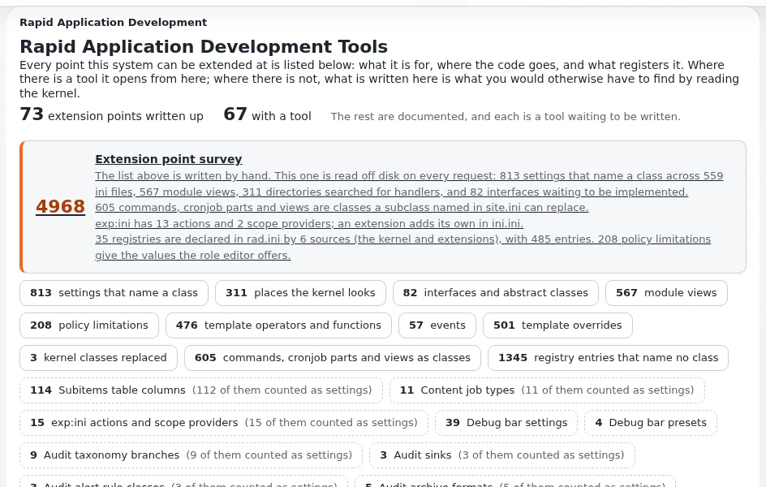

# RAD tools: building faster

This page is for application creators who want working skeletons instead of typing boilerplate. **Setup > RAD**
(`/setup/rad`) lists every point where Exponential can be extended, how it is registered, and offers wizards that write a
complete extension ([RAD tools](../../../features/6.0/rad-tools.md), [Extension points](../../../bc/6.0/rad-extension-points.md)).

## Contents

1. [Five minutes to a working extension](#five-minutes-to-a-working-extension)
2. [The catalogue](#the-catalogue)
3. [The wizards](#the-wizards)
4. [Survey and health check](#survey-and-health-check)
5. [With or without the tools](#with-or-without-the-tools)

## Five minutes to a working extension

1. Open **Setup > RAD**; you need `setup/setup`.
2. Pick an extension point; `/setup/rad/(show)/tools` lists those with a wizard.
3. The wizard asks for a name and what to generate, and lists every file it would write under `extension/<name>`
   before writing any.
4. Confirm, activate the extension, regenerate autoloads, clear caches.
5. Check it in the survey and the health check.

## The catalogue

`kernel/setup/expradcatalogue.php` lists the extension points in groups (content, templates, modules, workflow, storage,
packaging, access), each with its mechanism (directory, handler, autoload, file, design, ini, override, registry,
filter), the kernel file it lives in, and its tool. A kernel class override is the last resort: two extensions replacing
the same class fight without knowing it.

## The wizards

| Wizard | Writes |
|---|---|
| Design extension (`/setup/designextension`) | a design with templates, stylesheets and an override set |
| Template extension (`/setup/templateoperator`) | template operators, fetch functions, attribute operators, template functions |
| Module extension, module wizard (`/setup/moduleextension`, `/setup/modulewizard`) | a module with views and policies, or a module over existing tables |
| Datatype extension (`/setup/datatype`) | a datatype |
| Workflow event extension (`/setup/workflowevent`) | workflow event types and triggers |
| Content extension (`/setup/contentextension`) | a content class written as a script |
| Handler extension (`/setup/handlerextension/<point>`) | handlers, including VAT, shipping, basket totals, exchange rates, login |
| Settings extension (`/setup/settingsextension`) | an extension that only carries settings |
| Kernel override (`/setup/kerneloverride`) | a kernel class replacement, the last resort |

Generated code never writes outside `extension/<name>`, never overwrites an existing extension, and escapes what its
templates print ([RAD security](../../../bc/6.0/rad-security.md)).

### Corrections in output from wizards older than 6.0.15

From Exponential 6.0.15 on, the wizards no longer write the faults below. An extension generated by an older wizard
needs these edits by hand:

| Wizard | Fault in older output | Correction by hand |
|---|---|---|
| Template extension | The README and `doc/examples.php` call operators with `name=value` in the brackets (`{$value\|op( limit=3 )}`), which the template parser refuses | Pass the values by position: `{$value\|op( 3 )}`. Template functions keep `name=value` (`{box limit=3}`) |
| Template extension | `operatorTemplateHints()` lists `'input-as-parameter'` twice; the second one wins | Remove the last `'input-as-parameter'` line |
| Template, datatype, settings extension | The README says `php bin/php/ezpgenerateautoloads.php --extension=<name>`; `--extension` takes no value and the script refuses it | Run `php bin/php/ezpgenerateautoloads.php --extension` |
| Datatype | Templates are written to `templates/` in the extension root, which no design looks in | Move them to `design/standard/templates/` (the extension's `design.ini.append.php` has `DesignExtensions[]`) |
| Datatype | The edit and collect templates post `{$attribute_base}_data_text_{$attribute.id}` whatever storage was chosen | Post `_<type>_<column>_` for the column the value is kept in (`_mytype_data_int_`), and read the same name in `fetchObjectAttributeHTTPInput()`; the generated class now has it as `VALUE_VARIABLE` |
| Datatype | `content.ini.append.php` has `DataTypeGroup[<type>]`, which nothing reads | Remove the line; the form no longer asks for a group |
| Module wizard | Templates are written to `design/<extension name>/`, which is in no design chain, so every view draws an empty page | Move them to `design/standard/templates/<module>/` |
| Module wizard | The view script casts every parameter to `(int)`, so a text parameter (a language code, an identifier) becomes `0` | Cast only numbers (`ID`, `NodeID`, `Offset`...); take text as `(string)` and wash it in the template, as it already is |
| Design extension | The README says the design is found "without anything else being set" | `DesignExtensions[]` only makes the extension's designs searchable: a siteaccess still has to name the design in `SiteDesign` or `AdditionalSiteDesignList[]` |
| Handler (mail transport) | `sendMail()` returns `true` and sends nothing: mail is lost without a trace | Write the sending, and return `true` only when the mail has gone; the stub now logs an error and returns `false` |

The design extension wizard's own corrections (the Composer folder name, the operator autoload file, the Frontend
stylesheet and script lists, the page head) are in
[The design wizard's parts](../../designers/extensions/design-wizard-parts-reference.md).

## Survey and health check

**Setup > RAD > Extension point survey** (`/setup/radsurvey`) reads what the installation really exposes: settings that
name a class, registries declared in `rad.ini`, and entries whose class or template is missing. The health check loads
each registration and reports what cannot work ([RAD extension surface](../../../bc/6.0/rad-extension-surface.md)).

## With or without the tools

The wizards write the same code these pages show by hand: start with a wizard to see a working example, then read the
matching page ([Custom modules and views](custom-modules-and-views.md), [Writing a custom datatype](custom-datatypes.md),
[Writing a workflow event type](writing-a-workflow-event-type.md), [Writing template operators](template-operators.md)).

## Related pages

- [Your first extension](your-first-extension.md)
- [Anatomy of an extension](extension-anatomy.md)
- [Extension point pattern: INI plug-in points](../../../standards/patterns/ini-plugin-point.md)
- [Free documentation](../../free-documentation.md): this page is free to copy, translate and improve under the GNU FDL 1.3.

<!-- exp-partner-block:start -->
**Become an Exponential Partner.** Partners share their information, provide funding, contribute back and
develop the products with us, and that is how Exponential grows. A partner website and dashboard are planned for
mid-2027: please become a partner today to speed up our growth rate and land new features faster. Start with
[Partners: start here](../../partners/partners-start-here.md) and [How to apply](../../partners/how-to-apply.md).
<!-- exp-partner-block:end -->
