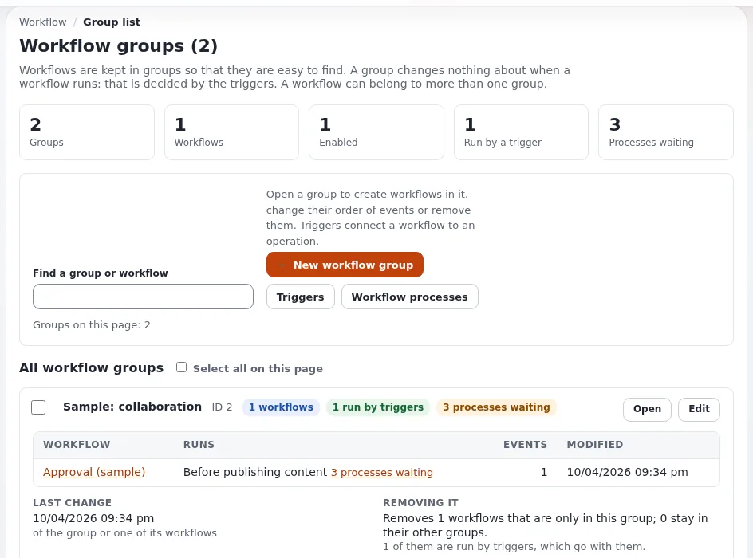
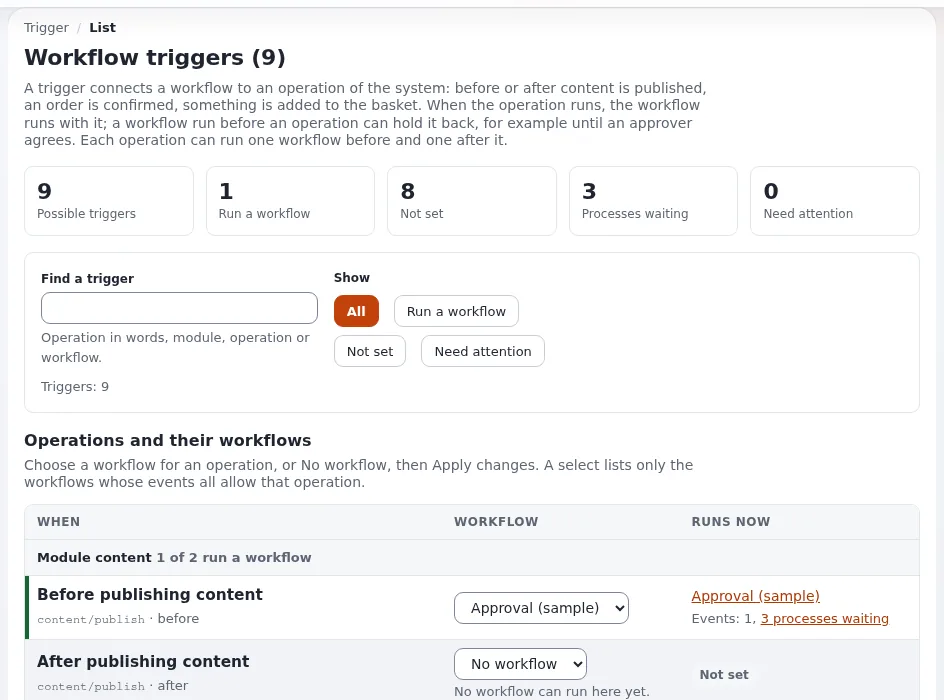

# Workflows, triggers and events

This page is for application creators who run their own logic when something happens: before content is published,
after a user registers, at checkout. Exponential offers two mechanisms: **workflows** (configured by administrators,
built from event types) and **kernel event listeners** (code). The administrator's guide is
[Workflows](../../../guides/workflows.md).

## Contents

1. [The pieces](#the-pieces)
2. [Operations you can hook](#operations-you-can-hook)
3. [How a process runs](#how-a-process-runs)
4. [Workflow or event listener?](#workflow-or-event-listener)
5. [Setting it up for an application](#setting-it-up-for-an-application)

## The pieces

| Term | What |
|---|---|
| Workflow | a named list of events, in a workflow group (**Setup > Workflows**) |
| Event type | a class that does one step: approve, wait until date, multiplexer, payment gateway, simple shipping, finish user register, and those of extensions |
| Trigger | connects a workflow to an operation, `before` or `after` it (**Setup > Triggers**) |
| Process | one run of a workflow for one object and version, kept while it waits |

## Operations you can hook

`settings/workflow.ini [OperationSettings] AvailableOperationList[]` lists the operations that offer triggers. Shipped
active: `content_publish`, `before_shop_confirmorder`, `shop_checkout`, `shop_addtobasket`, `shop_updatebasket`. More are
listed commented out (`content_move`, `content_hide`, `content_delete`, `content_updatesection`, `content_read`,
`content_updateobjectstate`, `user_activation`, `user_password` ...); enable one in an override to use it.

## How a process runs

1. The operation reaches its trigger and starts the workflow.
2. Each event's `execute()` returns a status: accepted (go on), rejected (stop the operation), deferred to cron (wait),
   fetch template (show a page), redirect, cancelled.
3. A deferred process is run again by the `workflow.php` cronjob (part `frequent`); without it, waiting content never
   publishes.
4. When the last event accepts, the held-back operation finishes.

Waiting processes are listed in **Setup > Workflow processes** (`/workflow/processlist`).

## Workflow or event listener?

| Use a workflow when | Use a kernel event listener when |
|---|---|
| administrators should switch it on and off, or order steps | the behavior is always part of your application |
| the step may wait (approval, payment, a date) | it must run synchronously and never wait |
| it is tied to one of the trigger operations | the event has no trigger (a `site.ini [Event] Listeners[]` event) |

Kernel events and filter events are listed in [Extension points](../../../bc/6.0/rad-extension-points.md#kernel-event-listener);
filter listeners must return the value they receive. See also the [event hook pattern](../../../standards/patterns/event-hook.md).

## Setting it up for an application

1. Write the event type ([Writing a workflow event type](writing-a-workflow-event-type.md)).
2. Ship a setup step or instructions: create the workflow, add the event, connect the trigger.
3. Make sure the `frequent` cron part runs if any event defers to cron.
4. Test publish with and without the workflow; test cancel in **Setup > Workflow processes**.

## Related pages

- [Writing a workflow event type](writing-a-workflow-event-type.md)
- [Object states](../../../guides/object-states.md)
- [Workflow event pattern](../../../standards/patterns/workflow-event.md)
- [Free documentation](../../free-documentation.md): this page is free to copy, translate and improve under the GNU FDL 1.3.

<!-- exp-partner-block:start -->
**Become an Exponential Partner.** Partners share their information, provide funding, contribute back and
develop the products with us, and that is how Exponential grows. A partner website and dashboard are planned for
mid-2027: please become a partner today to speed up our growth rate and land new features faster. Start with
[Partners: start here](../../partners/partners-start-here.md) and [How to apply](../../partners/how-to-apply.md).
<!-- exp-partner-block:end -->
