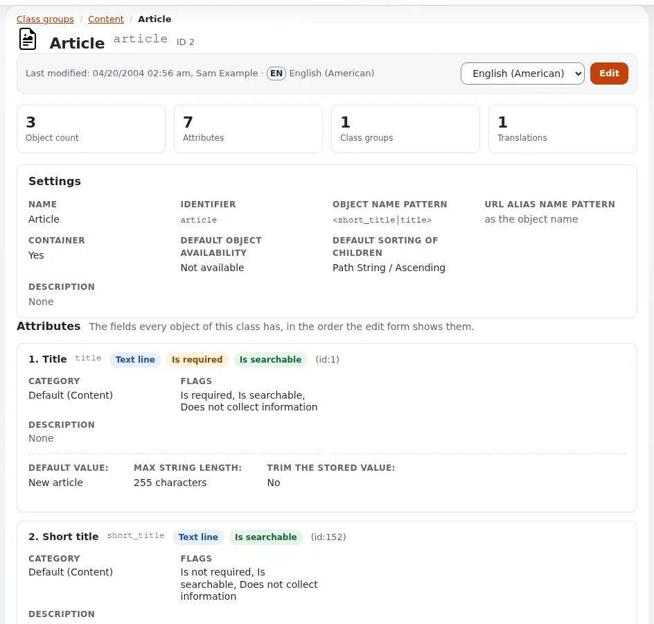

# Choosing datatypes for your fields

This page is for website creators who add attributes to classes. A datatype decides how a field is edited, stored,
validated, searched and shown, and it cannot be changed later without migrating data. Choose by what you will do with
the value.



## Contents

1. [The shipped datatypes](#the-shipped-datatypes)
2. [Choosing by need](#choosing-by-need)
3. [Datatypes from extensions](#datatypes-from-extensions)
4. [Showing a field in a template](#showing-a-field-in-a-template)
5. [Pitfalls](#pitfalls)

## The shipped datatypes

The datatypes available for new attributes are `AvailableDataTypes[]` in `settings/content.ini`; the shipped list has
35 entries:

| Group | Datatypes |
|---|---|
| Text | `ezstring` (Text line), `eztext` (Text block), `ezxmltext` (Rich text), `ezidentifier`, `ezisbn` |
| Dates and times | `ezdate`, `ezdatetime`, `eztime` |
| Numbers and yes/no | `ezinteger`, `ezfloat`, `ezboolean` |
| Choices | `ezselection`, `ezenum`, `ezcountry`, `ezkeyword` |
| Relations | `ezobjectrelation` (one object), `ezobjectrelationlist` (several) |
| Media | `ezimage`, `ezbinaryfile`, `ezmedia` |
| Contact and links | `ezemail`, `ezurl`, `ezauthor` |
| Structured | `ezmatrix` (a table) |
| Shop | `ezprice`, `ezmultiprice`, `ezoption`, `ezmultioption`, `ezmultioption2`, `ezrangeoption`, `ezproductcategory` |
| System | `ezuser`, `ezsubtreesubscription`, `ezinisetting`, `ezpackage` |

The implementations are in `kernel/classes/datatypes/<name>/`.

## Choosing by need

| You need | Choose | Not |
|---|---|---|
| A title, a name | `ezstring` | `ezxmltext` |
| A teaser or summary shown in lists and meta tags | `eztext` | `ezxmltext` (markup in meta tags) |
| A body with headings, links, embedded images | `ezxmltext` (edited with the online editor) | `eztext` |
| A date to sort or filter by | `ezdate` or `ezdatetime` | text |
| A yes/no switch (featured, hide teaser) | `ezboolean` | a selection with two items |
| One or several choices from a fixed list | `ezselection` | free text |
| A country | `ezcountry` | `ezselection` with your own list |
| An image used once | `ezimage` in the class | |
| An image reused in many places | `ezobjectrelation` to an Image object | a copy in each object |
| Several related items (authors, related articles) | `ezobjectrelationlist` | a text list of names |
| A download | `ezbinaryfile` | |
| A link to another site | `ezurl` | text |
| An e-mail address | `ezemail` (validated) | `ezstring` |
| A table of values | `ezmatrix` | rich text tables, when the values are data |
| Free keywords | `ezkeyword`, or better `eztags` from the eztags extension | |
| A price | `ezprice` (with VAT) or `ezmultiprice` (several currencies) | `ezfloat` |

## Datatypes from extensions

Extensions add datatypes; they register them in their own settings. Examples documented here:
[eztags](../../../features/6.0/extensions/eztags.md) (a tag tree with autocomplete),
[enhancedselection2](../../../features/6.0/extensions/enhancedselection2.md),
[enhancedezbinaryfile](../../../features/6.0/extensions/enhancedezbinaryfile.md),
[ezgmaplocation](../../../features/6.0/extensions/ezgmaplocation.md) (a map location),
[ezstarrating](../../../features/6.0/extensions/ezstarrating.md). A datatype of your own is an application
creator's task ([Writing a custom datatype](../app-creators/custom-datatypes.md)).

## Showing a field in a template

```text
{attribute_view_gui attribute=$node.data_map.body}
```

renders the field with its datatype's view template (`content/datatype/view/<datatype>.tpl`, overridable). For a plain
value, read `.content` or test `.has_content`:

```text
{if $node.data_map.image.has_content}
  {attribute_view_gui attribute=$node.data_map.image image_class='medium'}
{/if}
```

## Pitfalls

- **Rich text where plain text is needed.** Teasers in rich text end up as markup in feeds and meta tags.
- **Numbers as text.** Text sorts "10" before "9".
- **Selections for things that change.** Adding an option is easy; renaming one renames it in every object, and
  removing one leaves objects without a value. For a list editors maintain, use tags or relations.
- **Copies instead of relations.** A copied image or address must be updated in every copy.
- **Old media datatypes.** The Flash, QuickTime, Windows Media and RealVideo classes of older packages show content
  modern browsers do not play; use video files or embeds.

## Related pages

- [Designing your content model](designing-your-content-model.md)
- [Relations and content reuse](relations-and-reuse.md)
- [Images and image variations](images-and-image-variations.md)
- [The datatype life cycle](../app-creators/datatype-lifecycle.md)
- [Free documentation](../../free-documentation.md): this page is free to copy, translate and improve under the GNU FDL 1.3.

<!-- exp-partner-block:start -->
**Become an Exponential Partner.** Partners share their information, provide funding, contribute back and
develop the products with us, and that is how Exponential grows. A partner website and dashboard are planned for
mid-2027: please become a partner today to speed up our growth rate and land new features faster. Start with
[Partners: start here](../../partners/partners-start-here.md) and [How to apply](../../partners/how-to-apply.md).
<!-- exp-partner-block:end -->
